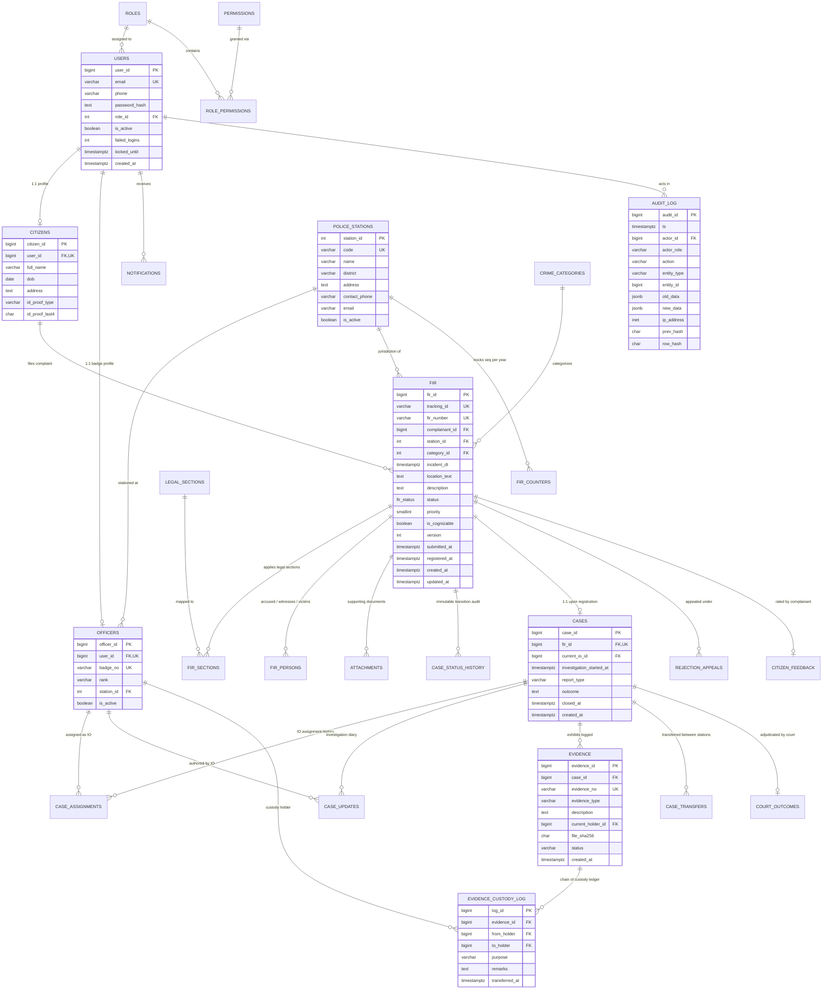

# CaseSync: Database Entity-Relationship (ER) Architecture & Normalization Analysis
**Document Version:** 1.0.0  
**Database Engine:** PostgreSQL 15+ Enterprise Relational Database  
**Author:** CaseSync Database Architecture Team

---

## 1. Architectural Overview & Design Philosophy

The **CaseSync** database architecture is designed to support mission-critical, legal-grade criminal justice operations. In accordance with statutory requirements under the **Bharatiya Nagarik Suraksha Sanhita (BNSS) 2023** and **Bharatiya Nyaya Sanhita (BNS) 2023**, the schema enforces:
1. **Mathematical Tamper-Evidence:** Cryptographically hash-chained append-only ledgers for regulatory compliance.
2. **ACID Transactional Guarantees:** Strict foreign key constraints with `ON DELETE RESTRICT` on all judicial entities.
3. **Optimistic & Pessimistic Concurrency:** Column-level `version` tokens for optimistic locking combined with `FOR UPDATE` pessimistic row locking on counters and transitions.
4. **Defense-in-Depth Relational Guards:** Database-level stored procedures and triggers that prevent invalid state transitions or data corruption even against rogue administrative queries.

---

## 2. Complete Entity-Relationship (ER) Diagram

---

## 3. Data Dictionary & Table Reference

### 3.1 Identity & Access Control Subsystem

#### `roles`
Defines operational authorizations in the criminal justice hierarchy.
- `role_id` (INT, PK, Auto-increment)
- `code` (VARCHAR(30), UNIQUE, NOT NULL): e.g., `'CITIZEN'`, `'DESK_OFFICER'`, `'IO'`, `'SHO'`, `'SUPERVISOR'`, `'AUDITOR'`, `'ADMIN'`.
- `description` (TEXT): Formal operational designation.

#### `permissions` & `role_permissions`
Granular capabilities mapped to role definitions.
- `permission_id` (INT, PK)
- `code` (VARCHAR(60), UNIQUE, NOT NULL): e.g., `'fir:create'`, `'fir:register'`, `'case:assign'`, `'evidence:transfer'`.
- `role_permissions` (M:N Bridge Table): Composite PK `(role_id, permission_id)`.

#### `users`
Core security entity for all human actors.
- `user_id` (BIGSERIAL, PK)
- `email` (VARCHAR(150), UNIQUE, NOT NULL)
- `phone` (VARCHAR(20), NOT NULL)
- `password_hash` (TEXT, NOT NULL): 12-round bcrypt hash.
- `role_id` (INT, NOT NULL, FK -> `roles.role_id`)
- `is_active` (BOOLEAN, DEFAULT TRUE)
- `failed_logins` (INT, DEFAULT 0): Auto-reset upon successful login.
- `locked_until` (TIMESTAMPTZ, NULL): Set to `now() + 30 mins` on 5 failed attempts.
- `created_at` (TIMESTAMPTZ, DEFAULT now())

#### `citizens`
Extended identity profile for complainants.
- `citizen_id` (BIGSERIAL, PK)
- `user_id` (BIGINT, UNIQUE, NOT NULL, FK -> `users.user_id`)
- `full_name` (VARCHAR(120), NOT NULL)
- `dob` (DATE, NOT NULL)
- `address` (TEXT, NOT NULL)
- `id_proof_type` (VARCHAR(30), NOT NULL): e.g., `'AADHAAR'`, `'VOTER_ID'`, `'PASSPORT'`, `'PAN'`.
- `id_proof_last4` (CHAR(4), NOT NULL): Privacy-compliant masked identifier.

#### `police_stations`
Territorial jurisdiction master.
- `station_id` (SERIAL, PK)
- `code` (VARCHAR(20), UNIQUE, NOT NULL): e.g., `'CPS-01'`, `'NPS-02'`.
- `name` (VARCHAR(150), NOT NULL): e.g., `'Central Police Station'`.
- `district` (VARCHAR(100), NOT NULL)
- `address` (TEXT, NOT NULL)
- `contact_phone` (VARCHAR(30))
- `email` (VARCHAR(150))
- `is_active` (BOOLEAN, DEFAULT TRUE)

#### `officers`
Police officer professional profile and active post.
- `officer_id` (BIGSERIAL, PK)
- `user_id` (BIGINT, UNIQUE, NOT NULL, FK -> `users.user_id`)
- `badge_no` (VARCHAR(40), UNIQUE, NOT NULL)
- `rank` (VARCHAR(50), NOT NULL): e.g., `'CONSTABLE'`, `'SUB_INSPECTOR'`, `'INSPECTOR'`, `'SUPERINTENDENT'`.
- `station_id` (INT, NOT NULL, FK -> `police_stations.station_id`)
- `is_active` (BOOLEAN, DEFAULT TRUE)

---

### 3.2 FIR & Incident Subsystem

#### `crime_categories`
Master taxonomy of criminal acts.
- `category_id` (SERIAL, PK)
- `name` (VARCHAR(80), UNIQUE, NOT NULL): e.g., `'Theft / Burglary'`, `'Cyber Crime'`, `'Physical Assault'`.
- `parent_id` (INT, FK -> `crime_categories.category_id`): Enables hierarchical categorization.
- `description` (TEXT)

#### `legal_sections`
Statutory criminal legal codes under Bharatiya Nyaya Sanhita (BNS) & Special Acts.
- `section_id` (SERIAL, PK)
- `act` (VARCHAR(20), NOT NULL): `'BNS'`, `'IPC'`, `'IT_ACT'`.
- `section_no` (VARCHAR(20), NOT NULL): e.g., `'303(2)'`, `'318'`, `'66C'`.
- `title` (VARCHAR(200), NOT NULL)
- `is_cognizable` (BOOLEAN, DEFAULT TRUE)
- `is_bailable` (BOOLEAN, DEFAULT FALSE)
- `description` (TEXT)
- UNIQUE constraint: `(act, section_no)`.

#### `fir`
Central operational entity representing complaints and registered First Information Reports.
- `fir_id` (BIGSERIAL, PK)
- `tracking_id` (VARCHAR(25), UNIQUE): Human-readable code (`CMP-2026-000045`).
- `fir_number` (VARCHAR(40), UNIQUE): Official statutory numbering (`FIR/CPS-01/2026/00012`).
- `complainant_id` (BIGINT, NOT NULL, FK -> `citizens.citizen_id`)
- `station_id` (INT, FK -> `police_stations.station_id`, NULL for e-Zero FIR)
- `category_id` (INT, FK -> `crime_categories.category_id`)
- `incident_dt` (TIMESTAMPTZ, NOT NULL)
- `location_text` (TEXT, NOT NULL)
- `latitude` (NUMERIC(9,6)), `longitude` (NUMERIC(9,6))
- `description` (TEXT, NOT NULL)
- `status` (`fir_status` ENUM, NOT NULL, DEFAULT `'DRAFT'`)
- `priority` (SMALLINT, NOT NULL, DEFAULT 2, CHECK (priority BETWEEN 1 AND 3))
- `is_cognizable` (BOOLEAN, DEFAULT TRUE)
- `rejection_reason` (TEXT)
- `version` (INT, NOT NULL, DEFAULT 1): Optimistic locking token.
- `submitted_at`, `registered_at`, `created_at`, `updated_at` (TIMESTAMPTZ)

#### `fir_sections`
Bridge table associating legal sections with FIRs.
- Composite PK: `(fir_id, section_id)`
- `fir_id` (BIGINT, FK -> `fir.fir_id` ON DELETE CASCADE)
- `section_id` (INT, FK -> `legal_sections.section_id` ON DELETE RESTRICT)

#### `fir_persons`
Multi-role persons registry linked to incidents.
- `person_id` (BIGSERIAL, PK)
- `fir_id` (BIGINT, NOT NULL, FK -> `fir.fir_id` ON DELETE CASCADE)
- `person_role` (VARCHAR(20), NOT NULL, CHECK: `'ACCUSED'`, `'WITNESS'`, `'VICTIM'`)
- `full_name` (VARCHAR(120), NOT NULL)
- `contact` (VARCHAR(50)), `address` (TEXT), `notes` (TEXT)

#### `attachments`
Digital documents, CCTV clips, and affidavits supporting complaints.
- `attachment_id` (BIGSERIAL, PK)
- `fir_id` (BIGINT, NOT NULL, FK -> `fir.fir_id` ON DELETE CASCADE)
- `uploaded_by` (BIGINT, NOT NULL, FK -> `users.user_id`)
- `file_name` (VARCHAR(255), NOT NULL)
- `mime_type` (VARCHAR(100), NOT NULL)
- `size_bytes` (BIGINT, NOT NULL, CHECK > 0)
- `sha256` (CHAR(64), NOT NULL): Cryptographic tamper detection hash.
- `storage_path` (TEXT, NOT NULL)
- `uploaded_at` (TIMESTAMPTZ, DEFAULT now())

#### `fir_counters`
Pessimistic row-locked sequence generator for concurrency-safe FIR numbers.
- Composite PK: `(station_id, year)`
- `station_id` (INT, FK -> `police_stations.station_id`)
- `year` (INT, NOT NULL)
- `last_seq` (INT, NOT NULL, DEFAULT 0)

---

### 3.3 Investigation, Evidence & Outcome Subsystem

#### `cases`
1:1 judicial investigation record instantiated upon SHO approval of an FIR.
- `case_id` (BIGSERIAL, PK)
- `fir_id` (BIGINT, UNIQUE, NOT NULL, FK -> `fir.fir_id` ON DELETE RESTRICT)
- `current_io_id` (BIGINT, FK -> `officers.officer_id` ON DELETE SET NULL)
- `investigation_started_at` (TIMESTAMPTZ)
- `report_type` (VARCHAR(15), CHECK: `'CHARGESHEET'`, `'CLOSURE'`)
- `outcome` (TEXT), `closed_at` (TIMESTAMPTZ), `created_at` (TIMESTAMPTZ)

#### `case_assignments`
Complete historical ledger of investigating officer appointments.
- `assignment_id` (BIGSERIAL, PK)
- `case_id` (BIGINT, NOT NULL, FK -> `cases.case_id` ON DELETE CASCADE)
- `officer_id` (BIGINT, NOT NULL, FK -> `officers.officer_id`)
- `assigned_by` (BIGINT, NOT NULL, FK -> `users.user_id`)
- `from_ts` (TIMESTAMPTZ, NOT NULL, DEFAULT now())
- `to_ts` (TIMESTAMPTZ, NULL): NULL indicates currently active assignment.
- `reason` (TEXT)

#### `case_updates`
Digital case diary entries authored by Investigating Officers.
- `update_id` (BIGSERIAL, PK)
- `case_id` (BIGINT, NOT NULL, FK -> `cases.case_id` ON DELETE CASCADE)
- `officer_id` (BIGINT, NOT NULL, FK -> `officers.officer_id`)
- `update_type` (VARCHAR(20), CHECK: `'STATEMENT'`, `'SITE_VISIT'`, `'ARREST'`, `'SEARCH'`, `'FORENSIC'`, `'GENERAL'`)
- `body` (TEXT, NOT NULL)
- `visible_to_citizen` (BOOLEAN, NOT NULL, DEFAULT FALSE)
- `created_at` (TIMESTAMPTZ, DEFAULT now())

#### `evidence`
Seized physical, forensic, documentary, or digital exhibits.
- `evidence_id` (BIGSERIAL, PK)
- `case_id` (BIGINT, NOT NULL, FK -> `cases.case_id` ON DELETE CASCADE)
- `evidence_no` (VARCHAR(60), UNIQUE, NOT NULL): e.g., `'EVD-FIR-CPS-01-2026-00012-01'`.
- `evidence_type` (VARCHAR(30), CHECK: `'PHYSICAL'`, `'DOCUMENT'`, `'DIGITAL'`, `'BIOLOGICAL'`, `'WEAPON'`, `'NARCOTIC'`)
- `description` (TEXT, NOT NULL)
- `collected_at` (TIMESTAMPTZ, NOT NULL)
- `collected_by` (BIGINT, NOT NULL, FK -> `officers.officer_id`)
- `current_holder_id` (BIGINT, FK -> `officers.officer_id`)
- `storage_location` (VARCHAR(150), NOT NULL)
- `status` (VARCHAR(30), CHECK: `'COLLECTED'`, `'IN_STORAGE'`, `'IN_LAB'`, `'PRODUCED_IN_COURT'`, `'RETURNED'`, `'DESTROYED'`)
- `file_sha256` (CHAR(64)): Digital exhibit checksum.

#### `evidence_custody_log`
Strictly append-only chain of custody ledger.
- `log_id` (BIGSERIAL, PK)
- `evidence_id` (BIGINT, NOT NULL, FK -> `evidence.evidence_id` ON DELETE CASCADE)
- `from_holder` (BIGINT, FK -> `officers.officer_id`)
- `to_holder` (BIGINT, FK -> `officers.officer_id`)
- `purpose` (VARCHAR(120), NOT NULL)
- `remarks` (TEXT)
- `transferred_at` (TIMESTAMPTZ, NOT NULL, DEFAULT now())

#### `court_outcomes`
Judicial trial verdict recording and formal closure.
- `outcome_id` (BIGSERIAL, PK)
- `case_id` (BIGINT, UNIQUE, NOT NULL, FK -> `cases.case_id` ON DELETE CASCADE)
- `fir_id` (BIGINT, UNIQUE, NOT NULL, FK -> `fir.fir_id` ON DELETE CASCADE)
- `court_name` (VARCHAR(120), NOT NULL)
- `case_court_number` (VARCHAR(60))
- `verdict` (VARCHAR(25), CHECK: `'CONVICTED'`, `'ACQUITTED'`, `'COMPOUNDED'`, `'QUASHED'`, `'DISCHARGED'`)
- `judgment_date` (DATE, NOT NULL)
- `judge_name` (VARCHAR(120))
- `sentence_details` (TEXT)
- `fine_amount` (NUMERIC(12,2), DEFAULT 0)
- `remarks` (TEXT, NOT NULL)
- `recorded_by` (BIGINT, NOT NULL, FK -> `users.user_id`)

#### `case_transfers`
Inter-station territorial transfer records.
- `transfer_id` (BIGSERIAL, PK)
- `case_id` (BIGINT, NOT NULL, FK -> `cases.case_id` ON DELETE CASCADE)
- `fir_id` (BIGINT, NOT NULL, FK -> `fir.fir_id` ON DELETE CASCADE)
- `from_station_id` (INT, NOT NULL, FK -> `police_stations.station_id`)
- `to_station_id` (INT, NOT NULL, FK -> `police_stations.station_id`)
- `transferred_by` (BIGINT, NOT NULL, FK -> `users.user_id`)
- `transfer_reason` (TEXT, NOT NULL)
- `status` (VARCHAR(20), CHECK: `'PENDING'`, `'ACCEPTED'`, `'REJECTED'`)
- `previous_status` (`fir_status`, NOT NULL)
- `accepted_by` (BIGINT, FK -> `users.user_id`)

#### `rejection_appeals`
Citizen supervisory review against rejected complaints.
- `appeal_id` (BIGSERIAL, PK)
- `fir_id` (BIGINT, NOT NULL, FK -> `fir.fir_id` ON DELETE CASCADE)
- `citizen_id` (BIGINT, NOT NULL, FK -> `citizens.citizen_id`)
- `appeal_reason` (TEXT, NOT NULL)
- `status` (VARCHAR(20), CHECK: `'PENDING'`, `'ACCEPTED'`, `'REJECTED'`)
- `reviewed_by` (BIGINT, FK -> `users.user_id`)
- `review_notes` (TEXT)
- `resolved_at` (TIMESTAMPTZ)

---

### 3.4 Regulatory, Audit & Ledger Subsystem

#### `case_status_history`
Append-only state transition audit trail.
- `history_id` (BIGSERIAL, PK)
- `fir_id` (BIGINT, NOT NULL, FK -> `fir.fir_id` ON DELETE CASCADE)
- `from_state` (`fir_status`)
- `to_state` (`fir_status`, NOT NULL)
- `actor_id` (BIGINT, NOT NULL, FK -> `users.user_id`)
- `note` (TEXT)
- `created_at` (TIMESTAMPTZ, NOT NULL, DEFAULT now())

#### `audit_log`
Forward-chained cryptographic SHA-256 audit ledger.
- `audit_id` (BIGSERIAL, PK)
- `ts` (TIMESTAMPTZ, NOT NULL, DEFAULT now())
- `actor_id` (BIGINT, FK -> `users.user_id`)
- `actor_role` (VARCHAR(30))
- `action` (VARCHAR(60), NOT NULL)
- `entity_type` (VARCHAR(40), NOT NULL)
- `entity_id` (BIGINT)
- `old_data` (JSONB), `new_data` (JSONB)
- `ip_address` (INET)
- `prev_hash` (CHAR(64), NOT NULL)
- `row_hash` (CHAR(64), NOT NULL)

---

## 4. Normalization Analysis & Mathematical Proofs

The CaseSync relational schema was engineered through rigorous normalization up to **Boyce-Codd Normal Form (BCNF)**, strategically balancing theoretical relational purity against real-time operational query performance.

### 4.1 First Normal Form (1NF) Compliance
**Definition:** A relation is in 1NF if and only if all domain values are atomic, and there are no repeating groups or multi-valued attributes.
- **De-composition of Legal Sections:** A traditional non-normalized design stores sections as comma-separated strings (`"BNS 303(2), BNS 318"`). In CaseSync, legal sections are extracted into a dedicated `legal_sections` catalog and linked through the bridge table `fir_sections(fir_id, section_id)`. Each cell contains strictly atomic scalar keys.
- **De-composition of Involved Persons:** Rather than adding multi-valued repeating columns (`accused_1`, `accused_2`, `witness_1`), all persons are normalized into the relational table `fir_persons`, where each tuple represents exactly one atomic person associated with a defined role.
- **De-composition of Exhibits & Files:** Attachments and evidence exhibits are completely normalized into `attachments` and `evidence`, ensuring no repeating file columns exist within the `fir` table.

### 4.2 Second Normal Form (2NF) Compliance
**Definition:** A relation is in 2NF if it is in 1NF and every non-prime attribute is fully functionally dependent on the entire primary key (no partial key dependencies).
- **Composite Key Bridge Tables:** Consider `fir_sections(fir_id, section_id)`. The candidate key is the composite key `{fir_id, section_id}`. The table contains zero non-prime descriptive attributes (attributes such as `act`, `title`, `is_cognizable` reside exclusively in `legal_sections`). Therefore, no non-prime attribute depends on a subset of the candidate key.
- **FIR Counters:** `fir_counters(station_id, year)` has candidate key `{station_id, year}`. The sole non-prime attribute is `last_seq`, which functionally depends strictly on the combination of station and year (`{station_id, year} -> last_seq`).

### 4.3 Third Normal Form (3NF) Compliance
**Definition:** A relation is in 3NF if it is in 2NF and no non-prime attribute is transitively dependent on any candidate key (no $X \rightarrow Y \rightarrow Z$ where $X$ is a superkey, $Y$ is not a superkey, and $Z$ is a non-prime attribute).
- **Separation of Police Station Attributes:** In `officers(officer_id, user_id, badge_no, rank, station_id)`, the station name, station code, and district are NOT stored in `officers`. If stored in `officers`, there would be a transitive dependency:
  $$\text{officer\_id} \rightarrow \text{station\_id} \rightarrow \{\text{station\_name}, \text{district}\}$$
  This is eliminated by isolating station metadata into `police_stations(station_id, code, name, district)`.
- **Separation of User Authentication & Profiles:** `users(user_id, email, phone, password_hash, role_id)` holds pure authentication concerns. Citizen demographic attributes (DOB, address, government ID proof) reside in `citizens`, eliminating transitive dependencies between officer/citizen roles and authentication credentials.
- **Separation of Case Investigation from FIR Registration:** An FIR represents statutory intake, while `cases` represents active judicial investigation. Separating `cases` prevents transitive dependencies between IO assignment logs, chargesheet approval states, and the original citizen complaint.

### 4.4 Boyce-Codd Normal Form (BCNF) Compliance
**Definition:** A relation is in BCNF if and only if for every non-trivial functional dependency $X \rightarrow Y$, $X$ is a superkey.
- **Core Entity Analysis (`fir`):**
  - Candidate Keys: `fir_id`, `tracking_id`, `fir_number` (when assigned).
  - Functional Dependencies:
    - $\text{fir\_id} \rightarrow \{\text{tracking\_id}, \text{complainant\_id}, \text{station\_id}, \text{category\_id}, \text{incident\_dt}, \text{status}, \text{version}\}$
    - $\text{tracking\_id} \rightarrow \{\text{fir\_id}, \dots\}$
  - In every functional dependency, the determinant ($X$) is a candidate key. Hence, `fir` satisfies BCNF.
- **Legal Sections Analysis (`legal_sections`):**
  - Candidate Keys: `section_id`, and the composite alternate key `{act, section_no}`.
  - $\text{section\_id} \rightarrow \{\text{act}, \text{section\_no}, \text{title}, \text{is\_cognizable}\}$
  - $\{\text{act}, \text{section\_no}\} \rightarrow \{\text{section\_id}, \text{title}, \text{is\_cognizable}\}$
  - Both determinants are candidate keys. Hence, `legal_sections` satisfies BCNF.

---

## 5. Performance Indexing & Query Acceleration

The database incorporates specialized indexes tailored for high-velocity triage and audit queries as specified in **PROJECT_CONTEXT.md §8.6**:

| Index Name | Target Table | Columns Indexed | Type / Predicate | Query Accelerated |
|---|---|---|---|---|
| `idx_fir_complainant` | `fir` | `(complainant_id, created_at DESC)` | B-Tree | Citizen "My Complaints" listing |
| `idx_fir_station_status` | `fir` | `(station_id, status, priority DESC, submitted_at)` | Composite B-Tree | Real-time Station Triage Inbox (`v_station_inbox`) |
| `idx_fir_active_partial` | `fir` | `(station_id, submitted_at)` | Partial B-Tree: `WHERE status IN ('SUBMITTED','UNDER_REVIEW','INFO_REQUESTED')` | High-frequency active duty officer triage queues |
| `idx_fir_incident_dt` | `fir` | `(incident_dt)` | B-Tree | Crime analytics & monthly date range aggregations |
| `idx_history_fir` | `case_status_history` | `(fir_id, created_at DESC)` | B-Tree | Chronological case history timeline |
| `idx_assign_case_open` | `case_assignments` | `(case_id)` | Partial B-Tree: `WHERE to_ts IS NULL` | Instant lookup of currently assigned IO |
| `idx_cases_io` | `cases` | `(current_io_id)` | B-Tree | Officer workload ranking and active docket |
| `idx_evidence_case` | `evidence` | `(case_id, status)` | Composite B-Tree | Evidence exhibit docket per case |
| `idx_custody_evidence` | `evidence_custody_log`| `(evidence_id, transferred_at DESC)` | B-Tree | Complete chain-of-custody playback |
| `idx_audit_entity` | `audit_log` | `(entity_type, entity_id, ts DESC)` | Composite B-Tree | Full audit history of a specific case/FIR |
| `idx_audit_actor` | `audit_log` | `(actor_id, ts DESC)` | Composite B-Tree | User activity tracing and compliance audits |
| `idx_audit_ts_brin` | `audit_log` | `(ts)` | BRIN (Block Range Index) | Multi-gigabyte time-series audit scans |
| `idx_notif_user_unread` | `notifications` | `(user_id, created_at DESC)` | Partial B-Tree: `WHERE is_read = FALSE` | High-frequency navbar unread notification bell |
