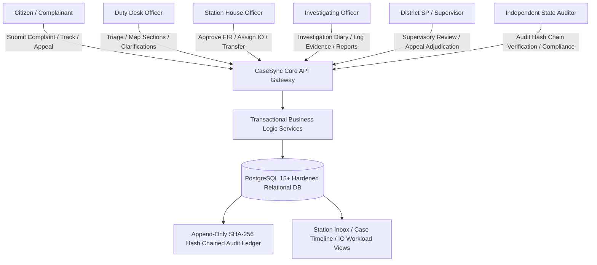
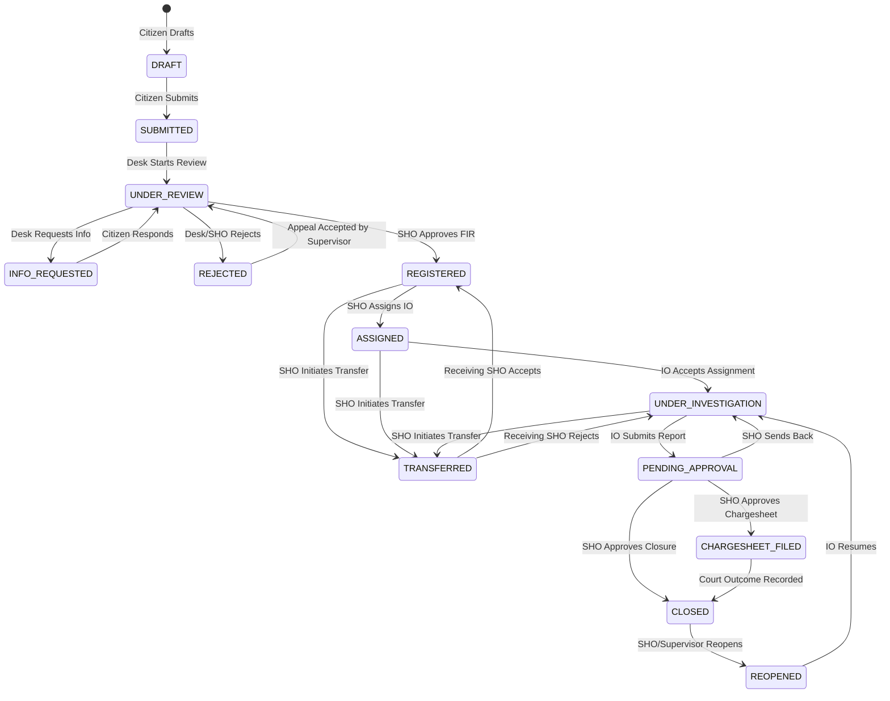

# CaseSync: Software Requirements Specification (SRS)
## Online FIR Registration, Case Management & Evidence Chain-of-Custody System
**Document Version:** 1.0.0  
**Statutory Alignment:** Bharatiya Nagarik Suraksha Sanhita (BNSS) 2023 / Bharatiya Nyaya Sanhita (BNS) 2023 / Indian Information Technology Act 2000  
**Classification:** Official Technical Specification

---

## 1. Introduction

### 1.1 Purpose
This Software Requirements Specification (SRS) details the complete functional, non-functional, security, and architectural specifications for **CaseSync**, an enterprise-grade, state-level Online Police Station Management, FIR Registration, Case Investigation, and Evidence Custody Tracking system.

### 1.2 Scope
CaseSync bridges the gap between citizens seeking lawful redress and law enforcement authorities conducting criminal proceedings. The system encompasses:
- Citizen intake portal for draft complaint preparation, duplicate incident detection heuristics, instant statutory intake slips, and real-time public tracking.
- Station duty officer triage workflows, non-cognizable inquiry dispatch, and legal act mapping under Bharatiya Nyaya Sanhita (BNS).
- Station House Officer (SHO) approval gates, concurrency-safe counter-based FIR numbering, and IO assignment.
- Investigating Officer (IO) investigation workbenches, digital case diaries, linked persons registries, and closure/chargesheet drafting.
- Cryptographically sealed evidence custody ledgers with SHA-256 digital fingerprinting and handover tracking.
- Inter-station case transfers and Zero FIR re-jurisdiction workflows.
- Citizen rejection appeals with supervisory ombudsman review.
- Judicial outcome recording and case resolution feedback loops.
- Tamper-evident, forward-chained SHA-256 immutable audit logging.

### 1.3 Definitions, Acronyms, and Abbreviations
- **BNSS:** Bharatiya Nagarik Suraksha Sanhita, 2023.
- **BNS:** Bharatiya Nyaya Sanhita, 2023.
- **CrPC:** Code of Criminal Procedure, 1973 (superseded by BNSS).
- **FIR:** First Information Report (statutory document registered under Section 173 BNSS).
- **Zero FIR:** An FIR registered at any police station irrespective of territorial jurisdiction, mandating immediate inquiry followed by formal inter-station transfer.
- **SHO:** Station House Officer (Officer in charge of a Police Station; rank of Inspector or Sub-Inspector).
- **IO:** Investigating Officer (Assigned police officer carrying out case investigation).
- **RBAC:** Role-Based Access Control.
- **ACID:** Atomicity, Consistency, Isolation, Durability.
- **SHA-256:** Secure Hash Algorithm producing a 256-bit (64 hex character) digest.

---

## 2. Overall Description

### 2.1 Product Perspective
CaseSync serves as the central operational backbone for police stations, supervisory headquarters (SP/DCP/DGP), forensic laboratories, courts, and citizens.

### 2.2 User Roles & Operational Responsibilities

| Role Code | Role Name | System Permissions & Responsibilities |
|---|---|---|
| `CITIZEN` | Registered Citizen | File draft/immediate complaints, upload attachments, track FIR timeline via tracking ID, respond to information requests, submit rejection appeals, view public case diary notes, download statutory FIR slips, submit case resolution feedback. |
| `DESK_OFFICER` | Station Duty Officer | Review submitted complaints, verify cognizable grounds, issue information requests to citizens, draft preliminary FIR charges, map BNS/IPC legal sections, recommend rejection with statutory grounds. |
| `SHO` | Station House Officer | Final authority for FIR registration, station-year sequence counter lock, IO assignment, chargesheet and closure report approvals, inter-station transfers, first-tier appeal review, court outcome recording. |
| `IO` | Investigating Officer | Accept assigned cases, conduct field investigations, enter case updates/diaries, manage accused/witnesses, seize and log evidence, transfer physical/digital custody, submit chargesheets or closure reports. |
| `SUPERVISOR` | District SP / Range DIG | Multi-station district-wide jurisdiction, appellate authority for rejected complaints, oversee delayed or stale investigations, reassign stalled cases, review crime statistics. |
| `AUDITOR` | Compliance / Internal Affairs | Full read-only access to audit logs, cryptographic SHA-256 audit chain verification engine, investigative audit of permission overrides and login anomaly hotspots. |
| `ADMIN` | System Administrator | Manage police stations, configure master crime categories and BNS legal sections, provision user accounts, enforce account lockouts, calibrate SLA turnaround thresholds. |

---

## 3. Functional Requirements Catalog

### 3.1 Authentication, Identity & Access Control (`FR-A`)
- **FR-A1 (Registration & Verification):** The system shall permit citizens to register with full legal name, email, phone number, date of birth, and government ID proof (Aadhaar, Voter ID, Passport, PAN). The system shall store only the ID proof type and masked last 4 digits for privacy.
- **FR-A2 (Role-Based Authentication):** The system shall authenticate users via bcrypt-hashed credentials and issue signed JSON Web Tokens (JWT) containing user ID, role code, station ID (if officer), and granular permission sets.
- **FR-A3 (Session Expiry & Revocation):** JWT tokens shall enforce standard expiration (8 hours). Explicit logout shall record an audit event and blacklist the token fingerprint.
- **FR-A4 (Brute-Force & Lockout Guard):** The system shall lock accounts for 30 minutes following 5 consecutive failed authentication attempts from any IP.
- **FR-A5 (Password Reset Flow):** The system shall generate time-limited (1-hour) single-use cryptographically random tokens for secure password resets.

### 3.2 Citizen Complaint Intake & Drafting (`FR-C`)
- **FR-C1 (Draft Complaint Management):** The system shall permit citizens to save incomplete complaints in `DRAFT` status with autosave capabilities.
- **FR-C2 (Formal Complaint Submission):** Upon citizen confirmation, the system shall atomically transition complaints from `DRAFT` to `SUBMITTED`, generate a human-readable tracking ID (`CMP-YYYY-XXXXXX`), and emit desk notifications.
- **FR-C3 (Draft Complaint Editing):** Citizens shall have unrestricted rights to edit incident narratives, locations, and linked persons while in `DRAFT` status. Edits to `SUBMITTED` complaints are strictly forbidden.
- **FR-C4 (Duplicate Detection Heuristics):** When drafting a complaint, the system shall execute real-time duplicate detection matching against existing complaints filed within a 2-kilometer radius and 48-hour window for the same category, alerting the citizen to prevent duplicate proceedings.
- **FR-C5 (Zero FIR Citizen Filing):** If an incident occurs outside jurisdictional boundaries or at an unknown station, citizens can file an e-Zero FIR.
- **FR-C6 (Statutory Slip Generation):** The system shall generate printable, tamper-sealed Acknowledgement Slips for `SUBMITTED` complaints and statutory FIR Slips under BNSS Section 173(2) upon formal registration.

### 3.3 Station Review & Formal FIR Registration (`FR-R`)
- **FR-R1 (Station Inbox Triage):** The system shall provide Desk Officers and SHOs with real-time station inboxes (`v_station_inbox`) sorting active cases by priority (High/Medium/Low) and pending turnaround duration.
- **FR-R2 (Clarification Cycle):** Desk Officers can transition complaints to `INFO_REQUESTED`, requesting specific clarifications from the citizen, pausing statutory review clocks until the citizen responds.
- **FR-R3 (Legal Section Mapping):** Desk Officers shall select cognizable and bailable legal sections from master BNS/IPC catalogues (`fir_sections`).
- **FR-R4 (Complaint Rejection & Appeal):** If non-cognizable or civil in nature, officers may reject complaints (`REJECTED`) with mandatory statutory reasons. Citizens can file an appeal within 30 days, routed to the SHO and District Supervisor.
- **FR-R5 (ACID FIR Registration):** Only SHOs can approve complaints into formal FIRs (`REGISTERED`). The system shall execute a database row-level lock on `fir_counters`, generate a sequential number (`FIR/<STATION>/<YEAR>/<SEQ>`), and instantiate the 1:1 `cases` investigation record within a single ACID transaction.

### 3.4 Case Investigation & Lifecycle Management (`FR-M`)
- **FR-M1 (IO Assignment):** SHOs shall assign qualified officers (`ASSIGNED`), triggering push notifications. IOs must formally accept to commence active investigation (`UNDER_INVESTIGATION`).
- **FR-M2 (Digital Case Diary):** IOs shall append structured diary updates (`STATEMENT`, `SITE_VISIT`, `ARREST`, `SEARCH`, `FORENSIC`, `GENERAL`) with citizen-visibility flags (`visible_to_citizen`).
- **FR-M3 (Persons Registry):** IOs shall maintain linked suspect, victim, and witness profiles with biometric/contact details.
- **FR-M4 (Final Reports & Approvals):** Upon concluding inquiry, IOs draft a `CHARGESHEET` or `CLOSURE` report (`PENDING_APPROVAL`). SHOs can send back for further investigation or approve filing in court (`CHARGESHEET_FILED` / `CLOSED`).
- **FR-M5 (Case Reopening):** A `CLOSED` case can be formally reopened (`REOPENED` -> `UNDER_INVESTIGATION`) by SHOs or Supervisors upon discovery of fresh material evidence.
- **FR-M6 (Inter-Station Case Transfer):** SHOs can initiate inter-station case transfers (`TRANSFERRED`). The receiving SHO can accept (reassigning station ownership) or reject with grounds.

### 3.5 Evidence Management & Chain of Custody (`FR-E`)
- **FR-E1 (Evidence Logging):** The system shall register physical, biological, documentary, and digital evidence items with unique tracking numbers (`EVD-FIR-...-XX`).
- **FR-E2 (Cryptographic Hashing):** Digital evidence files shall be fingerprinted with SHA-256 hashes upon upload. The system shall provide instant verification endpoints detecting bit-level tampering.
- **FR-E3 (Immutable Chain of Custody):** All handovers (Officer -> Malkhana -> FSL Lab -> Court) shall append to `evidence_custody_log`. Direct updates or deletions on custody logs are physically rejected by database triggers.

### 3.6 Tracking, Public Transparency & Notifications (`FR-T`)
- **FR-T1 (Public Tracking):** Unauthenticated citizens can track case milestones via Tracking ID. Sensitive PII, suspect names, and internal notes are strictly redacted.
- **FR-T2 (Chronological Timeline):** Authenticated citizens can view the complete, chronological timeline of their complaints (`v_case_timeline`).
- **FR-T3 (Citizen Feedback):** Once a case reaches final closure (`CLOSED`), complainants can rate resolution satisfaction, officer conduct, and turnaround timeliness.

### 3.7 Audit Trail & Regulatory Compliance (`FR-U`)
- **FR-U1 (Cryptographic SHA-256 Hash Chaining):** Every database mutation appends an audit row whose `row_hash = SHA256(prev_hash + timestamp + actor + action + data)`.
- **FR-U2 (Automated Verification Engine):** The system provides an automated chain validation engine (`/api/audit/verify`) scanning thousands of rows in milliseconds, pinpointing the exact row ID of any simulated corruption.
- **FR-U3 (Analytical Reporting):** Real-time reports for case volume by status, turnaround times, crime hotspots by month, and stale investigation alerts.

---

## 4. State Machine Transition Matrix

| Current State (`from_state`) | Allowed Next State (`to_state`) | Required Permission | Trigger / Role Authority |
|---|---|---|---|
| `DRAFT` | `SUBMITTED` | `fir:create` | Complainant Citizen |
| `SUBMITTED` | `UNDER_REVIEW` | `fir:review` | Desk Officer / SHO |
| `UNDER_REVIEW` | `INFO_REQUESTED` | `fir:review` | Desk Officer / SHO |
| `INFO_REQUESTED` | `UNDER_REVIEW` | `fir:respond` | Complainant Citizen |
| `UNDER_REVIEW` | `REJECTED` | `fir:reject` | Desk Officer / SHO |
| `REJECTED` | `UNDER_REVIEW` | `fir:appeal` | District Supervisor / SHO |
| `UNDER_REVIEW` | `REGISTERED` | `fir:register` | Station SHO |
| `REGISTERED` | `ASSIGNED` | `case:assign` | Station SHO |
| `REGISTERED` | `TRANSFERRED` | `case:transfer` | Station SHO |
| `ASSIGNED` | `UNDER_INVESTIGATION` | `case:investigate` | Assigned IO |
| `ASSIGNED` | `TRANSFERRED` | `case:transfer` | Station SHO |
| `UNDER_INVESTIGATION` | `PENDING_APPROVAL` | `case:submit_report`| Assigned IO |
| `UNDER_INVESTIGATION` | `TRANSFERRED` | `case:transfer` | Station SHO |
| `TRANSFERRED` | `REGISTERED` | `case:accept_transfer`| Receiving Station SHO |
| `TRANSFERRED` | `UNDER_INVESTIGATION` | `case:reject_transfer`| Receiving Station SHO |
| `PENDING_APPROVAL` | `UNDER_INVESTIGATION` | `case:send_back` | Station SHO |
| `PENDING_APPROVAL` | `CHARGESHEET_FILED` | `case:approve_chargesheet` | Station SHO |
| `PENDING_APPROVAL` | `CLOSED` | `case:approve_closure`| Station SHO |
| `CHARGESHEET_FILED` | `CLOSED` | `case:record_outcome` | Station SHO / Supervisor |
| `CLOSED` | `REOPENED` | `case:reopen` | Station SHO / Supervisor |
| `REOPENED` | `UNDER_INVESTIGATION` | `case:investigate` | Assigned IO |

---

## 5. Non-Functional Requirements (NFRs)

- **NFR-1 (ACID Concurrency Safety):** All critical state transitions, sequential FIR number generation, and counter updates shall execute inside strict transaction boundaries (`BEGIN ... COMMIT ... ROLLBACK`) with pessimistic row locking (`FOR UPDATE`).
- **NFR-2 (Optimistic Concurrency Control):** To prevent lost updates during simultaneous officer reviews, all FIR updates require a matching `version` token. Mismatched versions abort with HTTP 409 Conflict / `STALE_VERSION`.
- **NFR-3 (Defense-in-Depth DB Guards):** Database-level triggers (`trg_fir_status_guard`, `history_no_mutation`, `custody_no_mutation`, `trg_audit_no_mutation`) physically prevent unlawful state transitions or ledger tampering even if direct SQL access is obtained.
- **NFR-4 (Performance & Query Throughput):** Complex join queries for station queues and timelines shall be resolved via dedicated composite and partial indexes in under 50 milliseconds under a 100,000-case load.
- **NFR-5 (Cryptographic Integrity):** The audit ledger shall maintain mathematically verifiable SHA-256 hash continuity. Any manipulated byte in past records breaks chain validation.
- **NFR-6 (Statutory Privacy & Data Masking):** Citizen identity numbers must never be displayed in plain text. Public tracking endpoints must scrub complainant phone numbers, street addresses, suspect identities, and confidential diary updates.
- **NFR-7 (Audit Append-Only Compliance):** The audit log, status history, and evidence custody log are strictly immutable. Application user roles are blocked from executing `UPDATE` or `DELETE` on these tables.
