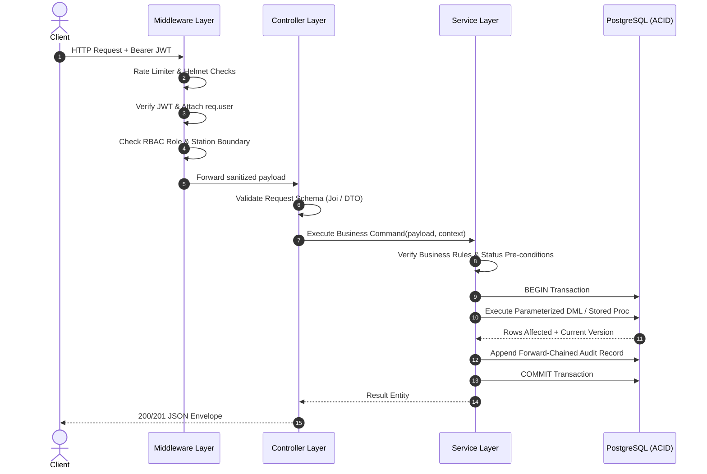
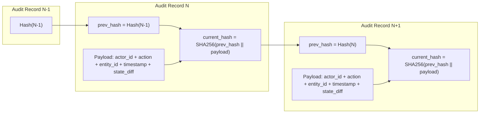
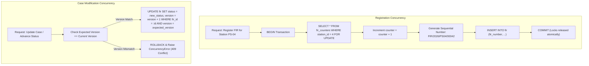

# CaseSync System Architecture & Security Specification

**System Name:** CaseSync - Police FIR & Criminal Investigation Management System  
**Version:** 1.0.0  
**Target Platform:** Node.js (v18+) / Express.js / PostgreSQL (14+)  
**Classification:** Law Enforcement / Criminal Justice Information Services (CJIS) Compliant  

---

## 1. Architectural Overview & System Topology

CaseSync is built upon a hardened, decoupled, multi-tier enterprise architecture engineered for high availability, zero-trust security, strict data integrity, and complete non-repudiation.

```mermaid
graph TD
    subgraph Client Tier
        Web["Web Portal (React / Vue SPA)"]
        Mobile["Citizen Mobile App"]
        Kiosk["Police Station Kiosk"]
    end

    subgraph Edge & Ingress Security
        ReverseProxy["Reverse Proxy / TLS 1.3 Terminator (Nginx)"]
        WAF["Web Application Firewall (WAF) & Rate Limiting"]
    end

    subgraph Application Server Tier (Node.js / Express)
        Middleware["Security & Auth Middleware (JWT, RBAC, Helmet, CORS)"]
        Controllers["Controller Layer (DTO Parsing & HTTP Serialization)"]
        Services["Service Layer (Business Logic & State Transitions)"]
        DAO["Data Access Layer (pg Driver & Prepared Statements)"]
    end

    subgraph Persistence Tier (PostgreSQL 14+)
        ConnectionPool["PgBouncer / Node Connection Pool"]
        Tables["Relational Schema (20 Hardened Tables)"]
        Guards["Immutability Triggers (Custody, Audit, Transitions)"]
        Procedures["Stored Procedures (change_case_status, etc.)"]
        Views["Analytical & Inbox Views"]
    end

    Client Tier --> ReverseProxy
    ReverseProxy --> WAF
    WAF --> Middleware
    Middleware --> Controllers
    Controllers --> Services
    Services --> DAO
    DAO --> ConnectionPool
    ConnectionPool --> Tables
    Tables -.-> Guards
    Tables -.-> Procedures
    Tables -.-> Views
```

### Architectural Tiers Breakdown

1. **Client Tier**: 
   - Multi-channel access: Citizens access self-service complaint portals; Police personnel (Desk Officers, IOs, SHOs, Supervisors) operate authenticated law-enforcement dashboards.
   - All communications take place strictly over HTTPS with modern cipher suites.
2. **Edge & Ingress Tier**:
   - TLS 1.3 termination, HTTP header hardening, distributed rate limiting per IP / client token, and payload size inspection (limiting request bodies to 10MB to avoid buffer exhaustion attacks).
3. **Application Server Tier**:
   - Stateless Node.js / Express micro-monolith structured strictly into four distinct layers: Middleware -> Controller -> Service -> Data Access.
   - Every state transition is executed through transactional service functions ensuring complete ACID compliance.
4. **Persistence Tier**:
   - PostgreSQL engine acting not merely as a storage layer, but as the final enforcement perimeter.
   - Database-level constraint triggers (`trg_fir_status_guard`, `trg_history_no_mutation`, `trg_custody_no_mutation`) enforce business rules regardless of whether access originates from the API or a direct administrative connection.

---

## 2. Layered Software Architecture



### 2.1 Middleware Layer (`src/middleware/`)
- **`auth.middleware.js`**: Decodes and verifies RS256 / HS256 JWT tokens, validates claims against revocation lists, and injects authenticated user identity (`user_id`, `role`, `station_id`) into `req.user`.
- **`rbac.middleware.js`**: Enforces granular permissions based on endpoint annotations (e.g., `authorize(['SHO', 'SUPERVISOR'])`).
- **`rate-limiter.js`**: Express-rate-limit protecting against brute-force attacks on sensitive auth endpoints (5 attempts per 15 min on `/login`, 100 requests per 15 min globally).
- **`error.middleware.js`**: Intercepts unhandled rejections, maps domain exceptions (`AppError`, `ConcurrencyError`, `ForbiddenError`) to standardized RFC 7807 problem details, and strips internal stack traces from production responses.

### 2.2 Controller Layer (`src/controllers/`)
- Extracts URL parameters, query strings, and request bodies.
- Performs schema validation and syntactic checks before triggering domain logic.
- Maps internal service domain models into serialized API responses.
- Handles HTTP status codes (200 OK, 201 Created, 204 No Content, 400 Bad Request, 401 Unauthorized, 403 Forbidden, 404 Not Found, 409 Conflict, 422 Unprocessable Entity, 500 Internal Error).

### 2.3 Service Layer (`src/services/`)
- Contains 100% of the domain business logic and workflow state rules.
- Manages transactional boundaries (`BEGIN`, `COMMIT`, `ROLLBACK`) across multi-table operations.
- Enforces workflow invariants (e.g., An IO cannot be assigned if their active caseload exceeds station threshold; a closure report must be reviewed by the station SHO before state transition).
- Coordinates cross-cutting operations like notifications, audit logging, and cryptographic hashing.

### 2.4 Data Access Layer / Persistence (`src/db/`)
- Relies on pure parameterized SQL queries via `pg.Pool` avoiding ORM overhead and N+1 query antipatterns.
- Encapsulates database transactions with isolation levels configured to `READ COMMITTED` or `SERIALIZABLE` where counter increments occur.

---

## 3. Defense-in-Depth Security Model

```
+-------------------------------------------------------+
| 1. Perimeter Security (HTTPS, Rate Limiting, CORS)    |
+-------------------------------------------------------+
| 2. Authentication (Bcrypt 12, JWT with Expiry)        |
+-------------------------------------------------------+
| 3. Authorization (RBAC + Station Jurisdictional Scope)|
+-------------------------------------------------------+
| 4. Input Sanitization (Parameterized Queries, XSS)    |
+-------------------------------------------------------+
| 5. Data Privacy (Aadhaar / PII Masking, Redaction)    |
+-------------------------------------------------------+
| 6. DB Integrity (Immutability Triggers, Foreign Keys) |
+-------------------------------------------------------+
| 7. Non-Repudiation (SHA-256 Chained Audit Trail)      |
+-------------------------------------------------------+
```

### 3.1 Authentication & Credential Hardening
- **Password Storage**: Passwords are never stored in plaintext. They are salted and hashed using **bcrypt** with a minimum work factor of **12** (`saltRounds = 12`).
- **Token Format**: Access tokens are signed JSON Web Tokens (JWT) containing subject (`user_id`), role code, and assigned `station_id`.
- **Token Lifecycle**:
  - Access Token Lifespan: 1 hour.
  - Refresh Token Lifespan: 7 days, stored with cryptographic hash and family tracking to detect replay attacks.
  - Revocation: User status flag `is_active = FALSE` immediately invalidates token evaluation on the next authenticated API request.

### 3.2 Role-Based Access Control (RBAC) & Jurisdictional Isolation
Every endpoint is guarded by a role-check middleware. Additionally, multi-tenancy is enforced by **Police Station Jurisdiction**:

| Role Code | Canonical Name | Operational Boundary | Permitted Actions |
| :--- | :--- | :--- | :--- |
| **`CITIZEN`** | Registered Citizen | Own Records Only | File complaints, track by Tracking ID, respond to clarification queries, submit appeals, download acknowledgement slips. |
| **`DESK_OFFICER`** | Station Desk Personnel | Own Station Inbox | Triage incoming complaints, request additional information, prepare draft FIRs, generate physical acknowledgement slips. |
| **`IO`** | Investigating Officer | Assigned Cases Only | Update Case Diaries, log evidence, request custody transfers, upload charge sheets and final closure reports. |
| **`SHO`** | Station House Officer | Full Station Boundary | Approve/reject FIR registrations, assign/reassign IOs, review and approve chargesheets/closures, review rejection appeals, approve transfers. |
| **`SUPERVISOR`** | ACP / DCP / SP | District / Multi-Station | Monitor SLA compliance, reassign stalled cases across stations, review multi-station jurisdictional transfer disputes, view performance analytics. |
| **`AUDITOR`** | Vigilance / Judicial Auditor | Read-Only (System-wide) | Inspect immutable audit logs, verify SHA-256 hash continuity, generate compliance and chain-of-custody reports. |
| **`ADMIN`** | System Administrator | System-wide Configuration | Station management, user provisioning, category and legal section master data, SLA threshold configuration. Cannot alter criminal records. |

#### Jurisdictional Scoping Rule
Any non-supervisory police officer (`DESK_OFFICER`, `IO`, `SHO`) attempting to access an FIR or Case outside their assigned `station_id` receives an immediate `403 Forbidden` response:
$$\text{Access Granted} \iff (\text{Role} \in \{\text{SUPERVISOR}, \text{ADMIN}, \text{AUDITOR}\}) \lor (\text{Record.station\_id} == \text{User.station\_id})$$

### 3.3 Personally Identifiable Information (PII) Protection & Masking
To prevent identity theft, data scraping, and unauthorized leakage of victim identities:
- **National ID / Aadhaar Masking**:
  - All identification numbers (Aadhaar, Passport, Voter ID) are masked at the service boundary.
  - Display format: `XXXX-XXXX-1234` (Only the trailing 4 characters are ever serialized to JSON responses for verification purposes).
  - In database storage, ID proof files and raw identifiers are restricted to authenticated roles with a validated `NEED_TO_KNOW` permission flag.
- **Victim & Complainant Privacy**:
  - In public tracking endpoints (`/api/tracking/public/:trackingId`), complainant phone numbers, email addresses, and full street addresses are completely omitted from the payload.
  - Only high-level case progress, current state, station contact details, and assigned IO contact numbers are displayed.

---

## 4. Cryptographic Non-Repudiation & Audit Trail Architecture

To satisfy strict evidentiary standards in a court of law, CaseSync implements a **Cryptographically Forward-Chained Audit Ledger** coupled with database-enforced immutability triggers.

### 4.1 Forward-Chained Ledger Specification
Every sensitive write operation (FIR registration, status change, evidence intake, diary entry, custody transfer) inserts a row into `audit_log`.



#### Mathematical Hash Formula
For any audit entry $i \ge 1$:
$$\text{prev\_hash}_i = \begin{cases} \text{"0000000000000000000000000000000000000000000000000000000000000000"}, & \text{if } i = 1 \\ \text{current\_hash}_{i-1}, & \text{if } i > 1 \end{cases}$$

$$\text{data\_string}_i = \text{prev\_hash}_i \mathbin{\Vert} \text{actor\_id} \mathbin{\Vert} \text{action} \mathbin{\Vert} \text{entity\_name} \mathbin{\Vert} \text{entity\_id} \mathbin{\Vert} \text{timestamp} \mathbin{\Vert} \text{JSON}(\text{details})$$

$$\text{current\_hash}_i = \text{SHA-256}(\text{data\_string}_i)$$

### 4.2 Audit Chain Verification Algorithm
The verification procedure iterates through all sequential records ordered by `log_id ASC`:

```javascript
async function verifyAuditChainIntegrity(db) {
  const records = await db.query('SELECT * FROM audit_log ORDER BY log_id ASC');
  let expectedPrevHash = '0'.repeat(64);

  for (let i = 0; i < records.rows.length; i++) {
    const row = records.rows[i];

    // 1. Verify backward linkage
    if (row.prev_hash !== expectedPrevHash) {
      return {
        valid: false,
        tamperedLogId: row.log_id,
        reason: `Broken chain link at log_id ${row.log_id}. Expected prev_hash: ${expectedPrevHash}, Found: ${row.prev_hash}`
      };
    }

    // 2. Recompute row SHA-256
    const payload = `${row.prev_hash}|${row.actor_id || ''}|${row.action}|${row.entity_name}|${row.entity_id}|${row.created_at.toISOString()}|${JSON.stringify(row.details || {})}`;
    const calculatedHash = crypto.createHash('sha256').update(payload).digest('hex');

    if (calculatedHash !== row.current_hash) {
      return {
        valid: false,
        tamperedLogId: row.log_id,
        reason: `Payload mutation detected at log_id ${row.log_id}. Recorded hash does not match computed hash.`
      };
    }

    expectedPrevHash = row.current_hash;
  }

  return { valid: true, verifiedCount: records.rows.length };
}
```

### 4.3 Database Immutability Enforcement (Triggers)
Even if an attacker gains database credentials (`postgres` superuser or application role), row alterations to historical criminal logs are rejected by PostgreSQL procedural triggers:

```sql
-- Trigger preventing UPDATE or DELETE on Case History
CREATE OR REPLACE FUNCTION fn_history_no_mutation()
RETURNS TRIGGER AS $$
BEGIN
    RAISE EXCEPTION 'Case history records are immutable and cannot be updated or deleted. Violation logged.';
END;
$$ LANGUAGE plpgsql;

CREATE TRIGGER trg_history_no_mutation
BEFORE UPDATE OR DELETE ON case_history
FOR EACH ROW EXECUTE FUNCTION fn_history_no_mutation();

-- Trigger preventing UPDATE or DELETE on Chain of Custody
CREATE OR REPLACE FUNCTION fn_custody_no_mutation()
RETURNS TRIGGER AS $$
BEGIN
    RAISE EXCEPTION 'Chain of custody entries are tamper-proof and cannot be modified or purged.';
END;
$$ LANGUAGE plpgsql;

CREATE TRIGGER trg_custody_no_mutation
BEFORE UPDATE OR DELETE ON evidence_custody
FOR EACH ROW EXECUTE FUNCTION fn_custody_no_mutation();
```

---

## 5. Concurrency Control & Data Consistency

CaseSync implements a dual concurrency strategy to handle simultaneous high-volume operations without race conditions, deadlocks, or dirty reads.



### 5.1 Pessimistic Locking: Atomic Sequence Generation
When multiple Desk Officers or SHOs register complaints at the exact same millisecond in a busy station, simple `COUNT(*)` or uncoordinated sequence generation results in duplicate registration numbers or sequence gaps.
- **Mechanism**: CaseSync utilizes row-level pessimistic locking (`SELECT ... FOR UPDATE`) on the `fir_counters` table scoped specifically to the police station:
  ```sql
  SELECT current_sequence 
  FROM fir_counters 
  WHERE station_id = $1 AND year = $2 
  FOR UPDATE;
  ```
- **Guarantee**: No two transactions can read or increment the station's counter simultaneously. The lock is held exclusively until `COMMIT`, guaranteeing 100% gapless, collision-free FIR registration numbers.

### 5.2 Optimistic Concurrency Control (OCC): Case State & Diary Edits
In collaborative investigation scenarios where both an Investigating Officer and a Senior Supervisor are reviewing or annotating a case at the same time:
- **Mechanism**: Every critical root aggregate (`fir`, `cases`) possesses an integer `version` column defaulting to `1`.
- **Protocol**:
  1. Client reads record: `{ fir_id: 104, status: 'UNDER_INVESTIGATION', version: 4 }`
  2. Client submits update with `expected_version = 4`.
  3. Service executes:
     ```sql
     UPDATE fir 
     SET status = $1, version = version + 1, updated_at = NOW()
     WHERE fir_id = $2 AND version = $3
     RETURNING fir_id, version;
     ```
  4. If `rowCount === 0`, another actor has already committed a modification. The service immediately throws a `409 Conflict` (Optimistic Concurrency Collision), prompting the client to reload the latest state rather than silently overwriting investigation findings.

---

## 6. Resilience, Scalability & Disaster Recovery

### 6.1 Database Connection Pool Sizing
The backend pool uses `pg.Pool` tuned according to standard sizing metrics:
Pool Size = (2 * Core Count) + Disk Spindle Count
- Configuration:
  - `max`: 20 connections per node instance.
  - `idleTimeoutMillis`: 30,000 ms.
  - `connectionTimeoutMillis`: 2,000 ms (fast-fail on pool exhaustion).

### 6.2 Transactional Integrity Guarantee
Every multi-table state transition (e.g., Registering an FIR updates `fir`, inserts into `case_history`, updates `fir_counters`, logs into `audit_log`, and enqueues a `notification`) is enclosed within a single database transaction:
```javascript
const client = await db.pool.connect();
try {
  await client.query('BEGIN');
  // 1. Lock counter & generate FIR number
  // 2. Insert FIR
  // 3. Insert initial Case History
  // 4. Record Audit Log with forward hash
  // 5. Enqueue Notification
  await client.query('COMMIT');
} catch (error) {
  await client.query('ROLLBACK');
  throw error;
} finally {
  client.release();
}
```

### 6.3 Input Validation & Injection Immunity
- **SQL Injection Prevention**: 100% of database queries utilize parameterized `$1, $2, ...` placeholders. Dynamic string concatenation of SQL statements is strictly prohibited across the codebase.
- **Cross-Site Scripting (XSS)**: Inputs are sanitized at entry, and all dynamic output renders with standard text escaping.
- **HTTP Header Hardening**: Helmet middleware sets:
  - `Content-Security-Policy: default-src 'self'`
  - `X-Frame-Options: DENY`
  - `X-Content-Type-Options: nosniff`
  - `Strict-Transport-Security: max-age=31536000; includeSubDomains`

---

## 7. Compliance & Standards Alignment

| Standard | CaseSync Implementation Mechanism |
| :--- | :--- |
| **CJIS Security Policy v5.9** | Multi-factor authentication support, bcrypt password hashing, 15-minute inactivity timeouts, encrypted transit, PII redaction. |
| **Indian IT Act (2000) & BNSS (2023)** | Mandatory electronic records maintenance, digital timestamping of Case Diary entries, chain-of-custody logging for digital evidence. |
| **ISO/IEC 27001 (A.12.4 Logging & Monitoring)** | Tamper-evident forward-chained audit logs, logging of all administrative and privileged user actions. |
| **RFC 7807 (Problem Details for HTTP APIs)** | Standardized error reporting schema across all API endpoints with machine-readable error codes. |
