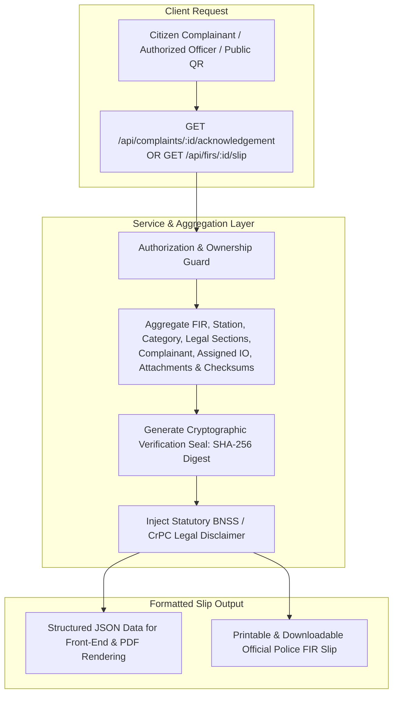

# Workflow 5: Complaint Acknowledgement & Official FIR Slip Implementation Guide

This guide documents the full architecture, data composition, statutory legal disclaimers, cryptographic anti-tamper sealing, and step-by-step implementation for **Workflow 5: Complaint Acknowledgement & Official FIR Slip Generation** (Functional Requirements FR-C6, PROJECT_CONTEXT.md §1.2, §5.2, §7.1, §12.2).

---

## 1. System Contract & Architecture Blueprint



---

## 2. Core Architectural Guarantees & Defense-in-Depth Guards

1. **Dual Format Availability:**  
   The endpoint returns structured JSON (`Accept: application/json` or default) containing all verifiable fields, metadata, and disclaimer text, suitable for client-side PDF rendering (e.g. `jspdf`, `html2pdf`) and mobile consumption. Setting `?format=html` or `Accept: text/html` returns an authentic, print-ready, high-resolution police acknowledgement slip complete with official crest styling, border formatting, and verification seals.
2. **Access Control & Scoping:**  
   - `CITIZEN`: Can only generate slips for their own complaints (`fir.complainant_id === req.user.citizenId`).
   - `POLICE OFFICERS` (`DESK_OFFICER`, `IO`, `SHO`, `SUPERVISOR`, `ADMIN`): Can generate slips within their station / district jurisdiction.
   - Public Verification: Anyone with a valid tracking ID can verify the authenticity of an acknowledgement via public tracking endpoint without disclosing confidential personal identifiers.
3. **Statutory Legal Disclaimer:**  
   Includes the mandatory statutory disclaimer under Section 173(2) BNSS / Section 154(2) CrPC:
   > *"This is a computer-generated official acknowledgement slip issued under the Online FIR & Case Management System. As per statutory provisions, a copy of the First Information Report (FIR) shall be given forthwith, free of cost, to the complainant or informant. Furnishing false information or filing frivolous complaints is punishable under Bharatiya Nyaya Sanhita (BNS) Section 217."*
4. **Cryptographic Anti-Tamper Digital Seal:**  
   Computes a deterministic SHA-256 seal of the core particulars (`tracking_id`, `fir_number`, `incident_dt`, `location_text`, `station_code`, `complainant_id`, `created_at`). This digest acts as a verifiable digital water-mark ensuring the printed document has not been altered.
5. **State-Adaptive Display:**  
   - If in `SUBMITTED` / `UNDER_REVIEW`: Generates an **Official Complaint Intake Acknowledgement Slip** with Tracking ID and pending review notice.
   - If in `REGISTERED`, `ASSIGNED`, `UNDER_INVESTIGATION`, `CHARGESHEET_FILED`, or `CLOSED`: Generates an **Official First Information Report (FIR) Slip** displaying the permanent FIR Number, tagged Bharatiya Nyaya Sanhita (BNS) / IPC sections, cognizable classification, and designated Investigating Officer (IO) details.

---

## 3. REST API Specification

| Method | Endpoint | Allowed Roles | Description |
|---|---|---|---|
| `GET` | `/api/complaints/:id/acknowledgement` | `CITIZEN`, `DESK_OFFICER`, `IO`, `SHO`, `SUPERVISOR`, `ADMIN` | Retrieve official complaint acknowledgement / FIR slip data (JSON / HTML) |
| `GET` | `/api/firs/:id/slip` | `CITIZEN`, `DESK_OFFICER`, `IO`, `SHO`, `SUPERVISOR`, `ADMIN` | Alias route for police officers and citizens to retrieve FIR slip |

### Response Example (JSON):
```json
{
  "success": true,
  "data": {
    "documentType": "OFFICIAL_FIR_SLIP",
    "documentTitle": "FIRST INFORMATION REPORT (FIR) ACKNOWLEDGEMENT",
    "trackingId": "CMP-2026-000030",
    "firNumber": "FIR/CPS-01/2026/00018",
    "status": "REGISTERED",
    "submittedAt": "2026-10-23T15:07:00.000Z",
    "registeredAt": "2026-10-23T15:07:30.000Z",
    "policeStation": {
      "stationId": 1,
      "name": "Central Police Station",
      "code": "CPS-01",
      "district": "Central Capital District",
      "contactPhone": "+91-11-23010101",
      "email": "central.ps@casesync.gov.in"
    },
    "complainant": {
      "fullName": "Priya Sharma",
      "phone": "9876543210",
      "address": "Flat 402, Lotus Apartments, Sector 12",
      "idType": "AADHAAR",
      "maskedIdNumber": "XXXX-XXXX-8921"
    },
    "incident": {
      "incidentDt": "2026-10-23T10:00:00.000Z",
      "locationText": "Central Metro Station, Bike Parking Bay 4",
      "category": "Motor Vehicle Theft",
      "description": "Motorcycle stolen while parked outside metro station...",
      "priority": "High"
    },
    "legalSections": [
      {
        "act": "BNS",
        "sectionNo": "303(2)",
        "title": "Theft",
        "isCognizable": true,
        "isBailable": false
      }
    ],
    "investigation": {
      "assignedIoName": "Sub-Inspector Rajesh Kumar",
      "badgeNo": "IO-CPS-101",
      "rank": "Sub-Inspector",
      "contactPhone": "9876500001"
    },
    "attachments": [
      {
        "attachmentId": 3,
        "fileName": "parking_ticket.pdf",
        "fileType": "application/pdf",
        "sha256": "e3b0c44298fc1c149afbf4c8996fb92427ae41e4649b934ca495991b7852b855"
      }
    ],
    "digitalSeal": {
      "algorithm": "SHA-256",
      "verificationDigest": "a8f5c317b9d62841...",
      "timestamp": "2026-10-23T15:10:00.000Z"
    },
    "disclaimer": "This is a computer-generated official acknowledgement slip issued under the Online FIR & Case Management System..."
  }
}
```

---

## 4. Implementation Steps & Target Files

1. **Service Layer**: Add `generateAcknowledgementSlip(firIdentifier, user)` in `src/services/complaint.service.js`.
2. **Controller Layer**: Add `getAcknowledgementSlip(req, res, next)` in `src/controllers/complaint.controller.js`.
3. **Route Mounting**:
   - Mount `GET /:id/acknowledgement` in `src/routes/complaint.route.js`.
   - Mount alias `GET /:id/slip` in `src/routes/fir.route.js`.
4. **Integration Test Suite**: Create `test/test-acknowledgement-slip-apis.js`.
5. **Package Scripts & Test Runner**: Add `test:acknowledgement` to `package.json` and include in `test/run-all-tests.js`.
