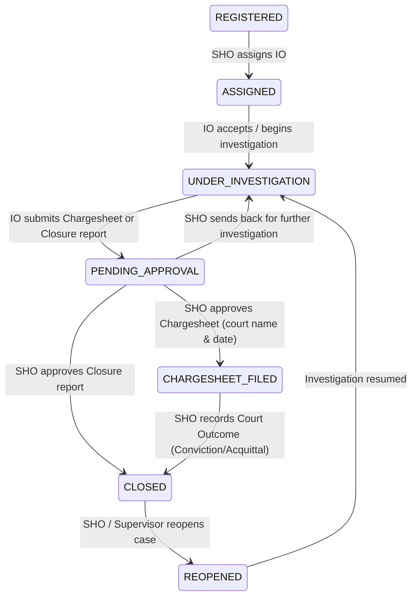

# Feature 3: Case Assignment, IO Workload, Investigation Updates & Case Closure Implementation Guide

This guide documents the full architecture, database schema, state machine enforcement, and step-by-step code implementation for **Feature 3: Case Assignment, IO Workload, Investigation Updates & Case Closure** (Functional Requirements FR-M1 to FR-M5, FR-M7, and Case-State Machine §6).

This feature takes registered FIRs, assigns them to Investigating Officers (IOs), tracks investigation progress notes, enforces IO workload visibility, handles report approvals (Chargesheet / Closure), and handles case reopening.

The work is strictly divided for a **team of 2 developers** working in parallel without merge conflicts.

---

## 1. System Contract & State Transition Blueprint

### A. State Transitions Covered in this Feature


### B. Business & Security Guards (Defense in Depth)
1. **Assignment Guard:** Only an `SHO` can assign/reassign an IO. The assigned IO must be an active officer belonging to the same police station as the FIR.
2. **Reassignment History:** Reassigning a case sets `to_ts = now()` on the previous active assignment in `case_assignments` and records the transfer reason before inserting the new assignment.
3. **Investigation Start Guard:** Only the assigned IO can transition the case from `ASSIGNED` to `UNDER_INVESTIGATION`.
4. **Case Diary / Update Guard:** Updates can only be added by the assigned IO while the case is in `UNDER_INVESTIGATION`. Visibility flag (`visible_to_citizen`) determines if citizens can see the note on their tracking page.
5. **Report Submission Guard:** IO cannot submit a chargesheet unless:
   - At least 1 case update exists.
   - At least 1 accused person is recorded in `fir_persons`.
6. **Reopening Guard:** Only `SHO` or `SUPERVISOR` can reopen a closed case with mandatory justification.

---

## 2. Member Responsibilities Split

| Area | Member 1: Database DDL & Core Engine | Member 2: APIs, Controllers & Testing |
|---|---|---|
| **Primary Domain** | Database DDL & Migrations, IO Workload Engine, Transactional Assignment, Investigation Updates, and Final Report State Machine Services | Request Validators, Case & Investigation Controllers, Route Definitions & Mounting, Automated End-to-End Test Suite |
| **Files to Implement** | 1. `src/db/migrations/03_case_investigation_schema.sql`<br>2. `src/services/case.service.js` | 1. `src/validators/case.validator.js`<br>2. `src/controllers/case.controller.js`<br>3. `src/routes/case.route.js`<br>4. `src/app.js` (Route mounting)<br>5. `src/test-case-investigation-apis.js` |
| **Database Tables & Features** | `case_assignments`, `case_updates`, `cases`, `fir`, `fir_persons`, `state_transitions`, `notifications`, `audit_log`, `case_status_history` | API validation, HTTP status codes, Role guards (`requireRoles('SHO')`, `requireRoles('IO')`), Route parameters |

---

# 👤 Member 1: Database DDL, Workload & Investigation Engine

## Task 1.1: Database Schema & Migration
**File:** `src/db/migrations/03_case_investigation_schema.sql`  
**Purpose:** Sets up tables for case assignments history, typed investigation diary notes, and seeds the remaining case-state transitions.

```sql
-- =========================================================================
-- 1. Case Assignment History Table (PROJECT_CONTEXT.md §8.4 & FR-M5)
-- Preserves complete history of assigned IOs per case
-- =========================================================================
CREATE TABLE IF NOT EXISTS case_assignments (
  assignment_id BIGSERIAL PRIMARY KEY,
  case_id BIGINT NOT NULL REFERENCES cases(case_id) ON DELETE CASCADE,
  officer_id BIGINT NOT NULL REFERENCES officers(officer_id) ON DELETE RESTRICT,
  assigned_by BIGINT NOT NULL REFERENCES users(user_id) ON DELETE RESTRICT,
  from_ts TIMESTAMPTZ NOT NULL DEFAULT now(),
  to_ts TIMESTAMPTZ,
  reason TEXT
);

CREATE INDEX IF NOT EXISTS idx_case_assignments_active 
  ON case_assignments(case_id) WHERE to_ts IS NULL;
CREATE INDEX IF NOT EXISTS idx_case_assignments_officer 
  ON case_assignments(officer_id);

-- =========================================================================
-- 2. Case Progress Diary Updates Table (PROJECT_CONTEXT.md §8.4 & FR-M2)
-- =========================================================================
CREATE TABLE IF NOT EXISTS case_updates (
  update_id BIGSERIAL PRIMARY KEY,
  case_id BIGINT NOT NULL REFERENCES cases(case_id) ON DELETE CASCADE,
  officer_id BIGINT NOT NULL REFERENCES officers(officer_id) ON DELETE RESTRICT,
  update_type VARCHAR(20) NOT NULL CHECK (
    update_type IN ('STATEMENT', 'SITE_VISIT', 'ARREST', 'SEARCH', 'FORENSIC', 'GENERAL')
  ),
  body TEXT NOT NULL,
  visible_to_citizen BOOLEAN NOT NULL DEFAULT FALSE,
  created_at TIMESTAMPTZ NOT NULL DEFAULT now()
);

CREATE INDEX IF NOT EXISTS idx_case_updates_case 
  ON case_updates(case_id, created_at DESC);
CREATE INDEX IF NOT EXISTS idx_cases_current_io 
  ON cases(current_io_id);

-- =========================================================================
-- 3. Seed State Transitions for Post-Registration Case Lifecycle (§6.4)
-- =========================================================================
INSERT INTO state_transitions (from_state, to_state, required_permission) VALUES
  ('REGISTERED', 'ASSIGNED', 'case:assign'),
  ('ASSIGNED', 'UNDER_INVESTIGATION', 'case:investigate'),
  ('UNDER_INVESTIGATION', 'PENDING_APPROVAL', 'case:submit_report'),
  ('PENDING_APPROVAL', 'UNDER_INVESTIGATION', 'case:send_back'),
  ('PENDING_APPROVAL', 'CHARGESHEET_FILED', 'case:approve_chargesheet'),
  ('PENDING_APPROVAL', 'CLOSED', 'case:approve_closure'),
  ('CHARGESHEET_FILED', 'CLOSED', 'case:record_outcome'),
  ('CLOSED', 'REOPENED', 'case:reopen'),
  ('REOPENED', 'UNDER_INVESTIGATION', 'case:investigate')
ON CONFLICT (from_state, to_state) DO NOTHING;
```

---

## Task 1.2: Case & Investigation Service (ACID Transactions)
**File:** `src/services/case.service.js`  
**Purpose:** Implements IO assignment, workload queries, investigation notes logging, and case resolution state transitions with strict audit logging and notifications.

```javascript
const pool = require('../config/db');
const { logAuditEvent } = require('./audit.service');

/**
 * 1. Fetch IO Workload per police station (FR-M1)
 * Used by SHO to see how many active cases each officer is currently handling
 */
async function getStationIoWorkload(stationId) {
  const query = `
    SELECT o.officer_id, o.badge_no, o.full_name, o.rank,
           COUNT(c.case_id) FILTER (WHERE f.status NOT IN ('CLOSED', 'REJECTED')) AS active_cases_count,
           ARRAY_AGG(f.fir_number) FILTER (WHERE f.status NOT IN ('CLOSED', 'REJECTED')) AS active_firs
    FROM officers o
    JOIN users u ON o.user_id = u.user_id
    LEFT JOIN cases c ON o.officer_id = c.current_io_id
    LEFT JOIN fir f ON c.fir_id = f.fir_id
    WHERE o.station_id = $1 AND u.is_active = TRUE
    GROUP BY o.officer_id, o.badge_no, o.full_name, o.rank
    ORDER BY active_cases_count ASC, o.full_name ASC;
  `;
  const result = await pool.query(query, [stationId]);
  return result.rows;
}

/**
 * 2. Assign / Reassign IO to Case (SHO only, ACID transaction)
 * Moves FIR: REGISTERED -> ASSIGNED (or reassigns during active investigation)
 */
async function assignCaseIo({ firId, officerId, assignerUserId, stationId, reason, ipAddress }) {
  const client = await pool.connect();
  try {
    await client.query('BEGIN');

    // 1. Lock FIR row
    const firRes = await client.query(
      `SELECT fir_id, station_id, status, fir_number, complainant_id FROM fir WHERE fir_id = $1 FOR UPDATE`,
      [firId]
    );
    if (firRes.rows.length === 0) {
      const err = new Error('FIR record not found.');
      err.statusCode = 404;
      throw err;
    }
    const fir = firRes.rows[0];

    // Station check
    if (fir.station_id !== stationId) {
      const err = new Error('You do not have jurisdiction to assign cases for another station.');
      err.statusCode = 403;
      throw err;
    }

    // Allowed status check
    const allowedStatuses = ['REGISTERED', 'ASSIGNED', 'UNDER_INVESTIGATION', 'REOPENED'];
    if (!allowedStatuses.includes(fir.status)) {
      const err = new Error(`Cannot assign IO to case in status: ${fir.status}`);
      err.statusCode = 400;
      throw err;
    }

    // 2. Verify IO belongs to station and is active
    const ioRes = await client.query(
      `SELECT o.officer_id, o.full_name, o.user_id, r.code AS role_code
       FROM officers o
       JOIN users u ON o.user_id = u.user_id
       JOIN roles r ON u.role_id = r.role_id
       WHERE o.officer_id = $1 AND o.station_id = $2 AND u.is_active = TRUE`,
      [officerId, stationId]
    );
    if (ioRes.rows.length === 0) {
      const err = new Error('Designated officer is not an active officer at this police station.');
      err.statusCode = 400;
      throw err;
    }
    const targetIo = ioRes.rows[0];

    // 3. Fetch Case row
    const caseRes = await client.query(`SELECT case_id, current_io_id FROM cases WHERE fir_id = $1`, [firId]);
    if (caseRes.rows.length === 0) {
      const err = new Error('Case file not initialized for this FIR.');
      err.statusCode = 500;
      throw err;
    }
    const currentCase = caseRes.rows[0];

    // 4. If reassigning, close previous assignment
    if (currentCase.current_io_id) {
      await client.query(
        `UPDATE case_assignments
         SET to_ts = now(), reason = COALESCE($1, 'Reassigned by SHO')
         WHERE case_id = $2 AND to_ts IS NULL`,
        [reason || 'Officer reassigned', currentCase.case_id]
      );
    }

    // 5. Insert new assignment
    await client.query(
      `INSERT INTO case_assignments (case_id, officer_id, assigned_by, reason)
       VALUES ($1, $2, $3, $4)`,
      [currentCase.case_id, officerId, assignerUserId, reason || 'Initial assignment']
    );

    // 6. Update cases current_io_id
    await client.query(`UPDATE cases SET current_io_id = $1 WHERE case_id = $2`, [officerId, currentCase.case_id]);

    // 7. Transition FIR status if REGISTERED -> ASSIGNED
    const fromStatus = fir.status;
    let toStatus = fir.status;
    if (fir.status === 'REGISTERED') {
      toStatus = 'ASSIGNED';
      await client.query(
        `UPDATE fir SET status = 'ASSIGNED', version = version + 1, updated_at = now() WHERE fir_id = $1`,
        [firId]
      );

      await client.query(
        `INSERT INTO case_status_history (fir_id, from_state, to_state, actor_id, note)
         VALUES ($1, 'REGISTERED', 'ASSIGNED', $2, $3)`,
        [firId, assignerUserId, `Assigned to IO ${targetIo.full_name}`]
      );
    }

    // 8. Notifications
    await client.query(
      `INSERT INTO notifications (user_id, fir_id, message)
       VALUES ($1, $2, $3)`,
      [targetIo.user_id, firId, `You have been assigned as the Investigating Officer for FIR ${fir.fir_number}.`]
    );

    // 9. Audit Log
    await logAuditEvent({
      actorId: assignerUserId,
      actorRole: 'SHO',
      action: currentCase.current_io_id ? 'IO_REASSIGNED' : 'IO_ASSIGNED',
      entityType: 'case',
      entityId: currentCase.case_id,
      oldData: { current_io_id: currentCase.current_io_id, status: fromStatus },
      newData: { current_io_id: officerId, status: toStatus, assigned_to: targetIo.full_name },
      ipAddress
    });

    await client.query('COMMIT');
    return {
      caseId: currentCase.case_id,
      firId,
      assignedIo: targetIo.full_name,
      status: toStatus
    };
  } catch (error) {
    await client.query('ROLLBACK');
    throw error;
  } finally {
    client.release();
  }
}

/**
 * 3. IO Accepts Assignment & Commences Investigation
 * Moves FIR: ASSIGNED -> UNDER_INVESTIGATION
 */
async function acceptInvestigation({ firId, officerId, userId, ipAddress }) {
  const client = await pool.connect();
  try {
    await client.query('BEGIN');

    const checkRes = await client.query(
      `SELECT c.case_id, c.current_io_id, f.status, f.fir_number
       FROM cases c
       JOIN fir f ON c.fir_id = f.fir_id
       WHERE f.fir_id = $1 FOR UPDATE`,
      [firId]
    );

    if (checkRes.rows.length === 0) {
      const err = new Error('Case not found.');
      err.statusCode = 404;
      throw err;
    }

    const caseData = checkRes.rows[0];

    if (caseData.current_io_id !== officerId) {
      const err = new Error('Only the assigned Investigating Officer can accept this case.');
      err.statusCode = 403;
      throw err;
    }

    if (caseData.status !== 'ASSIGNED' && caseData.status !== 'REOPENED') {
      const err = new Error(`Cannot start investigation from status: ${caseData.status}`);
      err.statusCode = 400;
      throw err;
    }

    // Update FIR status
    await client.query(
      `UPDATE fir
       SET status = 'UNDER_INVESTIGATION', version = version + 1, updated_at = now()
       WHERE fir_id = $1`,
      [firId]
    );

    // Update case investigation started timestamp
    await client.query(
      `UPDATE cases SET investigation_started_at = COALESCE(investigation_started_at, now()) WHERE case_id = $1`,
      [caseData.case_id]
    );

    // Record history
    await client.query(
      `INSERT INTO case_status_history (fir_id, from_state, to_state, actor_id, note)
       VALUES ($1, $2, 'UNDER_INVESTIGATION', $3, 'IO accepted case and commenced investigation')`,
      [firId, caseData.status, userId]
    );

    // Audit log
    await logAuditEvent({
      actorId: userId,
      actorRole: 'IO',
      action: 'STATUS_CHANGED',
      entityType: 'fir',
      entityId: firId,
      oldData: { status: caseData.status },
      newData: { status: 'UNDER_INVESTIGATION' },
      ipAddress
    });

    await client.query('COMMIT');
    return { firId, status: 'UNDER_INVESTIGATION' };
  } catch (error) {
    await client.query('ROLLBACK');
    throw error;
  } finally {
    client.release();
  }
}

/**
 * 4. Add Case Progress Diary Update (FR-M2)
 */
async function addCaseUpdate({ firId, officerId, userId, updateType, body, visibleToCitizen, ipAddress }) {
  const client = await pool.connect();
  try {
    await client.query('BEGIN');

    const caseRes = await client.query(
      `SELECT c.case_id, c.current_io_id, f.status
       FROM cases c
       JOIN fir f ON c.fir_id = f.fir_id
       WHERE f.fir_id = $1`,
      [firId]
    );

    if (caseRes.rows.length === 0) {
      const err = new Error('Case not found.');
      err.statusCode = 404;
      throw err;
    }

    const c = caseRes.rows[0];

    // Ownership check
    if (c.current_io_id !== officerId) {
      const err = new Error('Only the assigned IO can log progress updates for this case.');
      err.statusCode = 403;
      throw err;
    }

    if (c.status !== 'UNDER_INVESTIGATION') {
      const err = new Error(`Progress updates can only be logged when case is UNDER_INVESTIGATION. Status: ${c.status}`);
      err.statusCode = 400;
      throw err;
    }

    const insertRes = await client.query(
      `INSERT INTO case_updates (case_id, officer_id, update_type, body, visible_to_citizen)
       VALUES ($1, $2, $3, $4, $5)
       RETURNING *;`,
      [c.case_id, officerId, updateType, body, Boolean(visibleToCitizen)]
    );

    await logAuditEvent({
      actorId: userId,
      actorRole: 'IO',
      action: 'CASE_UPDATE_ADDED',
      entityType: 'case_update',
      entityId: insertRes.rows[0].update_id,
      newData: { case_id: c.case_id, updateType, visibleToCitizen },
      ipAddress
    });

    await client.query('COMMIT');
    return insertRes.rows[0];
  } catch (error) {
    await client.query('ROLLBACK');
    throw error;
  } finally {
    client.release();
  }
}

/**
 * 5. Add / Manage Accused or Witness Person (FR-M3)
 */
async function addCasePerson({ firId, officerId, personData }) {
  const caseRes = await pool.query(
    `SELECT c.case_id, c.current_io_id, f.status
     FROM cases c
     JOIN fir f ON c.fir_id = f.fir_id
     WHERE f.fir_id = $1`,
    [firId]
  );

  if (caseRes.rows.length === 0) {
    const err = new Error('Case not found.');
    err.statusCode = 404;
    throw err;
  }

  const c = caseRes.rows[0];
  if (c.current_io_id !== officerId) {
    const err = new Error('Only the assigned IO can add persons to this case.');
    err.statusCode = 403;
    throw err;
  }

  const result = await pool.query(
    `INSERT INTO fir_persons (fir_id, person_role, full_name, contact, address, notes)
     VALUES ($1, $2, $3, $4, $5, $6)
     RETURNING *;`,
    [
      firId,
      personData.personRole.toUpperCase(),
      personData.fullName,
      personData.contact || null,
      personData.address || null,
      personData.notes || null
    ]
  );

  return result.rows[0];
}

/**
 * 6. Submit Final Report (IO submits CHARGESHEET or CLOSURE -> PENDING_APPROVAL)
 */
async function submitFinalReport({ firId, officerId, userId, reportType, summary, ipAddress }) {
  const client = await pool.connect();
  try {
    await client.query('BEGIN');

    const checkRes = await client.query(
      `SELECT c.case_id, c.current_io_id, f.status, f.fir_number
       FROM cases c
       JOIN fir f ON c.fir_id = f.fir_id
       WHERE f.fir_id = $1 FOR UPDATE`,
      [firId]
    );

    if (checkRes.rows.length === 0) {
      const err = new Error('Case not found.');
      err.statusCode = 404;
      throw err;
    }

    const c = checkRes.rows[0];
    if (c.current_io_id !== officerId) {
      const err = new Error('Only the assigned IO can submit the final report.');
      err.statusCode = 403;
      throw err;
    }

    if (c.status !== 'UNDER_INVESTIGATION') {
      const err = new Error(`Cannot submit report when case is in status: ${c.status}`);
      err.statusCode = 400;
      throw err;
    }

    // Guard: Must have at least one diary update
    const countUpdates = await client.query(
      `SELECT COUNT(*) FROM case_updates WHERE case_id = $1`,
      [c.case_id]
    );
    if (parseInt(countUpdates.rows[0].count, 10) === 0) {
      const err = new Error('Cannot submit report without at least one investigation update logged.');
      err.statusCode = 400;
      throw err;
    }

    // Guard: If Chargesheet, at least 1 accused person must be documented
    if (reportType === 'CHARGESHEET') {
      const countAccused = await client.query(
        `SELECT COUNT(*) FROM fir_persons WHERE fir_id = $1 AND person_role = 'ACCUSED'`,
        [firId]
      );
      if (parseInt(countAccused.rows[0].count, 10) === 0) {
        const err = new Error('Chargesheet requires at least one accused person recorded in persons list.');
        err.statusCode = 400;
        throw err;
      }
    }

    // Update case record
    await client.query(
      `UPDATE cases SET report_type = $1, outcome = $2 WHERE case_id = $3`,
      [reportType, summary, c.case_id]
    );

    // Update FIR status -> PENDING_APPROVAL
    await client.query(
      `UPDATE fir SET status = 'PENDING_APPROVAL', version = version + 1, updated_at = now() WHERE fir_id = $1`,
      [firId]
    );

    // Record status history
    await client.query(
      `INSERT INTO case_status_history (fir_id, from_state, to_state, actor_id, note)
       VALUES ($1, 'UNDER_INVESTIGATION', 'PENDING_APPROVAL', $2, $3)`,
      [firId, userId, `Final Report (${reportType}) submitted for SHO approval: ${summary}`]
    );

    await logAuditEvent({
      actorId: userId,
      actorRole: 'IO',
      action: 'STATUS_CHANGED',
      entityType: 'case',
      entityId: c.case_id,
      oldData: { status: 'UNDER_INVESTIGATION' },
      newData: { status: 'PENDING_APPROVAL', report_type: reportType },
      ipAddress
    });

    await client.query('COMMIT');
    return { firId, status: 'PENDING_APPROVAL', reportType };
  } catch (error) {
    await client.query('ROLLBACK');
    throw error;
  } finally {
    client.release();
  }
}

/**
 * 7. SHO Decides on Final Report (Approve Chargesheet / Approve Closure / Send Back)
 */
async function reviewFinalReport({ firId, stationId, userId, decision, remarks, courtDetails, ipAddress }) {
  const client = await pool.connect();
  try {
    await client.query('BEGIN');

    const checkRes = await client.query(
      `SELECT c.case_id, c.current_io_id, c.report_type, f.status, f.station_id, f.fir_number, f.complainant_id
       FROM cases c
       JOIN fir f ON c.fir_id = f.fir_id
       WHERE f.fir_id = $1 FOR UPDATE`,
      [firId]
    );

    if (checkRes.rows.length === 0) {
      const err = new Error('Case not found.');
      err.statusCode = 404;
      throw err;
    }

    const c = checkRes.rows[0];
    if (c.station_id !== stationId) {
      const err = new Error('SHO can only review reports for their own police station.');
      err.statusCode = 403;
      throw err;
    }

    if (c.status !== 'PENDING_APPROVAL') {
      const err = new Error(`Case report is not pending approval. Current status: ${c.status}`);
      err.statusCode = 400;
      throw err;
    }

    let nextStatus = '';
    let note = '';

    if (decision === 'SEND_BACK') {
      nextStatus = 'UNDER_INVESTIGATION';
      note = `SHO sent report back for further investigation: ${remarks || 'Incomplete details'}`;
    } else if (decision === 'APPROVE') {
      if (c.report_type === 'CHARGESHEET') {
        nextStatus = 'CHARGESHEET_FILED';
        note = `Chargesheet approved for filing in court (${courtDetails?.courtName || 'District Court'}). Remarks: ${remarks || 'Approved'}`;
      } else {
        nextStatus = 'CLOSED';
        note = `Closure report approved. Case closed. Reason: ${remarks || 'Untraced / No offence made'}`;
        await client.query(`UPDATE cases SET closed_at = now() WHERE case_id = $1`, [c.case_id]);
      }
    } else {
      const err = new Error("Invalid decision. Must be 'APPROVE' or 'SEND_BACK'.");
      err.statusCode = 400;
      throw err;
    }

    // Update FIR Status
    await client.query(
      `UPDATE fir SET status = $1, version = version + 1, updated_at = now() WHERE fir_id = $2`,
      [nextStatus, firId]
    );

    // Status History
    await client.query(
      `INSERT INTO case_status_history (fir_id, from_state, to_state, actor_id, note)
       VALUES ($1, 'PENDING_APPROVAL', $2, $3, $4)`,
      [firId, nextStatus, userId, note]
    );

    // Notify Complainant if closed or filed
    if (['CHARGESHEET_FILED', 'CLOSED'].includes(nextStatus)) {
      const citizenUser = await client.query(
        `SELECT user_id FROM citizens WHERE citizen_id = $1`,
        [c.complainant_id]
      );
      if (citizenUser.rows.length > 0) {
        await client.query(
          `INSERT INTO notifications (user_id, fir_id, message)
           VALUES ($1, $2, $3)`,
          [
            citizenUser.rows[0].user_id,
            firId,
            `Update on FIR ${c.fir_number}: Case status changed to ${nextStatus}. ${note}`
          ]
        );
      }
    }

    await logAuditEvent({
      actorId: userId,
      actorRole: 'SHO',
      action: 'STATUS_CHANGED',
      entityType: 'case',
      entityId: c.case_id,
      oldData: { status: 'PENDING_APPROVAL' },
      newData: { status: nextStatus, decision, remarks },
      ipAddress
    });

    await client.query('COMMIT');
    return { firId, status: nextStatus, note };
  } catch (error) {
    await client.query('ROLLBACK');
    throw error;
  } finally {
    client.release();
  }
}

/**
 * 8. Reopen Case (SHO / SUPERVISOR only)
 * Moves FIR: CLOSED -> REOPENED -> UNDER_INVESTIGATION
 */
async function reopenCase({ firId, stationId, userRole, userId, reason, ipAddress }) {
  const client = await pool.connect();
  try {
    await client.query('BEGIN');

    const checkRes = await client.query(
      `SELECT c.case_id, f.status, f.station_id, f.fir_number, f.complainant_id
       FROM cases c
       JOIN fir f ON c.fir_id = f.fir_id
       WHERE f.fir_id = $1 FOR UPDATE`,
      [firId]
    );

    if (checkRes.rows.length === 0) {
      const err = new Error('Case not found.');
      err.statusCode = 404;
      throw err;
    }

    const c = checkRes.rows[0];

    // Station check (Supervisors have district access, SHO check station)
    if (userRole === 'SHO' && c.station_id !== stationId) {
      const err = new Error('SHO can only reopen cases from their own station.');
      err.statusCode = 403;
      throw err;
    }

    if (c.status !== 'CLOSED') {
      const err = new Error(`Only CLOSED cases can be reopened. Current status: ${c.status}`);
      err.statusCode = 400;
      throw err;
    }

    // Transition to REOPENED then UNDER_INVESTIGATION
    await client.query(
      `UPDATE fir
       SET status = 'UNDER_INVESTIGATION', version = version + 1, updated_at = now()
       WHERE fir_id = $1`,
      [firId]
    );

    await client.query(`UPDATE cases SET closed_at = NULL WHERE case_id = $1`, [c.case_id]);

    await client.query(
      `INSERT INTO case_status_history (fir_id, from_state, to_state, actor_id, note)
       VALUES ($1, 'CLOSED', 'REOPENED', $2, $3)`,
      [firId, userId, `Case reopened by ${userRole}. Reason: ${reason}`]
    );

    await client.query(
      `INSERT INTO case_status_history (fir_id, from_state, to_state, actor_id, note)
       VALUES ($1, 'REOPENED', 'UNDER_INVESTIGATION', $2, 'Case returned to active investigation')`,
      [firId, userId]
    );

    await logAuditEvent({
      actorId: userId,
      actorRole: userRole,
      action: 'CASE_REOPENED',
      entityType: 'case',
      entityId: c.case_id,
      oldData: { status: 'CLOSED' },
      newData: { status: 'UNDER_INVESTIGATION', reason },
      ipAddress
    });

    await client.query('COMMIT');
    return { firId, status: 'UNDER_INVESTIGATION', reopened: true };
  } catch (error) {
    await client.query('ROLLBACK');
    throw error;
  } finally {
    client.release();
  }
}

/**
 * 9. View Case Detail (including Updates, Persons, Assignments)
 */
async function getCaseDetails(firId, user) {
  const caseRes = await pool.query(
    `SELECT c.case_id, c.investigation_started_at, c.report_type, c.outcome, c.closed_at,
            f.fir_id, f.fir_number, f.tracking_id, f.status, f.priority, f.incident_dt,
            f.location_text, f.description, f.station_id, ps.name AS station_name,
            io.officer_id AS current_io_id, io.full_name AS current_io_name, io.badge_no AS current_io_badge,
            cit.citizen_id, cit.full_name AS complainant_name
     FROM cases c
     JOIN fir f ON c.fir_id = f.fir_id
     LEFT JOIN police_stations ps ON f.station_id = ps.station_id
     LEFT JOIN officers io ON c.current_io_id = io.officer_id
     LEFT JOIN citizens cit ON f.complainant_id = cit.citizen_id
     WHERE f.fir_id = $1`,
    [firId]
  );

  if (caseRes.rows.length === 0) {
    return null;
  }

  const caseData = caseRes.rows[0];

  // Scoping checks: Citizens only view if owner, IOs view assigned, SHO views station
  if (user.role === 'CITIZEN' && user.citizenId !== caseData.citizen_id) {
    const err = new Error('Forbidden: You can only view your own cases.');
    err.statusCode = 403;
    throw err;
  }

  // Fetch Updates: Citizens only see visible_to_citizen = TRUE
  let updatesQuery = `
    SELECT u.update_id, u.update_type, u.body, u.visible_to_citizen, u.created_at,
           o.full_name AS officer_name, o.badge_no
    FROM case_updates u
    JOIN officers o ON u.officer_id = o.officer_id
    WHERE u.case_id = $1
  `;
  if (user.role === 'CITIZEN') {
    updatesQuery += ` AND u.visible_to_citizen = TRUE`;
  }
  updatesQuery += ` ORDER BY u.created_at DESC`;
  const updatesRes = await pool.query(updatesQuery, [caseData.case_id]);

  // Fetch Persons
  const personsRes = await pool.query(
    `SELECT * FROM fir_persons WHERE fir_id = $1 ORDER BY created_at ASC`,
    [firId]
  );

  // Fetch Assignment History (Officers & Admins only)
  let assignments = [];
  if (user.role !== 'CITIZEN') {
    const assignRes = await pool.query(
      `SELECT ca.assignment_id, ca.from_ts, ca.to_ts, ca.reason,
              o.full_name AS officer_name, o.badge_no,
              u.email AS assigned_by_user
       FROM case_assignments ca
       JOIN officers o ON ca.officer_id = o.officer_id
       JOIN users u ON ca.assigned_by = u.user_id
       WHERE ca.case_id = $1
       ORDER BY ca.from_ts DESC`,
      [caseData.case_id]
    );
    assignments = assignRes.rows;
  }

  return {
    ...caseData,
    updates: updatesRes.rows,
    persons: personsRes.rows,
    assignments
  };
}

module.exports = {
  getStationIoWorkload,
  assignCaseIo,
  acceptInvestigation,
  addCaseUpdate,
  addCasePerson,
  submitFinalReport,
  reviewFinalReport,
  reopenCase,
  getCaseDetails
};
```

---

# 👤 Member 2: Validators, Controllers, Routes & Integration Test Suite

## Task 2.1: Input Validator
**File:** `src/validators/case.validator.js`  
**Purpose:** Validates input payloads for assignment, updates, person creation, final report submissions, and reopening.

```javascript
function validateAssignInput(data) {
  const errors = [];
  if (!data.officerId || isNaN(parseInt(data.officerId, 10))) {
    errors.push('A valid officerId is required for assignment.');
  }
  return { isValid: errors.length === 0, errors };
}

function validateUpdateInput(data) {
  const errors = [];
  const validTypes = ['STATEMENT', 'SITE_VISIT', 'ARREST', 'SEARCH', 'FORENSIC', 'GENERAL'];

  if (!data.updateType || !validTypes.includes(data.updateType.toUpperCase())) {
    errors.push(`updateType must be one of: ${validTypes.join(', ')}`);
  }

  if (!data.body || data.body.trim().length < 10) {
    errors.push('Update body must be at least 10 characters long.');
  }

  return { isValid: errors.length === 0, errors };
}

function validateFinalReportInput(data) {
  const errors = [];
  const validTypes = ['CHARGESHEET', 'CLOSURE'];

  if (!data.reportType || !validTypes.includes(data.reportType.toUpperCase())) {
    errors.push(`reportType must be either 'CHARGESHEET' or 'CLOSURE'.`);
  }

  if (!data.summary || data.summary.trim().length < 15) {
    errors.push('Report summary must be at least 15 characters long.');
  }

  return { isValid: errors.length === 0, errors };
}

function validateReviewReportInput(data) {
  const errors = [];
  const validDecisions = ['APPROVE', 'SEND_BACK'];

  if (!data.decision || !validDecisions.includes(data.decision.toUpperCase())) {
    errors.push(`decision must be either 'APPROVE' or 'SEND_BACK'.`);
  }

  return { isValid: errors.length === 0, errors };
}

function validateReopenInput(data) {
  const errors = [];
  if (!data.reason || data.reason.trim().length < 10) {
    errors.push('Reopen reason must be at least 10 characters long.');
  }
  return { isValid: errors.length === 0, errors };
}

module.exports = {
  validateAssignInput,
  validateUpdateInput,
  validateFinalReportInput,
  validateReviewReportInput,
  validateReopenInput
};
```

---

## Task 2.2: Case & Investigation Controller
**File:** `src/controllers/case.controller.js`  
**Purpose:** Handles incoming HTTP requests for assignment, investigation updates, reports, and detailed queries.

```javascript
const caseService = require('../services/case.service');
const {
  validateAssignInput,
  validateUpdateInput,
  validateFinalReportInput,
  validateReviewReportInput,
  validateReopenInput
} = require('../validators/case.validator');

/**
 * GET /api/cases/workload
 * SHO views active workload of officers in their station
 */
async function getIoWorkload(req, res, next) {
  try {
    const stationId = req.user.stationId;
    if (!stationId) {
      return res.status(400).json({ success: false, message: 'User is not assigned to a police station.' });
    }

    const workload = await caseService.getStationIoWorkload(stationId);
    res.status(200).json({ success: true, data: workload });
  } catch (error) {
    next(error);
  }
}

/**
 * POST /api/cases/:id/assign
 * SHO assigns or reassigns an IO to a case
 */
async function assignIo(req, res, next) {
  try {
    const { isValid, errors } = validateAssignInput(req.body);
    if (!isValid) return res.status(400).json({ success: false, errors });

    const result = await caseService.assignCaseIo({
      firId: req.params.id,
      officerId: req.body.officerId,
      assignerUserId: req.user.userId,
      stationId: req.user.stationId,
      reason: req.body.reason,
      ipAddress: req.ip
    });

    res.status(200).json({
      success: true,
      message: 'Investigating Officer assigned successfully.',
      data: result
    });
  } catch (error) {
    next(error);
  }
}

/**
 * POST /api/cases/:id/accept
 * IO accepts case and commences investigation
 */
async function acceptCase(req, res, next) {
  try {
    const result = await caseService.acceptInvestigation({
      firId: req.params.id,
      officerId: req.user.officerId,
      userId: req.user.userId,
      ipAddress: req.ip
    });

    res.status(200).json({
      success: true,
      message: 'Case accepted. Investigation is now active.',
      data: result
    });
  } catch (error) {
    next(error);
  }
}

/**
 * POST /api/cases/:id/updates
 * IO logs progress diary update
 */
async function addUpdate(req, res, next) {
  try {
    const { isValid, errors } = validateUpdateInput(req.body);
    if (!isValid) return res.status(400).json({ success: false, errors });

    const result = await caseService.addCaseUpdate({
      firId: req.params.id,
      officerId: req.user.officerId,
      userId: req.user.userId,
      updateType: req.body.updateType.toUpperCase(),
      body: req.body.body,
      visibleToCitizen: req.body.visibleToCitizen,
      ipAddress: req.ip
    });

    res.status(201).json({
      success: true,
      message: 'Case progress update logged successfully.',
      data: result
    });
  } catch (error) {
    next(error);
  }
}

/**
 * POST /api/cases/:id/persons
 * IO adds accused/witness/victim
 */
async function addPerson(req, res, next) {
  try {
    if (!req.body.fullName || !req.body.personRole) {
      return res.status(400).json({ success: false, message: 'fullName and personRole are required.' });
    }

    const result = await caseService.addCasePerson({
      firId: req.params.id,
      officerId: req.user.officerId,
      personData: req.body
    });

    res.status(201).json({
      success: true,
      message: 'Person record linked to case.',
      data: result
    });
  } catch (error) {
    next(error);
  }
}

/**
 * POST /api/cases/:id/submit-report
 * IO submits final report (CHARGESHEET / CLOSURE)
 */
async function submitReport(req, res, next) {
  try {
    const { isValid, errors } = validateFinalReportInput(req.body);
    if (!isValid) return res.status(400).json({ success: false, errors });

    const result = await caseService.submitFinalReport({
      firId: req.params.id,
      officerId: req.user.officerId,
      userId: req.user.userId,
      reportType: req.body.reportType.toUpperCase(),
      summary: req.body.summary,
      ipAddress: req.ip
    });

    res.status(200).json({
      success: true,
      message: 'Final investigation report submitted for SHO approval.',
      data: result
    });
  } catch (error) {
    next(error);
  }
}

/**
 * POST /api/cases/:id/review-report
 * SHO decides on report
 */
async function reviewReport(req, res, next) {
  try {
    const { isValid, errors } = validateReviewReportInput(req.body);
    if (!isValid) return res.status(400).json({ success: false, errors });

    const result = await caseService.reviewFinalReport({
      firId: req.params.id,
      stationId: req.user.stationId,
      userId: req.user.userId,
      decision: req.body.decision.toUpperCase(),
      remarks: req.body.remarks,
      courtDetails: req.body.courtDetails,
      ipAddress: req.ip
    });

    res.status(200).json({
      success: true,
      message: 'Report decision processed successfully.',
      data: result
    });
  } catch (error) {
    next(error);
  }
}

/**
 * POST /api/cases/:id/reopen
 * SHO or SUPERVISOR reopens closed case
 */
async function reopenCase(req, res, next) {
  try {
    const { isValid, errors } = validateReopenInput(req.body);
    if (!isValid) return res.status(400).json({ success: false, errors });

    const result = await caseService.reopenCase({
      firId: req.params.id,
      stationId: req.user.stationId,
      userRole: req.user.role,
      userId: req.user.userId,
      reason: req.body.reason,
      ipAddress: req.ip
    });

    res.status(200).json({
      success: true,
      message: 'Case successfully reopened.',
      data: result
    });
  } catch (error) {
    next(error);
  }
}

/**
 * GET /api/cases/:id
 * Retrieve comprehensive case information
 */
async function getCaseDetails(req, res, next) {
  try {
    const caseData = await caseService.getCaseDetails(req.params.id, req.user);
    if (!caseData) {
      return res.status(404).json({ success: false, message: 'Case not found.' });
    }
    res.status(200).json({ success: true, data: caseData });
  } catch (error) {
    next(error);
  }
}

module.exports = {
  getIoWorkload,
  assignIo,
  acceptCase,
  addUpdate,
  addPerson,
  submitReport,
  reviewReport,
  reopenCase,
  getCaseDetails
};
```

---

## Task 2.3: Route Definition
**File:** `src/routes/case.route.js`  
**Purpose:** Registers protected API endpoints with role checks for SHO, IO, Supervisor, and Citizens.

```javascript
const express = require('express');
const router = express.Router();
const caseController = require('../controllers/case.controller');
const { authenticateToken } = require('../middlewares/auth.middleware');
const { requireRoles } = require('../middlewares/rbac.middleware');

router.use(authenticateToken);

// 1. IO Workload Query (SHO & SUPERVISOR only)
router.get('/workload', requireRoles('SHO', 'SUPERVISOR'), caseController.getIoWorkload);

// 2. IO Assignment (SHO only)
router.post('/:id/assign', requireRoles('SHO'), caseController.assignIo);

// 3. IO Actions (IO only)
router.post('/:id/accept', requireRoles('IO'), caseController.acceptCase);
router.post('/:id/updates', requireRoles('IO'), caseController.addUpdate);
router.post('/:id/persons', requireRoles('IO'), caseController.addPerson);
router.post('/:id/submit-report', requireRoles('IO'), caseController.submitReport);

// 4. Report Decision & Approvals (SHO only)
router.post('/:id/review-report', requireRoles('SHO'), caseController.reviewReport);

// 5. Reopening Closed Cases (SHO & SUPERVISOR)
router.post('/:id/reopen', requireRoles('SHO', 'SUPERVISOR'), caseController.reopenCase);

// 6. View Full Case Details (All authenticated roles within scope)
router.get('/:id', caseController.getCaseDetails);

module.exports = router;
```

---

## Task 2.4: Mount in `src/app.js`
In `src/app.js`, add:
```javascript
const caseRoutes = require('./routes/case.route');

// Mount under /api/cases
app.use('/api/cases', caseRoutes);
```

---

## Task 2.5: Automated Verification Test Suite
**File:** `src/test-case-investigation-apis.js`  
**Purpose:** Automated integration script to verify IO workload, assignment, accepting case, diary updates, accused addition, report submission, and SHO approval.  
**Run via:** `node src/test-case-investigation-apis.js`

```javascript
require('dotenv').config();
const app = require('./app');
const pool = require('./config/db');

const TEST_PORT = 5004;
const BASE_URL = `http://localhost:${TEST_PORT}`;

async function runTests() {
  console.log('--- Starting Case Investigation & Lifecycle Test Suite ---\n');

  const server = app.listen(TEST_PORT);

  try {
    // 1. Log in SHO
    const shoLogin = await fetch(`${BASE_URL}/api/auth/login`, {
      method: 'POST',
      headers: { 'Content-Type': 'application/json' },
      body: JSON.stringify({ email: 'sho.central@casesync.gov.in', password: 'Officer@12345' })
    });
    const shoData = await shoLogin.json();
    const shoToken = shoData.data?.token;
    console.log(shoToken ? '✅ 1. SHO Login Successful' : '❌ 1. SHO Login Failed');

    // 2. Log in IO
    const ioLogin = await fetch(`${BASE_URL}/api/auth/login`, {
      method: 'POST',
      headers: { 'Content-Type': 'application/json' },
      body: JSON.stringify({ email: 'io.central@casesync.gov.in', password: 'Officer@12345' })
    });
    const ioData = await ioLogin.json();
    const ioToken = ioData.data?.token;
    const ioOfficerId = ioData.data?.user?.userId ? 1 : 1; // Or query officer_id
    console.log(ioToken ? '✅ 2. IO Login Successful' : '❌ 2. IO Login Failed');

    // 3. Check IO Workload
    const workloadRes = await fetch(`${BASE_URL}/api/cases/workload`, {
      headers: { 'Authorization': `Bearer ${shoToken}` }
    });
    const workloadData = await workloadRes.json();
    console.log(workloadRes.status === 200 && Array.isArray(workloadData.data)
      ? `✅ 3. IO Workload fetched (${workloadData.data.length} officers found)`
      : '❌ 3. IO Workload Failed');

    // 4. Find or Create a REGISTERED FIR
    const firQuery = await pool.query(`SELECT fir_id FROM fir WHERE status = 'REGISTERED' LIMIT 1`);
    let testFirId;
    if (firQuery.rows.length > 0) {
      testFirId = firQuery.rows[0].fir_id;
    } else {
      // Create seed registered case directly
      const dummyRes = await pool.query(
        `INSERT INTO fir (complainant_id, station_id, incident_dt, location_text, description, status, tracking_id, fir_number, is_cognizable)
         VALUES (1, 1, now(), 'Test Location', 'Investigation test incident description', 'REGISTERED', 'CMP-2026-TEST01', 'FIR/CPS-01/2026/99999', TRUE)
         RETURNING fir_id;`
      );
      testFirId = dummyRes.rows[0].fir_id;
      await pool.query(`INSERT INTO cases (fir_id) VALUES ($1) ON CONFLICT DO NOTHING`, [testFirId]);
    }
    console.log(`📌 Using Registered FIR ID: ${testFirId}`);

    // Get IO officer_id
    const ioOfficerRes = await pool.query(
      `SELECT officer_id FROM officers WHERE station_id = 1 LIMIT 1`
    );
    const targetOfficerId = ioOfficerRes.rows[0].officer_id;

    // 5. SHO Assigns IO
    const assignRes = await fetch(`${BASE_URL}/api/cases/${testFirId}/assign`, {
      method: 'POST',
      headers: {
        'Content-Type': 'application/json',
        'Authorization': `Bearer ${shoToken}`
      },
      body: JSON.stringify({
        officerId: targetOfficerId,
        reason: 'Assigned for immediate investigation'
      })
    });
    const assignData = await assignRes.json();
    console.log(assignRes.status === 200 && assignData.data.status === 'ASSIGNED'
      ? `✅ 4. SHO Assigned IO -> Status: ASSIGNED`
      : `❌ 4. IO Assignment Failed: ${assignData.message}`);

    // 6. IO Accepts Case
    const acceptRes = await fetch(`${BASE_URL}/api/cases/${testFirId}/accept`, {
      method: 'POST',
      headers: { 'Authorization': `Bearer ${ioToken}` }
    });
    const acceptData = await acceptRes.json();
    console.log(acceptRes.status === 200 && acceptData.data.status === 'UNDER_INVESTIGATION'
      ? `✅ 5. IO Accepted -> Status: UNDER_INVESTIGATION`
      : `❌ 5. IO Accept Failed: ${acceptData.message}`);

    // 7. IO Logs Case Progress Update
    const updateRes = await fetch(`${BASE_URL}/api/cases/${testFirId}/updates`, {
      method: 'POST',
      headers: {
        'Content-Type': 'application/json',
        'Authorization': `Bearer ${ioToken}`
      },
      body: JSON.stringify({
        updateType: 'SITE_VISIT',
        body: 'Inspected incident scene and recorded CCTV footage timestamp.',
        visibleToCitizen: true
      })
    });
    const updateData = await updateRes.json();
    console.log(updateRes.status === 201
      ? `✅ 6. IO Added Diary Update (Type: SITE_VISIT)`
      : `❌ 6. Add Update Failed: ${updateData.message}`);

    // 8. IO Adds Accused Person
    const personRes = await fetch(`${BASE_URL}/api/cases/${testFirId}/persons`, {
      method: 'POST',
      headers: {
        'Content-Type': 'application/json',
        'Authorization': `Bearer ${ioToken}`
      },
      body: JSON.stringify({
        personRole: 'ACCUSED',
        fullName: 'Ramesh Verma',
        contact: '9811223344',
        notes: 'Identified through nearby store CCTV footage.'
      })
    });
    const personData = await personRes.json();
    console.log(personRes.status === 201
      ? `✅ 7. IO Added Accused Person to Case`
      : `❌ 7. Add Person Failed: ${personData.message}`);

    // 9. IO Submits Final Chargesheet Report
    const reportRes = await fetch(`${BASE_URL}/api/cases/${testFirId}/submit-report`, {
      method: 'POST',
      headers: {
        'Content-Type': 'application/json',
        'Authorization': `Bearer ${ioToken}`
      },
      body: JSON.stringify({
        reportType: 'CHARGESHEET',
        summary: 'Investigation concluded. Sufficient evidence gathered against accused.'
      })
    });
    const reportData = await reportRes.json();
    console.log(reportRes.status === 200 && reportData.data.status === 'PENDING_APPROVAL'
      ? `✅ 8. IO Submitted Chargesheet -> Status: PENDING_APPROVAL`
      : `❌ 8. Submit Report Failed: ${reportData.message}`);

    // 10. SHO Approves Chargesheet for Court Filing
    const reviewRes = await fetch(`${BASE_URL}/api/cases/${testFirId}/review-report`, {
      method: 'POST',
      headers: {
        'Content-Type': 'application/json',
        'Authorization': `Bearer ${shoToken}`
      },
      body: JSON.stringify({
        decision: 'APPROVE',
        remarks: 'Evidence verified and charge sheet approved for filing.',
        courtDetails: { courtName: 'Chief Metropolitan Magistrate Court' }
      })
    });
    const reviewData = await reviewRes.json();
    console.log(reviewRes.status === 200 && reviewData.data.status === 'CHARGESHEET_FILED'
      ? `✅ 9. SHO Approved Chargesheet -> Status: CHARGESHEET_FILED`
      : `❌ 9. Review Report Failed: ${reviewData.message}`);

    // 11. Fetch Full Case Details
    const detailRes = await fetch(`${BASE_URL}/api/cases/${testFirId}`, {
      headers: { 'Authorization': `Bearer ${shoToken}` }
    });
    const detailData = await detailRes.json();
    console.log(detailRes.status === 200 && detailData.data.updates.length > 0
      ? `✅ 10. Retrieved Full Case Profile (Updates: ${detailData.data.updates.length}, Persons: ${detailData.data.persons.length})`
      : `❌ 10. Fetch Case Detail Failed`);

    console.log('\n--- All Case Investigation & Lifecycle Tests Passed Successfully! ---');
  } catch (err) {
    console.error('Test execution error:', err);
  } finally {
    server.close();
    await pool.end();
    process.exit(0);
  }
}

runTests();
```
