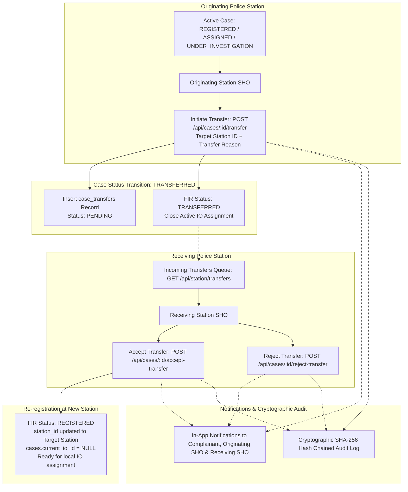

# Workflow 2: Inter-Station Case Transfer & Zero FIR Flow Implementation Guide

This guide documents the full architecture, database schema, state machine transitions, defense-in-depth guards, and step-by-step code implementation for **Workflow 2: Inter-Station Case Transfer & Zero FIR Flow** (Functional Requirements FR-C5, FR-M6, PROJECT_CONTEXT.md §2, §5.4, §6.4, §7.2, §10.1, §12.2).

---

## 1. System Contract & Architecture Blueprint



### A. State Machine Transition Specification (§6.4)
| From State | To State | Trigger | Actor Role | Guard Conditions | Side Effects |
|---|---|---|---|---|---|
| `REGISTERED`, `ASSIGNED`, or `UNDER_INVESTIGATION` | `TRANSFERRED` | Originating SHO initiates case transfer | `SHO` (originating station), `SUPERVISOR` | Target station must exist, be active, and `target_station_id != current_station_id` | Status becomes `TRANSFERRED`; closes active IO assignment in `case_assignments`; creates pending record in `case_transfers`; notifies receiving station SHO; logs audit trail |
| `TRANSFERRED` | `REGISTERED` | Receiving SHO accepts case transfer | `SHO` (receiving station), `SUPERVISOR` | Caller's station must match `to_station_id`; transfer must be `PENDING` | `fir.station_id` updated to receiving station; `cases.current_io_id` set to `NULL`; `case_transfers` updated to `ACCEPTED`; status returns to `REGISTERED`; complainant and originating station notified; audit logged |
| `TRANSFERRED` | Previous state (`REGISTERED` / `UNDER_INVESTIGATION`) | Receiving SHO rejects transfer | `SHO` (receiving station), `SUPERVISOR` | Caller's station must match `to_station_id`; mandatory rejection reason | Status reverts to pre-transfer state at originating station; `case_transfers` set to `REJECTED`; originating SHO notified |

---

## 2. Core Architectural Guarantees & Defense-in-Depth Guards

1. **Station Jurisdiction & Self-Transfer Guard:**  
   An SHO can only transfer cases currently residing at their station (`fir.station_id === req.user.stationId`). Transferring a case to the same station (`toStationId === currentStationId`) is strictly forbidden and rejected with `400 Bad Request`.
2. **Active Case Lifecycle Guard:**  
   Only registered, open cases (`REGISTERED`, `ASSIGNED`, `UNDER_INVESTIGATION`) can be transferred. Unsubmitted drafts, rejected complaints, closed cases, or cases awaiting report approval (`PENDING_APPROVAL`, `CHARGESHEET_FILED`, `CLOSED`) cannot be transferred.
3. **Single Active Transfer Guard:**  
   If a case already has a `PENDING` transfer in `case_transfers`, subsequent transfer attempts return `409 Conflict`.
4. **Receiving Station Authority Guard:**  
   Only the SHO of the target receiving station (`to_station_id === req.user.stationId`) or a district `SUPERVISOR` can accept or reject an incoming transfer. Officers from other stations are blocked with `403 Forbidden`.
5. **Atomic State & Assignment Reset:**  
   Upon transfer initiation, any active IO assignment in `case_assignments` is automatically end-dated (`to_ts = now()`). When accepted, `fir.station_id` is updated atomically, `cases.current_io_id` is cleared, and status transitions to `REGISTERED`, allowing the new SHO to assign a local officer.
6. **Append-Only Tamper-Evident Auditing:**  
   Every transfer action (`CASE_TRANSFERRED`, `CASE_TRANSFER_ACCEPTED`, `CASE_TRANSFER_REJECTED`) is cryptographically hash-chained into `audit_log`.

---

## 3. Database Schema (`09_case_transfer_schema.sql`)

### Tables Created & Permissions Configured:
1. **`case_transfers`**: Tracks inter-station transfer proposals, originating and target stations, transfer reasons, resolution decisions, and supervisory remarks.
2. **`state_transitions`**: Seeds transitions:
   - `REGISTERED -> TRANSFERRED` (`case:transfer`)
   - `ASSIGNED -> TRANSFERRED` (`case:transfer`)
   - `UNDER_INVESTIGATION -> TRANSFERRED` (`case:transfer`)
   - `TRANSFERRED -> REGISTERED` (`case:accept_transfer`)
3. **Permissions**: Maps `case:transfer` and `case:accept_transfer` to `SHO`, `SUPERVISOR`, and `ADMIN`.

```sql
CREATE TABLE IF NOT EXISTS case_transfers (
  transfer_id BIGSERIAL PRIMARY KEY,
  case_id BIGINT NOT NULL REFERENCES cases(case_id) ON DELETE CASCADE,
  fir_id BIGINT NOT NULL REFERENCES fir(fir_id) ON DELETE CASCADE,
  from_station_id INT NOT NULL REFERENCES police_stations(station_id) ON DELETE RESTRICT,
  to_station_id INT NOT NULL REFERENCES police_stations(station_id) ON DELETE RESTRICT,
  transferred_by BIGINT NOT NULL REFERENCES users(user_id) ON DELETE RESTRICT,
  transfer_reason TEXT NOT NULL,
  status VARCHAR(20) NOT NULL DEFAULT 'PENDING' CHECK (status IN ('PENDING', 'ACCEPTED', 'REJECTED')),
  previous_status fir_status NOT NULL,
  accepted_by BIGINT REFERENCES users(user_id) ON DELETE SET NULL,
  resolution_remarks TEXT,
  resolved_at TIMESTAMPTZ,
  created_at TIMESTAMPTZ NOT NULL DEFAULT now(),
  updated_at TIMESTAMPTZ NOT NULL DEFAULT now()
);

CREATE INDEX IF NOT EXISTS idx_transfers_case ON case_transfers(case_id);
CREATE INDEX IF NOT EXISTS idx_transfers_to_station ON case_transfers(to_station_id, status);
CREATE INDEX IF NOT EXISTS idx_transfers_from_station ON case_transfers(from_station_id);
```

---

## 4. REST API Specification

| Method | Endpoint | Allowed Roles | Description |
|---|---|---|---|
| `POST` | `/api/cases/:id/transfer` | `SHO`, `SUPERVISOR` | Propose inter-station transfer for a registered case |
| `POST` | `/api/cases/:id/accept-transfer` | `SHO`, `SUPERVISOR` | Receiving station SHO accepts case transfer |
| `POST` | `/api/cases/:id/reject-transfer` | `SHO`, `SUPERVISOR` | Receiving station SHO rejects incoming transfer |
| `GET` | `/api/station/transfers` | `SHO`, `SUPERVISOR`, `ADMIN` | List incoming pending transfers for the officer's station |
| `GET` | `/api/cases/:id/transfers` | `SHO`, `SUPERVISOR`, `IO`, `ADMIN`, `CITIZEN` | View full transfer history for a case |

### Request & Response Examples

#### A. Initiate Case Transfer: `POST /api/cases/:id/transfer`
**Headers:** `Authorization: Bearer <originating_sho_token>`  
**Body:**
```json
{
  "toStationId": 2,
  "reason": "Offence occurred in North District jurisdiction (Zero FIR initial filing at Central Station)."
}
```
**Response (200 OK):**
```json
{
  "success": true,
  "message": "Case transfer initiated successfully and dispatched to target police station.",
  "data": {
    "transfer_id": 1,
    "case_id": 5,
    "fir_id": 25,
    "from_station_id": 1,
    "to_station_id": 2,
    "status": "PENDING",
    "fir_status": "TRANSFERRED"
  }
}
```

#### B. Accept Transfer: `POST /api/cases/:id/accept-transfer`
**Headers:** `Authorization: Bearer <receiving_sho_token>`  
**Body:**
```json
{
  "remarks": "Jurisdiction confirmed. Case accepted into North Police Station registry."
}
```
**Response (200 OK):**
```json
{
  "success": true,
  "message": "Case transfer accepted. Case successfully registered at receiving station awaiting IO assignment.",
  "data": {
    "transfer_id": 1,
    "case_id": 5,
    "fir_id": 25,
    "new_station_id": 2,
    "fir_status": "REGISTERED"
  }
}
```

---

## 5. Implementation Files & Step-by-Step Plan

1. **Migration File**: `src/db/migrations/09_case_transfer_schema.sql`
2. **Validator File**: `src/validators/transfer.validator.js`
3. **Service Layer**: `src/services/transfer.service.js`
4. **Controller Layer**: `src/controllers/transfer.controller.js`
5. **Route Mounting**:
   - Add routes in `src/routes/case.route.js` and `src/routes/station.route.js`
6. **Integration Test Suite**: `test/test-case-transfer-apis.js`
7. **Test Runner Update**: Add suite to `test/run-all-tests.js` and `package.json`
8. **Verification**: Run complete test suite and confirm 100% pass rate.
