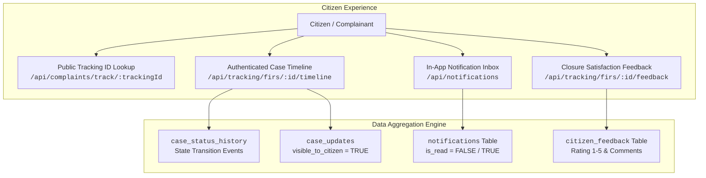

# Feature 5: Citizen Tracking, Case Timeline, Notifications & Citizen Feedback Implementation Guide

This guide documents the full architecture, database schema, chronological timeline aggregation, in-app notification engine, citizen feedback mechanisms, and step-by-step code implementation for **Feature 5: Citizen Tracking, Chronological Case Timeline, In-App Notifications & Citizen Feedback** (Functional Requirements FR-T1 to FR-T4, PROJECT_CONTEXT.md §5.6, §8.2, §12.2, §12.3).

This feature empowers citizens to track complaint/FIR progress transparently, aggregates case diary notes into an easy-to-read chronological timeline while preserving internal police confidentiality, delivers real-time in-app notifications on workflow events, and enables citizen feedback upon case closure in alignment with **SDG 16 (Peace, Justice and Strong Institutions)**.

The work is strictly divided for a **team of 2 developers** working in parallel without merge conflicts.

---

## 1. System Contract & Architecture Blueprint



### A. Core Architectural Guarantees & Security Guards
1. **Privacy & Redaction Guard for Public Tracking (FR-T1):**  
   The public tracking endpoint (`GET /api/complaints/track/:trackingId`) is accessible without authentication. It strictly redacts PII: complainant phone/email are masked, accused personal identifiers and sensitive internal investigation remarks are withheld, returning only high-level status, station name, submission timestamp, and current lifecycle phase.
2. **Citizen Ownership Guard for Authenticated Timeline (FR-T2):**  
   When retrieving detailed timelines (`GET /api/tracking/firs/:id/timeline`), citizens can only access cases where `fir.complainant_id = req.user.citizenId`. Police officers (`IO`, `SHO`, `SUPERVISOR`) can access any case within their station/jurisdiction.
3. **Internal Note Redaction Guard:**  
   Investigation progress diary updates (`case_updates`) have a `visible_to_citizen` boolean flag. Internal operational notes (`visible_to_citizen = false`) are **never** exposed to citizen API responses.
4. **Lifecycle Notification Triggers (FR-T3):**  
   Notifications are automatically generated inside single ACID transactions whenever:
   - A complaint is submitted (`SUBMITTED`).
   - Clarification is requested (`INFO_REQUESTED`).
   - A complaint is rejected (`REJECTED`) or approved (`REGISTERED`).
   - An Investigating Officer is assigned (`ASSIGNED`).
   - An IO adds a public diary progress update (`visible_to_citizen = true`).
   - A final report is filed (`CHARGESHEET_FILED` or `CLOSED`).
5. **Closure Feedback Guard (FR-T4):**  
   Feedback ratings (1 to 5 stars + qualitative remarks) can **only** be submitted if:
   - The FIR is in the `CLOSED` terminal state.
   - The actor is the verified complainant of the FIR.
   - Feedback has not already been submitted for this FIR (`UNIQUE(fir_id)`).

---

## 2. Member Responsibilities Split

| Area | Member 1: Database DDL, Notification Engine & Aggregator Services | Member 2: APIs, Request Validators & Test Suite |
|---|---|---|
| **Primary Domain** | Database DDL & Migrations, Unified Timeline Aggregation Service, Notification Dispatcher & Reader Engine, Citizen Feedback Service | Request Validators, Tracking & Timeline Controllers, Notification Controllers, Route Mounting, Automated End-to-End Test Suite |
| **Files to Implement** | 1. `src/db/migrations/05_tracking_notifications_schema.sql`<br>2. `src/services/tracking.service.js`<br>3. `src/services/notification.service.js` | 1. `src/validators/tracking.validator.js`<br>2. `src/controllers/tracking.controller.js`<br>3. `src/controllers/notification.controller.js`<br>4. `src/routes/tracking.route.js`<br>5. `src/routes/notification.route.js`<br>6. `src/app.js` (Mounting)<br>7. `src/test-tracking-notifications-apis.js` |
| **Database Tables & Features** | `notifications`, `citizen_feedback`, `case_status_history`, `case_updates`, `fir`, `cases`, `police_stations` | Route parameters, HTTP status codes, Role scoping (`CITIZEN`, `IO`, `SHO`), Unread counter badge, Sanitized public payload |

---

## 3. Database Schema (`05_tracking_notifications_schema.sql`)

### Tables & Indexes:
1. **`citizen_feedback`**: Stores citizen ratings (1 to 5) and feedback on closed cases.
2. **`notifications` Enhancement**: Adds composite partial indexes for instant unread badge counts (`WHERE is_read = FALSE`).
3. **Permissions**: Seeds `tracking:view_own`, `notifications:read`, `feedback:submit`.

```sql
-- =========================================================================
-- Migration 05: Citizen Tracking, Notifications & Feedback Schema
-- Aligns with PROJECT_CONTEXT.md §5.6 (FR-T1 to FR-T4) & §8.2
-- =========================================================================

-- 1. Ensure Notifications table exists with complete columns
CREATE TABLE IF NOT EXISTS notifications (
  notification_id BIGSERIAL PRIMARY KEY,
  user_id BIGINT NOT NULL REFERENCES users(user_id) ON DELETE CASCADE,
  fir_id BIGINT REFERENCES fir(fir_id) ON DELETE SET NULL,
  message TEXT NOT NULL,
  is_read BOOLEAN NOT NULL DEFAULT FALSE,
  created_at TIMESTAMPTZ NOT NULL DEFAULT now()
);

-- Partial index for fast notification bell icon badge count (PO1 & PO5)
CREATE INDEX IF NOT EXISTS idx_notifications_unread_user 
  ON notifications(user_id, created_at DESC) 
  WHERE is_read = FALSE;

CREATE INDEX IF NOT EXISTS idx_notifications_user_all 
  ON notifications(user_id, created_at DESC);

-- 2. Citizen Feedback Table (FR-T4)
CREATE TABLE IF NOT EXISTS citizen_feedback (
  feedback_id BIGSERIAL PRIMARY KEY,
  fir_id BIGINT UNIQUE NOT NULL REFERENCES fir(fir_id) ON DELETE CASCADE,
  citizen_id BIGINT NOT NULL REFERENCES citizens(citizen_id) ON DELETE RESTRICT,
  rating SMALLINT NOT NULL CHECK (rating BETWEEN 1 AND 5),
  comments TEXT,
  timeliness_rating SMALLINT CHECK (timeliness_rating BETWEEN 1 AND 5),
  police_conduct_rating SMALLINT CHECK (police_conduct_rating BETWEEN 1 AND 5),
  created_at TIMESTAMPTZ NOT NULL DEFAULT now()
);

CREATE INDEX IF NOT EXISTS idx_feedback_fir ON citizen_feedback(fir_id);
CREATE INDEX IF NOT EXISTS idx_feedback_citizen ON citizen_feedback(citizen_id);

-- 3. Register and Map Permissions
INSERT INTO permissions (code) VALUES
  ('notification:read'),
  ('feedback:create'),
  ('timeline:read')
ON CONFLICT (code) DO NOTHING;

INSERT INTO role_permissions (role_id, permission_id)
SELECT r.role_id, p.permission_id
FROM roles r, permissions p
WHERE r.code = 'CITIZEN'
  AND p.code IN ('notification:read', 'feedback:create', 'timeline:read')
ON CONFLICT (role_id, permission_id) DO NOTHING;

INSERT INTO role_permissions (role_id, permission_id)
SELECT r.role_id, p.permission_id
FROM roles r, permissions p
WHERE r.code IN ('DESK_OFFICER', 'IO', 'SHO', 'SUPERVISOR', 'ADMIN')
  AND p.code IN ('notification:read', 'timeline:read')
ON CONFLICT (role_id, permission_id) DO NOTHING;
```

---

## 4. API Specification & Endpoints

| Method | Endpoint | Allowed Roles | Description |
|---|---|---|---|
| `GET` | `/api/track/:trackingId` | Public (No auth required) | Redacted, safe public tracking info by tracking ID (e.g. `CMP-2026-000001`) |
| `GET` | `/api/tracking/firs/:id/timeline` | `CITIZEN`, `IO`, `SHO`, `SUPERVISOR`, `ADMIN` | Chronological unified timeline merging status transitions & public diary updates |
| `GET` | `/api/notifications` | All authenticated roles | Paginated list of notifications for the logged-in user |
| `GET` | `/api/notifications/unread-count` | All authenticated roles | Returns integer count of unread notifications for navbar bell icon |
| `PATCH` | `/api/notifications/:id/read` | All authenticated roles | Mark single notification as read |
| `PATCH` | `/api/notifications/read-all` | All authenticated roles | Mark all notifications of current user as read |
| `POST` | `/api/tracking/firs/:id/feedback` | `CITIZEN` | Submit satisfaction rating (1-5) and feedback on a `CLOSED` case |
| `GET` | `/api/tracking/firs/:id/feedback` | `CITIZEN`, `SHO`, `SUPERVISOR` | View submitted feedback for a closed case |

---

# 👤 Member 1: Database DDL, Notification Engine & Aggregator Services

## Task 1.1: Migration Execution
Create `Backend/src/db/migrations/05_tracking_notifications_schema.sql` using the schema from Section 3.

---

## Task 1.2: Notification Service
**File:** `Backend/src/services/notification.service.js`  
**Purpose:** Dispatches in-app notifications and manages read/unread status.

```javascript
const pool = require('../config/db');

/**
 * Create a new notification for a user
 */
async function createNotification({ client = null, userId, firId = null, message }) {
  const db = client || pool;
  const query = `
    INSERT INTO notifications (user_id, fir_id, message)
    VALUES ($1, $2, $3)
    RETURNING notification_id, user_id, fir_id, message, is_read, created_at;
  `;
  const result = await db.query(query, [userId, firId, message]);
  return result.rows[0];
}

/**
 * Fetch paginated notifications for the logged-in user
 */
async function getUserNotifications(userId, { unreadOnly = false, limit = 20, offset = 0 } = {}) {
  const conditions = ['user_id = $1'];
  const params = [userId];
  let paramIdx = 2;

  if (unreadOnly) {
    conditions.push('is_read = FALSE');
  }

  const query = `
    SELECT notification_id, fir_id, message, is_read, created_at
    FROM notifications
    WHERE ${conditions.join(' AND ')}
    ORDER BY created_at DESC
    LIMIT $${paramIdx++} OFFSET $${paramIdx++};
  `;
  params.push(parseInt(limit, 10), parseInt(offset, 10));

  const result = await pool.query(query, params);
  return result.rows;
}

/**
 * Fast badge count of unread notifications using partial index
 */
async function getUnreadCount(userId) {
  const query = `
    SELECT COUNT(*)::INT AS unread_count
    FROM notifications
    WHERE user_id = $1 AND is_read = FALSE;
  `;
  const result = await pool.query(query, [userId]);
  return result.rows[0]?.unread_count || 0;
}

/**
 * Mark a single notification as read (with user isolation)
 */
async function markAsRead(notificationId, userId) {
  const query = `
    UPDATE notifications
    SET is_read = TRUE
    WHERE notification_id = $1 AND user_id = $2
    RETURNING notification_id, user_id, is_read, created_at;
  `;
  const result = await pool.query(query, [notificationId, userId]);
  if (result.rows.length === 0) {
    const error = new Error('Notification not found or access denied');
    error.statusCode = 404;
    throw error;
  }
  return result.rows[0];
}

/**
 * Mark all notifications for the user as read
 */
async function markAllAsRead(userId) {
  const query = `
    UPDATE notifications
    SET is_read = TRUE
    WHERE user_id = $1 AND is_read = FALSE
    RETURNING notification_id;
  `;
  const result = await pool.query(query, [userId]);
  return { updatedCount: result.rows.length };
}

module.exports = {
  createNotification,
  getUserNotifications,
  getUnreadCount,
  markAsRead,
  markAllAsRead
};
```

---

## Task 1.3: Tracking & Chronological Timeline Aggregator Service
**File:** `Backend/src/services/tracking.service.js`  
**Purpose:** Delivers public redacted tracking, merges state history and citizen-visible case diary entries into a unified chronological timeline, and processes closure feedback.

```javascript
const pool = require('../config/db');

/**
 * Public tracking lookup by tracking_id (FR-T1)
 * Strips all PII and internal sensitive details
 */
async function getPublicTrackingInfo(trackingId) {
  const query = `
    SELECT 
      f.fir_id,
      f.tracking_id,
      f.fir_number,
      f.status,
      f.priority,
      f.incident_dt,
      f.submitted_at,
      f.registered_at,
      ps.name AS station_name,
      ps.district,
      cc.name AS crime_category
    FROM fir f
    LEFT JOIN police_stations ps ON f.station_id = ps.station_id
    LEFT JOIN crime_categories cc ON f.category_id = cc.category_id
    WHERE f.tracking_id = $1;
  `;
  const result = await pool.query(query, [trackingId]);
  if (result.rows.length === 0) {
    const error = new Error('Invalid tracking ID. No record found.');
    error.statusCode = 404;
    throw error;
  }

  const record = result.rows[0];
  return {
    trackingId: record.tracking_id,
    firNumber: record.fir_number,
    status: record.status,
    priority: record.priority,
    station: record.station_name ? `${record.station_name}, ${record.district}` : 'Zero FIR (Unassigned Station)',
    crimeCategory: record.crime_category,
    incidentDate: record.incident_dt,
    submittedAt: record.submitted_at,
    registeredAt: record.registered_at
  };
}

/**
 * Authenticated Unified Chronological Case Timeline (FR-T2)
 * Merges case_status_history and citizen-visible case_updates
 */
async function getCaseTimeline(firId, user) {
  // 1. Fetch FIR details and verify authorization
  const firRes = await pool.query(
    `SELECT f.fir_id, f.tracking_id, f.fir_number, f.status, f.complainant_id, f.station_id,
            ps.name AS station_name,
            c.case_id, c.investigation_started_at, c.outcome, c.closed_at,
            o.full_name AS io_name, o.rank AS io_rank, o.badge_no AS io_badge
     FROM fir f
     LEFT JOIN police_stations ps ON f.station_id = ps.station_id
     LEFT JOIN cases c ON f.fir_id = c.fir_id
     LEFT JOIN officers o ON c.current_io_id = o.officer_id
     WHERE f.fir_id = $1`,
    [firId]
  );

  if (firRes.rows.length === 0) {
    const error = new Error('FIR record not found');
    error.statusCode = 404;
    throw error;
  }

  const fir = firRes.rows[0];

  // Citizen scope check: citizen must be the complainant
  if (user.role === 'CITIZEN' && fir.complainant_id !== user.citizenId) {
    const error = new Error('Forbidden: You can only view timeline for your own complaints');
    error.statusCode = 403;
    throw error;
  }

  // Station scope check for DESK_OFFICER and SHO
  if (['DESK_OFFICER', 'SHO'].includes(user.role) && user.stationId && fir.station_id !== user.stationId) {
    const error = new Error('Forbidden: Case belongs to another police station');
    error.statusCode = 403;
    throw error;
  }

  // 2. Fetch State Transition History
  const historyRes = await pool.query(
    `SELECT 
       csh.history_id,
       csh.from_state,
       csh.to_state,
       csh.note,
       csh.created_at,
       u.email AS actor_email,
       r.code AS actor_role
     FROM case_status_history csh
     JOIN users u ON csh.actor_id = u.user_id
     JOIN roles r ON u.role_id = r.role_id
     WHERE csh.fir_id = $1
     ORDER BY csh.created_at ASC`,
    [firId]
  );

  // 3. Fetch Case Diary Updates (filter visible_to_citizen for citizens)
  let updatesQuery = `
    SELECT 
      cu.update_id,
      cu.update_type,
      cu.body,
      cu.visible_to_citizen,
      cu.created_at,
      o.full_name AS officer_name,
      o.rank AS officer_rank
    FROM case_updates cu
    JOIN officers o ON cu.officer_id = o.officer_id
    WHERE cu.case_id = $1
  `;
  if (user.role === 'CITIZEN') {
    updatesQuery += ` AND cu.visible_to_citizen = TRUE`;
  }
  updatesQuery += ` ORDER BY cu.created_at ASC`;

  const updatesRes = fir.case_id ? await pool.query(updatesQuery, [fir.case_id]) : { rows: [] };

  // 4. Merge events into a single chronological array
  const events = [];

  historyRes.rows.forEach(h => {
    events.push({
      eventType: 'STATUS_CHANGE',
      timestamp: h.created_at,
      title: `Status changed to ${h.to_state}`,
      description: h.note || `Transition from ${h.from_state || 'INITIAL'} to ${h.to_state}`,
      fromState: h.from_state,
      toState: h.to_state,
      actor: user.role === 'CITIZEN' ? 'Police Administration' : `${h.actor_role} (${h.actor_email})`
    });
  });

  updatesRes.rows.forEach(u => {
    events.push({
      eventType: 'INVESTIGATION_UPDATE',
      timestamp: u.created_at,
      title: `Investigation Activity: ${u.update_type}`,
      description: u.body,
      officer: `${u.officer_rank} ${u.officer_name}`,
      isInternal: !u.visible_to_citizen
    });
  });

  // Sort chronological ascending
  events.sort((a, b) => new Date(a.timestamp) - new Date(b.timestamp));

  return {
    firId: fir.fir_id,
    trackingId: fir.tracking_id,
    firNumber: fir.fir_number,
    currentStatus: fir.status,
    station: fir.station_name,
    assignedIO: fir.io_name ? `${fir.io_rank} ${fir.io_name} (Badge: ${fir.io_badge})` : 'Not yet assigned',
    outcome: fir.outcome,
    closedAt: fir.closed_at,
    totalEvents: events.length,
    timeline: events
  };
}

/**
 * Submit Citizen Feedback on Closed Case (FR-T4)
 */
async function submitCitizenFeedback(firId, citizenId, { rating, comments, timelinessRating, conductRating }) {
  // 1. Verify case exists and is in CLOSED state
  const firRes = await pool.query(
    'SELECT fir_id, complainant_id, status FROM fir WHERE fir_id = $1',
    [firId]
  );

  if (firRes.rows.length === 0) {
    const error = new Error('FIR not found');
    error.statusCode = 404;
    throw error;
  }

  const fir = firRes.rows[0];

  if (fir.complainant_id !== citizenId) {
    const error = new Error('Forbidden: You can only submit feedback for your own cases');
    error.statusCode = 403;
    throw error;
  }

  if (fir.status !== 'CLOSED') {
    const error = new Error(`Feedback can only be submitted for CLOSED cases. Current status: ${fir.status}`);
    error.statusCode = 400;
    throw error;
  }

  // 2. Insert feedback
  const insertQuery = `
    INSERT INTO citizen_feedback (
      fir_id, citizen_id, rating, comments, timeliness_rating, police_conduct_rating
    ) VALUES ($1, $2, $3, $4, $5, $6)
    RETURNING feedback_id, fir_id, rating, comments, timeliness_rating, police_conduct_rating, created_at;
  `;

  try {
    const result = await pool.query(insertQuery, [
      firId,
      citizenId,
      rating,
      comments || null,
      timelinessRating || null,
      conductRating || null
    ]);
    return result.rows[0];
  } catch (err) {
    if (err.code === '23505') { // Unique violation
      const error = new Error('Feedback has already been submitted for this case');
      error.statusCode = 409;
      throw error;
    }
    throw err;
  }
}

/**
 * Get feedback for an FIR
 */
async function getCaseFeedback(firId) {
  const query = `
    SELECT cf.*, c.full_name AS complainant_name
    FROM citizen_feedback cf
    JOIN citizens c ON cf.citizen_id = c.citizen_id
    WHERE cf.fir_id = $1;
  `;
  const result = await pool.query(query, [firId]);
  return result.rows[0] || null;
}

module.exports = {
  getPublicTrackingInfo,
  getCaseTimeline,
  submitCitizenFeedback,
  getCaseFeedback
};
```

---

# 👤 Member 2: APIs, Request Validators & Test Suite

## Task 2.1: Request Validators
**File:** `Backend/src/validators/tracking.validator.js`

```javascript
function validateFeedbackInput(req, res, next) {
  const { rating, comments, timelinessRating, conductRating } = req.body;

  if (rating === undefined || rating === null) {
    return res.status(400).json({
      success: false,
      message: 'Overall rating is required (1 to 5)'
    });
  }

  const numRating = parseInt(rating, 10);
  if (isNaN(numRating) || numRating < 1 || numRating > 5) {
    return res.status(400).json({
      success: false,
      message: 'Rating must be an integer between 1 and 5'
    });
  }

  if (timelinessRating !== undefined) {
    const t = parseInt(timelinessRating, 10);
    if (isNaN(t) || t < 1 || t > 5) {
      return res.status(400).json({
        success: false,
        message: 'timelinessRating must be between 1 and 5'
      });
    }
  }

  if (conductRating !== undefined) {
    const c = parseInt(conductRating, 10);
    if (isNaN(c) || c < 1 || c > 5) {
      return res.status(400).json({
        success: false,
        message: 'conductRating must be between 1 and 5'
      });
    }
  }

  next();
}

module.exports = {
  validateFeedbackInput
};
```

---

## Task 2.2: Tracking & Timeline Controller
**File:** `Backend/src/controllers/tracking.controller.js`

```javascript
const trackingService = require('../services/tracking.service');

async function trackPublic(req, res, next) {
  try {
    const { trackingId } = req.params;
    const data = await trackingService.getPublicTrackingInfo(trackingId);
    return res.status(200).json({
      success: true,
      data
    });
  } catch (error) {
    next(error);
  }
}

async function getTimeline(req, res, next) {
  try {
    const { id } = req.params;
    const timeline = await trackingService.getCaseTimeline(parseInt(id, 10), req.user);
    return res.status(200).json({
      success: true,
      data: timeline
    });
  } catch (error) {
    next(error);
  }
}

async function postFeedback(req, res, next) {
  try {
    const { id } = req.params;
    const feedback = await trackingService.submitCitizenFeedback(
      parseInt(id, 10),
      req.user.citizenId,
      req.body
    );
    return res.status(201).json({
      success: true,
      message: 'Feedback submitted successfully. Thank you for helping improve police services.',
      data: feedback
    });
  } catch (error) {
    next(error);
  }
}

async function getFeedback(req, res, next) {
  try {
    const { id } = req.params;
    const feedback = await trackingService.getCaseFeedback(parseInt(id, 10));
    if (!feedback) {
      return res.status(404).json({
        success: false,
        message: 'No feedback found for this case'
      });
    }
    return res.status(200).json({
      success: true,
      data: feedback
    });
  } catch (error) {
    next(error);
  }
}

module.exports = {
  trackPublic,
  getTimeline,
  postFeedback,
  getFeedback
};
```

---

## Task 2.3: Notification Controller
**File:** `Backend/src/controllers/notification.controller.js`

```javascript
const notificationService = require('../services/notification.service');

async function getNotifications(req, res, next) {
  try {
    const { unreadOnly, limit, offset } = req.query;
    const notifications = await notificationService.getUserNotifications(req.user.userId, {
      unreadOnly: unreadOnly === 'true',
      limit,
      offset
    });
    return res.status(200).json({
      success: true,
      count: notifications.length,
      data: notifications
    });
  } catch (error) {
    next(error);
  }
}

async function getUnreadCount(req, res, next) {
  try {
    const count = await notificationService.getUnreadCount(req.user.userId);
    return res.status(200).json({
      success: true,
      unreadCount: count
    });
  } catch (error) {
    next(error);
  }
}

async function markRead(req, res, next) {
  try {
    const { id } = req.params;
    const notification = await notificationService.markAsRead(parseInt(id, 10), req.user.userId);
    return res.status(200).json({
      success: true,
      data: notification
    });
  } catch (error) {
    next(error);
  }
}

async function markAllRead(req, res, next) {
  try {
    const result = await notificationService.markAllAsRead(req.user.userId);
    return res.status(200).json({
      success: true,
      message: 'All notifications marked as read',
      ...result
    });
  } catch (error) {
    next(error);
  }
}

module.exports = {
  getNotifications,
  getUnreadCount,
  markRead,
  markAllRead
};
```

---

## Task 2.4: Routes & App Mounting
**File:** `Backend/src/routes/tracking.route.js`

```javascript
const express = require('express');
const router = express.Router();
const trackingController = require('../controllers/tracking.controller');
const { authenticateToken } = require('../middlewares/auth.middleware');
const { requireRoles } = require('../middlewares/rbac.middleware');
const { validateFeedbackInput } = require('../validators/tracking.validator');

// Public tracking (no auth required)
router.get('/track/:trackingId', trackingController.trackPublic);

// Authenticated timeline lookup
router.get('/firs/:id/timeline', authenticateToken, trackingController.getTimeline);

// Citizen feedback on closed cases
router.post(
  '/firs/:id/feedback',
  authenticateToken,
  requireRoles('CITIZEN'),
  validateFeedbackInput,
  trackingController.postFeedback
);

router.get(
  '/firs/:id/feedback',
  authenticateToken,
  requireRoles('CITIZEN', 'SHO', 'SUPERVISOR', 'ADMIN'),
  trackingController.getFeedback
);

module.exports = router;
```

**File:** `Backend/src/routes/notification.route.js`

```javascript
const express = require('express');
const router = express.Router();
const notificationController = require('../controllers/notification.controller');
const { authenticateToken } = require('../middlewares/auth.middleware');

router.use(authenticateToken);

router.get('/', notificationController.getNotifications);
router.get('/unread-count', notificationController.getUnreadCount);
router.patch('/:id/read', notificationController.markRead);
router.patch('/read-all', notificationController.markAllRead);

module.exports = router;
```

Mount both in `Backend/src/app.js`:
```javascript
const trackingRoutes = require('./routes/tracking.route');
const notificationRoutes = require('./routes/notification.route');

app.use('/api/tracking', trackingRoutes);
app.use('/api/notifications', notificationRoutes);
```

---

## 5. Automated Verification Test Suite

Add script to `Backend/package.json`:
```json
"test:tracking": "node src/test-tracking-notifications-apis.js"
```

The automated test script validates:
1. Public Tracking Lookup with valid tracking ID.
2. Safe Redaction (Verifying no complainant phone/email or accused sensitive notes are leaked).
3. Chronological Case Timeline generation merging status history and public case diary updates.
4. Confidentiality Guard: Verifying that internal police diary notes (`visible_to_citizen = false`) are concealed from citizens.
5. In-App Notification retrieval and unread count badge.
6. Marking individual and all notifications as read.
7. Closure Feedback Submission on a `CLOSED` case.
8. Feedback Rejection on non-closed cases (validation guard test).
9. Duplicate feedback rejection (`409 Conflict`).

Execute test suite:
```bash
npm run test:tracking
```
