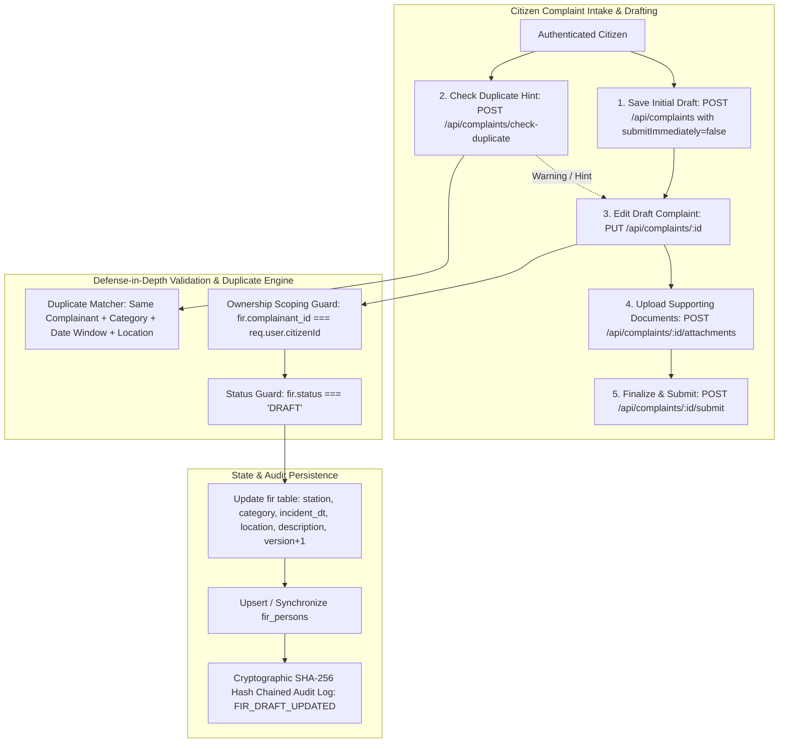

# Workflow 4: Draft Complaint Editing & Duplicate Detection Hint Implementation Guide

This guide documents the full architecture, database interaction, security scoping guards, and step-by-step implementation for **Workflow 4: Draft Complaint Editing & Duplicate Detection Hint** (Functional Requirements FR-C3, FR-C4, PROJECT_CONTEXT.md §5.2, §6.2, §6.4, §10.1, §12.2).

---

## 1. System Contract & Architecture Blueprint



---

## 2. Core Architectural Guarantees & Defense-in-Depth Guards

1. **Strict Draft-Only Mutability Guard (`FR-C3`):**  
   Once a complaint is submitted (`SUBMITTED`, `UNDER_REVIEW`, `REGISTERED`, etc.), its core incident particulars are legally sealed to prevent post-submission evidence tampering. Only complaints in `DRAFT` status can be edited via `PUT /api/complaints/:id`. Attempts to edit submitted or registered complaints return `400 Bad Request`.
2. **Citizen Ownership Scoping Guard:**  
   A citizen can only view, edit, check duplicates for, or submit complaints where `fir.complainant_id === req.user.citizenId`. Attempting to access another citizen's draft returns `403 Forbidden`.
3. **Optimistic Locking & Concurrency Guard:**  
   Updating a draft verifies the record version and increments `version = version + 1` with `updated_at = now()` to guard against concurrent overwrites across multiple browser tabs.
4. **Intelligent Duplicate Detection Hint (`FR-C4`):**  
   The duplicate detection engine identifies potential duplicate filings using a multi-attribute correlation query:
   - Identical Complainant (`complainant_id`)
   - Identical Crime Category (`category_id`)
   - Same Incident Date Window (`ABS(EXTRACT(EPOCH FROM (incident_dt - $date))) <= 86400` seconds / 24 hours)
   - Matching or substring location text (`location_text ILIKE ...`)
   - Non-terminal / Active Status (excludes complaints previously marked `REJECTED`)  
   The engine returns a proactive warning payload `{ hasDuplicate: boolean, count: number, matchedComplaints: [...] }` both via dedicated endpoint `POST /api/complaints/check-duplicate` and as metadata in draft update responses.
5. **Persons Linked Synchronization:**  
   Updating a draft allows updating/replacing linked persons (accused, witnesses, victims) atomically within the same PostgreSQL transaction (`BEGIN`/`COMMIT`/`ROLLBACK`).
6. **Append-Only Tamper-Evident Auditing:**  
   Draft updates are recorded in `audit_log` with action `FIR_DRAFT_UPDATED` and incorporated into the SHA-256 cryptographic hash chain.

---

## 3. REST API Specification

| Method | Endpoint | Allowed Roles | Description |
|---|---|---|---|
| `PUT` | `/api/complaints/:id` | `CITIZEN` | Update an existing draft complaint and its linked persons |
| `POST` | `/api/complaints/check-duplicate` | `CITIZEN` | Check if an incident matches any previously filed complaints |

### Request & Response Examples

#### A. Edit Draft Complaint: `PUT /api/complaints/:id`
**Headers:** `Authorization: Bearer <citizen_token>`  
**Body:**
```json
{
  "stationId": 1,
  "categoryId": 2,
  "incidentDt": "2026-10-22T21:30:00Z",
  "locationText": "Central Market, Sector 17, Shop 42",
  "latitude": 28.6139,
  "longitude": 77.2090,
  "descriptionText": "Revised description: Two unidentified persons snatched handbag containing gold chain and cash.",
  "priority": 1,
  "persons": [
    {
      "personRole": "ACCUSED",
      "fullName": "Unknown Person wearing red jacket",
      "notes": "Fled on black motorcycle"
    },
    {
      "personRole": "WITNESS",
      "fullName": "Ramesh Kumar (Shopkeeper)",
      "contact": "9811223344"
    }
  ]
}
```
**Response (200 OK):**
```json
{
  "success": true,
  "message": "Draft complaint updated successfully.",
  "data": {
    "fir_id": 14,
    "status": "DRAFT",
    "version": 2,
    "station_id": 1,
    "category_id": 2,
    "location_text": "Central Market, Sector 17, Shop 42",
    "description": "Revised description: Two unidentified persons...",
    "persons_count": 2,
    "duplicateHint": {
      "hasDuplicate": false,
      "count": 0,
      "matches": []
    }
  }
}
```

#### B. Check Duplicate Hint: `POST /api/complaints/check-duplicate`
**Headers:** `Authorization: Bearer <citizen_token>`  
**Body:**
```json
{
  "categoryId": 2,
  "incidentDt": "2026-10-22T21:00:00Z",
  "locationText": "Central Market"
}
```
**Response (200 OK):**
```json
{
  "success": true,
  "data": {
    "hasDuplicate": true,
    "count": 1,
    "matches": [
      {
        "fir_id": 12,
        "tracking_id": "CMP-2026-000008",
        "status": "UNDER_REVIEW",
        "category_name": "Theft / Snatching",
        "incident_dt": "2026-10-22T21:30:00.000Z",
        "location_text": "Central Market, Sector 17",
        "created_at": "2026-10-22T22:00:00.000Z"
      }
    ],
    "message": "Notice: 1 existing complaint matching this date, category and location was found."
  }
}
```

---

## 4. Implementation Steps & Target Files

1. **Validator Enhancement**: Add `validateUpdateDraftInput` and `validateDuplicateCheckInput` in `src/validators/complaint.validator.js`.
2. **Service Layer**: Add `updateDraftComplaint` and `checkDuplicateHint` in `src/services/complaint.service.js`.
3. **Controller Layer**: Add `updateDraft` and `checkDuplicate` handlers in `src/controllers/complaint.controller.js`.
4. **Route Mounting**: Mount `PUT /:id` and `POST /check-duplicate` in `src/routes/complaint.route.js`.
5. **Integration Test Suite**: Create `test/test-complaint-draft-duplicate-apis.js` testing all validations, ownership scoping, status immutability, duplicate detection heuristics, and audit logging.
6. **Package & Suite Runner**: Add `test:complaint-draft` script to `package.json` and register suite in `test/run-all-tests.js`.
