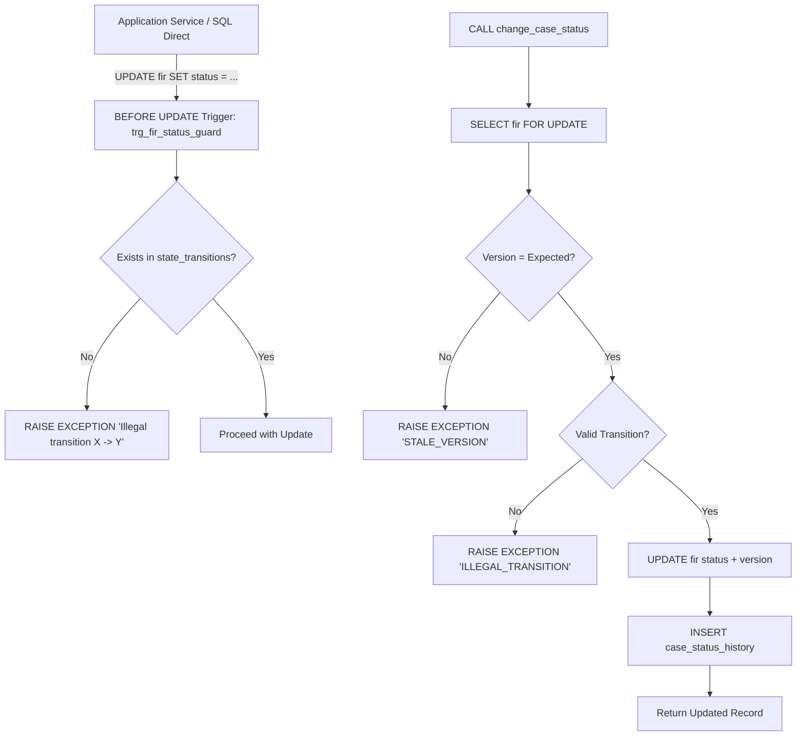

# Database Hardening, State Machine Guards & SQL Views Architecture Guide

## 1. Overview & Architectural Objectives
This document establishes the database-level enforcement mechanisms and analytical view layer for **CaseSync (FIR & Case Management System)** as mandated in **PROJECT_CONTEXT.md §6.5, §7.2, §8.5, §8.6, §11, and §13**.

In compliance with the **defense-in-depth security model**, application-level business logic is fortified with strict database triggers, stored procedures, and immutable table guards:
1. **DB-Level State Machine Guard Trigger (`trg_fir_status_guard`)**: A `BEFORE UPDATE` trigger on `fir.status` enforcing that every status change must exist within the `state_transitions` table, completely blocking direct SQL tampering or unauthorized bypasses.
2. **Append-Only Protection Triggers (`history_no_mutation`, `custody_no_mutation`)**: Ensuring that `case_status_history` and `evidence_custody_log` cannot be altered or deleted, matching the existing `trg_audit_no_mutation` on `audit_log`.
3. **Atomic State Transition Stored Procedure (`change_case_status`)**: A canonical PostgreSQL stored function executing status transitions with optimistic concurrency locking (`version`), state validity verification, and automated history recording in a single atomic transaction.
4. **Consolidated High-Performance SQL Views (§13 item 10)**:
   - `v_station_inbox`: Real-time operational triage inbox for station desk officers and SHOs.
   - `v_case_timeline`: Unified multi-source event timeline aggregating status changes, IO investigation updates, evidence custody handovers, inter-station transfers, and court outcomes.
   - `v_io_workload`: Officer performance and case load analytical view featuring `RANK()` window partitioning.
   - `v_citizen_case_summary`: Secure citizen-facing view strictly filtering out confidential internal notes and restricted police logs.
5. **Targeted Performance Indexes (§8.6)**: Adding composite and partial indexes for high-throughput station queues and active case lookups.

---

## 2. State Machine & Defense-in-Depth Enforcement (§6.5, §8.5)



### 2.1 State Guard Trigger
```sql
CREATE OR REPLACE FUNCTION trg_fir_status_guard() RETURNS trigger AS $$
BEGIN
  IF NEW.status IS DISTINCT FROM OLD.status THEN
    IF NOT EXISTS (
      SELECT 1 FROM state_transitions
      WHERE from_state = OLD.status AND to_state = NEW.status
    ) THEN
      RAISE EXCEPTION 'Illegal transition % -> %', OLD.status, NEW.status;
    END IF;
  END IF;
  RETURN NEW;
END;
$$ LANGUAGE plpgsql;

DROP TRIGGER IF EXISTS fir_status_guard ON fir;
CREATE TRIGGER fir_status_guard
BEFORE UPDATE ON fir
FOR EACH ROW EXECUTE FUNCTION trg_fir_status_guard();
```

### 2.2 Append-Only Ledger Triggers
```sql
DROP TRIGGER IF EXISTS history_no_mutation ON case_status_history;
CREATE TRIGGER history_no_mutation
BEFORE UPDATE OR DELETE ON case_status_history
FOR EACH ROW EXECUTE FUNCTION trg_block_audit_mutation();

DROP TRIGGER IF EXISTS custody_no_mutation ON evidence_custody_log;
CREATE TRIGGER custody_no_mutation
BEFORE UPDATE OR DELETE ON evidence_custody_log
FOR EACH ROW EXECUTE FUNCTION trg_block_audit_mutation();
```

---

## 3. Stored Procedure: `change_case_status` (§8.5 b, §11)

### 3.1 Function Signature
```sql
change_case_status(
  p_fir_id BIGINT,
  p_new_status fir_status,
  p_actor_id BIGINT,
  p_note TEXT DEFAULT NULL,
  p_expected_version INT DEFAULT NULL
)
RETURNS TABLE (
  fir_id BIGINT,
  status fir_status,
  version INT,
  updated_at TIMESTAMPTZ
)
```

### 3.2 Operational Guarantees
1. **Pessimistic Row Lock (`FOR UPDATE`)**: Prevents race conditions during simultaneous supervisory or officer approvals.
2. **Optimistic Locking (`version`)**: If `p_expected_version` is supplied and differs from the database `version`, execution is aborted with `STALE_VERSION`.
3. **Automated Audit Entry in `case_status_history`**: Inserts actor ID, previous state, new state, timestamp, and optional remarks into the immutable history log.
4. **Consistency**: Both the `fir` update and the `case_status_history` append occur within the exact same database transaction.

---

## 4. Analytical Views Specifications (§13 item 10)

### 4.1 Station Inbox View (`v_station_inbox`)
- **Target Audience:** Station Desk Officers, SHOs, District Supervisors.
- **Purpose:** Fast filtering and prioritization of non-terminal cases (`status NOT IN ('CLOSED', 'REJECTED')`).
- **Columns:**
  - `fir_id`, `tracking_id`, `fir_number`, `status`, `priority`, `priority_label`
  - `station_id`, `station_name`, `station_code`, `station_district`
  - `complainant_id`, `complainant_name`, `complainant_phone`
  - `incident_dt`, `location_text`, `category_name`, `submitted_at`, `registered_at`, `days_pending`
  - `case_id`, `current_io_id`, `io_name`, `io_badge`, `io_rank`
  - `legal_sections_summary` (concatenated list of acts and sections).

### 4.2 Unified Case Timeline View (`v_case_timeline`)
- **Target Audience:** Investigating Officers, SHOs, Supervisors, Citizens (for public records).
- **Purpose:** Single source of chronological events combining five core sub-systems via `UNION ALL`:
  1. `STATUS_CHANGE`: From `case_status_history` (`is_public = TRUE`).
  2. `INVESTIGATION_UPDATE`: From `case_updates` (respects `visible_to_citizen` flag).
  3. `EVIDENCE_TRANSFER`: From `evidence_custody_log` (`is_public = FALSE`).
  4. `STATION_TRANSFER`: From `case_transfers` (`is_public = TRUE`).
  5. `COURT_OUTCOME`: From `court_outcomes` (`is_public = TRUE`).

### 4.3 IO Workload & Performance View (`v_io_workload`)
- **Target Audience:** SHOs, District Supervisors, State Administrators.
- **Purpose:** Equal distribution of caseloads and accountability tracking.
- **Columns:**
  - Officer bio: `officer_id`, `officer_name`, `badge_no`, `rank`, `station_id`, `station_name`
  - Metrics: `active_cases_count`, `pending_approval_count`, `chargesheet_count`, `closed_cases_count`, `total_lifetime_cases`
  - `oldest_active_case_date`: Date of the earliest pending active case assigned to the IO.
  - `station_workload_rank`: `RANK() OVER (PARTITION BY station_id ORDER BY active_cases_count DESC)`.

### 4.4 Citizen Case Summary View (`v_citizen_case_summary`)
- **Target Audience:** Public Citizen Portal / Complainants.
- **Purpose:** Sanitized presentation of case progress without leaking internal investigative notes, suspect statements, or sensitive evidence chains.

---

## 5. Performance Indexes (§8.6)
| Index Name | Table(Columns) | Filter / Type | Purpose |
|---|---|---|---|
| `idx_fir_complainant` | `fir(complainant_id, created_at DESC)` | B-Tree | Citizen "My Complaints" list acceleration |
| `idx_fir_station_status` | `fir(station_id, status, priority DESC, submitted_at)` | B-Tree Composite | Station triage queue indexing |
| `idx_fir_active_partial` | `fir(station_id, submitted_at)` | `WHERE status IN ('SUBMITTED','UNDER_REVIEW','INFO_REQUESTED')` | Compact partial index for high-velocity review queues |
| `idx_fir_incident_dt` | `fir(incident_dt)` | B-Tree | Temporal incident reporting & analytics |
| `idx_cases_io` | `cases(current_io_id)` | B-Tree | Fast lookup for IO assigned caseloads |

---

## 6. Verification & Automated Test Strategy
The test suite `Backend/test/test-database-hardening.js` validates:
1. **Trigger Rejection**: Attempting an illegal direct SQL `UPDATE fir SET status = 'CLOSED' WHERE status = 'DRAFT'` throws `Illegal transition DRAFT -> CLOSED`.
2. **Trigger Acceptance**: Valid SQL `UPDATE` honoring `state_transitions` succeeds.
3. **Append-Only Protection**: Attempting `UPDATE` or `DELETE` on `case_status_history` or `evidence_custody_log` throws append-only exception.
4. **Stored Procedure Execution**: Calling `change_case_status` successfully transitions status, increments version, and inserts history.
5. **Optimistic Locking Conflict**: Calling `change_case_status` with an outdated `expected_version` throws `STALE_VERSION`.
6. **SQL Views Querying**: Verifying that `v_station_inbox`, `v_case_timeline`, `v_io_workload`, and `v_citizen_case_summary` return correct schema columns and calculated aggregations.
