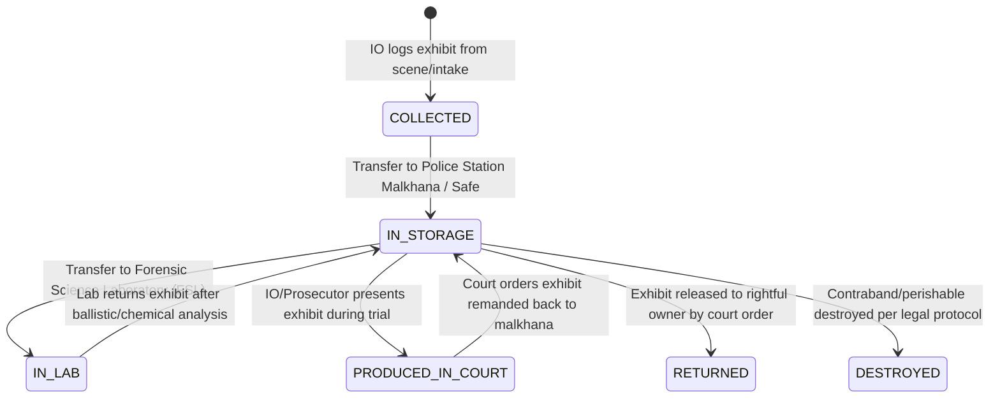

# Feature 4: Evidence Management & Chain of Custody Implementation Guide

This guide documents the full architecture, database schema, cryptographic verification, and step-by-step code implementation for **Feature 4: Evidence Management & Chain of Custody** (Functional Requirements FR-E1 to FR-E6, PROJECT_CONTEXT.md §5.5 and §8.4).

This feature manages physical, digital, biological, and weapon evidence exhibits associated with criminal cases, enforces a **tamper-evident append-only chain of custody**, and provides **cryptographic SHA-256 integrity checks** for digital assets.

The work is strictly divided for a **team of 2 developers** working in parallel without merge conflicts.

---

## 1. System Contract & Custody Lifecycle Blueprint

### A. Evidence Lifecycle & Custody Statuses (FR-E4)


### B. Business & Security Guards (Defense in Depth)
1. **Case Status Guard:** Evidence can only be logged for cases that are actively under investigation (`UNDER_INVESTIGATION`, `ASSIGNED`, `PENDING_APPROVAL`, or `REOPENED`).
2. **Investigating Officer Guard:** Only the assigned Investigating Officer (`IO`) or Station House Officer (`SHO`) has jurisdiction to log evidence for a case.
3. **Collision-Free Evidence Numbering (FR-E2):** Each evidence exhibit receives a unique sequential identifier per case: `EVD-<FIR_NUMBER_SANITIZED>-<SEQ_NUMBER>` (e.g. `EVD-FIR-CPS-01-2026-00001-01`).
4. **Append-Only Chain of Custody (FR-E3 & FR-E5):** Every physical or digital handover (from officer to officer, or officer to malkhana/lab) creates an immutable record in `evidence_custody_log`. Evidence records are never hard-deleted.
5. **Custody Transfer Guard:** Only the **current custody holder** of the exhibit (or the station SHO) has authority to transfer the evidence item to another active police officer.
6. **Cryptographic SHA-256 Integrity Verification (FR-E6):** Digital exhibits (CCTV footage, document scans, photos) are hashed with SHA-256 upon upload. An integrity verification endpoint re-computes the file hash on disk to detect file corruption or tampering.

---

## 2. Member Responsibilities Split

| Area | Member 1: Database DDL, Hashing & Evidence Core Engine | Member 2: APIs, Controllers & Testing |
|---|---|---|
| **Primary Domain** | Database DDL & Migrations, Sequential Number Generator, Cryptographic SHA-256 Hash Engine, Custody Transfer Transactions, Integrity Verifier | Request Validators, Evidence Controllers, Route Definitions & Mounting, Automated End-to-End Test Suite |
| **Files to Implement** | 1. `src/db/migrations/04_evidence_schema.sql`<br>2. `src/services/evidence.service.js` | 1. `src/validators/evidence.validator.js`<br>2. `src/controllers/evidence.controller.js`<br>3. `src/routes/evidence.route.js`<br>4. `src/routes/case.route.js` (Mounting)<br>5. `src/app.js` (Route mounting)<br>6. `src/test-evidence-apis.js` |
| **Database Tables & Features** | `evidence`, `evidence_custody_log`, `permissions`, `role_permissions`, `audit_log` | API input validation, HTTP status codes, Multer multipart handling, Role guards (`requireRoles('IO', 'SHO')`), Custody timeline API |

---

## 3. Database Schema (`04_evidence_schema.sql`)

### Tables Created:
1. **`evidence`**: Stores exhibit metadata, case association, current holder, storage location, status, and optional digital file metadata + SHA-256 checksum.
2. **`evidence_custody_log`**: Append-only audit trail recording every handover between officers/facilities with purpose and remarks.

```sql
CREATE TABLE IF NOT EXISTS evidence (
  evidence_id BIGSERIAL PRIMARY KEY,
  case_id BIGINT NOT NULL REFERENCES cases(case_id) ON DELETE CASCADE,
  evidence_no VARCHAR(60) UNIQUE NOT NULL,
  evidence_type VARCHAR(20) NOT NULL CHECK (
    evidence_type IN ('PHYSICAL', 'DIGITAL', 'DOCUMENT', 'BIOLOGICAL', 'WEAPON', 'OTHER')
  ),
  description TEXT NOT NULL,
  collected_at TIMESTAMPTZ NOT NULL DEFAULT now(),
  collected_by BIGINT NOT NULL REFERENCES officers(officer_id) ON DELETE RESTRICT,
  current_holder_id BIGINT REFERENCES officers(officer_id) ON DELETE RESTRICT,
  location_stored TEXT,
  status VARCHAR(25) NOT NULL DEFAULT 'COLLECTED' CHECK (
    status IN ('COLLECTED', 'IN_STORAGE', 'IN_LAB', 'PRODUCED_IN_COURT', 'RETURNED', 'DESTROYED')
  ),
  file_name VARCHAR(255),
  file_path TEXT,
  file_size_bytes BIGINT,
  file_sha256 CHAR(64),
  created_at TIMESTAMPTZ NOT NULL DEFAULT now(),
  updated_at TIMESTAMPTZ NOT NULL DEFAULT now()
);

CREATE TABLE IF NOT EXISTS evidence_custody_log (
  log_id BIGSERIAL PRIMARY KEY,
  evidence_id BIGINT NOT NULL REFERENCES evidence(evidence_id) ON DELETE CASCADE,
  from_holder BIGINT REFERENCES officers(officer_id) ON DELETE RESTRICT,
  to_holder BIGINT REFERENCES officers(officer_id) ON DELETE RESTRICT,
  purpose VARCHAR(120) NOT NULL,
  remarks TEXT,
  transferred_at TIMESTAMPTZ NOT NULL DEFAULT now()
);
```

---

## 4. API Specification & Endpoints

| Method | Endpoint | Allowed Roles | Description |
|---|---|---|---|
| `POST` | `/api/cases/:caseId/evidence` | `IO`, `SHO`, `ADMIN` | Log a new evidence exhibit (supports multipart file upload) |
| `GET` | `/api/cases/:caseId/evidence` | All authenticated roles | List all exhibits registered for an investigation case |
| `GET` | `/api/evidence/:id` | All authenticated roles | View exhibit details + complete chronological custody timeline |
| `POST` | `/api/evidence/:id/transfer` | `IO`, `SHO`, `ADMIN` | Transfer custody to another officer / Malkhana / Lab |
| `GET` | `/api/evidence/:id/verify` | `IO`, `SHO`, `SUPERVISOR`, `AUDITOR`, `ADMIN` | Re-hash digital file on disk & verify SHA-256 against stored hash |

---

## 5. Automated Verification

Run the automated test suite with:
```bash
npm run test:evidence
```
The test suite validates:
1. Physical exhibit registration without file attachments.
2. Digital exhibit registration with SHA-256 hash generation.
3. Cryptographic integrity verification against the file stored on disk.
4. Custody transfer from IO to Malkhana with `IN_STORAGE` status.
5. Chronological chain-of-custody retrieval.
6. Role-based access control preventing unauthorized users from transferring evidence.
