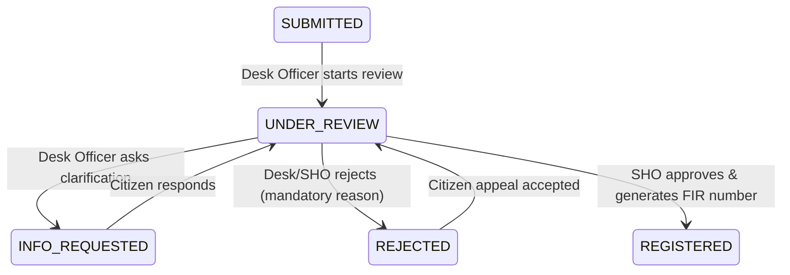

# Feature 2: Station Review, Legal Sections & SHO FIR Registration Implementation Guide

This guide documents the full architecture, database schema, state machine enforcement, and step-by-step code implementation for **Feature 2: Station Desk Review, Legal Sections & SHO FIR Registration** (Functional Requirements FR-R1 to FR-R4, FR-AD1, and Case-State Machine §6).

This feature converts submitted complaints into formally registered police FIRs and initializes investigative case files. Like the previous guides, the work is divided for a **team of 2 developers**.

---

## 1. System Contract & State Transition Blueprint

### A. State Transitions Covered in this Feature


### B. Mandatory Guard Rules for FIR Registration (Defense in Depth)
Before an FIR can transition from `UNDER_REVIEW` to `REGISTERED`:
1. **Actor Role Guard:** The actor **must** have the role of `SHO` (Station House Officer) at the matching police station.
2. **Legal Section Guard:** At least one legal section (e.g., BNS or IPC) **must** be tagged to the complaint.
3. **Cognizability Guard:** The complaint **must** be marked as a cognizable offence (`is_cognizable = true`).
4. **Atomic FIR Number Generation:** A unique station-year sequence **must** be locked and incremented in a single ACID transaction. Format:
   `FIR/<STATION_CODE>/<YEAR>/<5-DIGIT-ZERO-PADDED-SEQ>`  
   *(e.g., `FIR/CPS-01/2026/00001`)*
5. **Case File Initialization:** A new row in `cases` **must** be created atomically within the same transaction.

---

## 2. Member Responsibilities Split

| Area | Member 1: Core Engine & DB Layer | Member 2: APIs, Controllers & Testing |
|---|---|---|
| **Primary Domain** | Database DDL, Atomic Counter Service, FIR State Transition & Registration Service | Request Validators, Station Inbox & FIR Review Controller, Route Configuration, Integration Test Suite |
| **Files to Implement** | 1. `src/db/migrations/02_fir_registration_schema.sql`<br>2. `src/services/fir-counter.service.js`<br>3. `src/services/fir.service.js` | 1. `src/validators/fir.validator.js`<br>2. `src/controllers/fir.controller.js`<br>3. `src/routes/fir.route.js`<br>4. `src/app.js` (Mounting)<br>5. `src/test-fir-registration-apis.js` |
| **Database Interactions** | `legal_sections`, `fir_sections`, `fir_counters`, `cases`, `state_transitions`, atomic `SELECT ... FOR UPDATE` | Role scoping (`DESK_OFFICER`, `SHO`), Station scoping (`req.user.stationId`), Inbox filtering |

---

# 👤 Member 1: Database DDL, Atomic Counters & Registration Engine

## Task 1.1: Database Schema & Migration
**File:** `src/db/migrations/02_fir_registration_schema.sql`  
**Purpose:** Sets up legal sections, station counters, investigation case files, and transition constraints.

```sql
-- 1. Legal Sections Master Table (Bharatiya Nyaya Sanhita - BNS & IPC)
CREATE TABLE IF NOT EXISTS legal_sections (
  section_id SERIAL PRIMARY KEY,
  act VARCHAR(20) NOT NULL,             -- 'BNS', 'IPC', 'IT_ACT'
  section_no VARCHAR(20) NOT NULL,
  title VARCHAR(200) NOT NULL,
  is_cognizable BOOLEAN NOT NULL DEFAULT TRUE,
  is_bailable BOOLEAN DEFAULT FALSE,
  description TEXT,
  UNIQUE (act, section_no)
);

-- Seed common BNS & IPC sections
INSERT INTO legal_sections (act, section_no, title, is_cognizable, is_bailable) VALUES
  ('BNS', '303(2)', 'Theft', TRUE, FALSE),
  ('BNS', '318', 'Cheating and dishonestly inducing delivery of property', TRUE, TRUE),
  ('BNS', '115(2)', 'Voluntarily causing hurt', TRUE, TRUE),
  ('IT_ACT', '66C', 'Identity Theft', TRUE, TRUE),
  ('IT_ACT', '66D', 'Cheating by personation using computer resource', TRUE, FALSE)
ON CONFLICT (act, section_no) DO NOTHING;

-- 2. FIR Legal Sections Bridge Table
CREATE TABLE IF NOT EXISTS fir_sections (
  fir_id BIGINT REFERENCES fir(fir_id) ON DELETE CASCADE,
  section_id INT REFERENCES legal_sections(section_id) ON DELETE RESTRICT,
  PRIMARY KEY (fir_id, section_id)
);

-- 3. Investigation Cases Table (1:1 with Registered FIR)
CREATE TABLE IF NOT EXISTS cases (
  case_id BIGSERIAL PRIMARY KEY,
  fir_id BIGINT UNIQUE NOT NULL REFERENCES fir(fir_id) ON DELETE RESTRICT,
  current_io_id BIGINT REFERENCES officers(officer_id) ON DELETE SET NULL,
  investigation_started_at TIMESTAMPTZ,
  report_type VARCHAR(15) CHECK (report_type IN ('CHARGESHEET','CLOSURE')),
  outcome TEXT,
  closed_at TIMESTAMPTZ,
  created_at TIMESTAMPTZ NOT NULL DEFAULT now()
);

-- 4. Station Year Sequence Counters for Concurrency Safety
CREATE TABLE IF NOT EXISTS fir_counters (
  station_id INT NOT NULL REFERENCES police_stations(station_id) ON DELETE CASCADE,
  year INT NOT NULL,
  last_seq INT NOT NULL DEFAULT 0,
  PRIMARY KEY (station_id, year)
);

-- 5. State Transitions Configuration Table
CREATE TABLE IF NOT EXISTS state_transitions (
  from_state fir_status NOT NULL,
  to_state fir_status NOT NULL,
  required_permission VARCHAR(60) NOT NULL,
  PRIMARY KEY (from_state, to_state)
);

-- Seed valid transitions for intake & registration
INSERT INTO state_transitions (from_state, to_state, required_permission) VALUES
  ('DRAFT', 'SUBMITTED', 'fir:create'),
  ('SUBMITTED', 'UNDER_REVIEW', 'fir:review'),
  ('UNDER_REVIEW', 'INFO_REQUESTED', 'fir:review'),
  ('INFO_REQUESTED', 'UNDER_REVIEW', 'fir:respond'),
  ('UNDER_REVIEW', 'REJECTED', 'fir:reject'),
  ('REJECTED', 'UNDER_REVIEW', 'fir:appeal'),
  ('UNDER_REVIEW', 'REGISTERED', 'fir:register')
ON CONFLICT (from_state, to_state) DO NOTHING;
```

---

## Task 1.2: Atomic FIR Counter Service
**File:** `src/services/fir-counter.service.js`  
**Purpose:** Atomically locks the station counter row for the current year to generate guaranteed non-colliding, sequential FIR numbers under high concurrency.

```javascript
/**
 * Atomically generates next sequential FIR Number for a police station
 * Format: FIR/<STATION_CODE>/<YYYY>/<00001>
 *
 * @param {object} client - pg pool client with an active transaction
 * @param {number} stationId
 * @returns {Promise<string>} Generated FIR number
 */
async function generateNextFirNumber(client, stationId) {
  const currentYear = new Date().getFullYear();

  // 1. Fetch station code
  const stationRes = await client.query(
    'SELECT code FROM police_stations WHERE station_id = $1',
    [stationId]
  );

  if (stationRes.rows.length === 0) {
    throw new Error(`Police station with ID ${stationId} does not exist.`);
  }

  const stationCode = stationRes.rows[0].code;

  // 2. Atomic UPSERT with row lock
  const counterRes = await client.query(
    `INSERT INTO fir_counters (station_id, year, last_seq)
     VALUES ($1, $2, 1)
     ON CONFLICT (station_id, year)
     DO UPDATE SET last_seq = fir_counters.last_seq + 1
     RETURNING last_seq;`,
    [stationId, currentYear]
  );

  const seq = counterRes.rows[0].last_seq;
  const paddedSeq = String(seq).padStart(5, '0');

  return `FIR/${stationCode}/${currentYear}/${paddedSeq}`;
}

module.exports = {
  generateNextFirNumber
};
```

---

## Task 1.3: FIR Review & Registration Service
**File:** `src/services/fir.service.js`  
**Purpose:** Executes review transitions, sections tagging, and SHO approval within ACID transactions.

```javascript
const pool = require('../config/db');
const { generateNextFirNumber } = require('./fir-counter.service');
const { logAuditEvent } = require('./audit.service');

/**
 * 1. Start review of a submitted complaint (SUBMITTED -> UNDER_REVIEW)
 */
async function startReview({ firId, officerId, userId, stationId, ipAddress }) {
  const client = await pool.connect();
  try {
    await client.query('BEGIN');

    const checkRes = await client.query(
      `SELECT * FROM fir WHERE fir_id = $1 FOR UPDATE`,
      [firId]
    );

    if (checkRes.rows.length === 0) {
      const err = new Error('Complaint not found.');
      err.statusCode = 404;
      throw err;
    }

    const fir = checkRes.rows[0];

    // Station check (unless Zero FIR pool where station is null)
    if (fir.station_id && fir.station_id !== stationId) {
      const err = new Error('Complaint belongs to another police station jurisdiction.');
      err.statusCode = 403;
      throw err;
    }

    if (fir.status !== 'SUBMITTED') {
      const err = new Error(`Cannot start review from status: ${fir.status}`);
      err.statusCode = 400;
      throw err;
    }

    const updateRes = await client.query(
      `UPDATE fir
       SET status = 'UNDER_REVIEW',
           station_id = COALESCE(station_id, $1),
           version = version + 1,
           updated_at = now()
       WHERE fir_id = $2
       RETURNING *;`,
      [stationId, firId]
    );

    await client.query(
      `INSERT INTO case_status_history (fir_id, from_state, to_state, actor_id, note)
       VALUES ($1, 'SUBMITTED', 'UNDER_REVIEW', $2, 'Desk officer started review')`,
      [firId, userId]
    );

    await logAuditEvent({
      actorId: userId,
      actorRole: 'DESK_OFFICER',
      action: 'FIR_REVIEW_STARTED',
      entityType: 'fir',
      entityId: firId,
      newData: { status: 'UNDER_REVIEW' },
      ipAddress
    });

    await client.query('COMMIT');
    return updateRes.rows[0];
  } catch (error) {
    await client.query('ROLLBACK');
    throw error;
  } finally {
    client.release();
  }
}

/**
 * 2. Request clarification from citizen (UNDER_REVIEW -> INFO_REQUESTED)
 */
async function requestInfo({ firId, questionText, userId, ipAddress }) {
  const client = await pool.connect();
  try {
    await client.query('BEGIN');

    const checkRes = await client.query(
      `SELECT * FROM fir WHERE fir_id = $1 FOR UPDATE`,
      [firId]
    );

    if (checkRes.rows.length === 0) {
      const err = new Error('Complaint not found.');
      err.statusCode = 404;
      throw err;
    }

    const fir = checkRes.rows[0];
    if (fir.status !== 'UNDER_REVIEW') {
      const err = new Error(`Cannot request info when complaint status is: ${fir.status}`);
      err.statusCode = 400;
      throw err;
    }

    const updateRes = await client.query(
      `UPDATE fir
       SET status = 'INFO_REQUESTED',
           version = version + 1,
           updated_at = now()
       WHERE fir_id = $1
       RETURNING *;`,
      [firId]
    );

    await client.query(
      `INSERT INTO case_status_history (fir_id, from_state, to_state, actor_id, note)
       VALUES ($1, 'UNDER_REVIEW', 'INFO_REQUESTED', $2, $3)`,
      [firId, userId, questionText]
    );

    // Notify citizen user
    const citizenUserRes = await client.query(
      `SELECT user_id FROM citizens WHERE citizen_id = $1`,
      [fir.complainant_id]
    );
    if (citizenUserRes.rows.length > 0) {
      await client.query(
        `INSERT INTO notifications (user_id, fir_id, message)
         VALUES ($1, $2, $3)`,
        [citizenUserRes.rows[0].user_id, firId, `Police station requested clarification: ${questionText}`]
      );
    }

    await logAuditEvent({
      actorId: userId,
      actorRole: 'DESK_OFFICER',
      action: 'INFO_REQUESTED',
      entityType: 'fir',
      entityId: firId,
      newData: { status: 'INFO_REQUESTED', question: questionText },
      ipAddress
    });

    await client.query('COMMIT');
    return updateRes.rows[0];
  } catch (error) {
    await client.query('ROLLBACK');
    throw error;
  } finally {
    client.release();
  }
}

/**
 * 3. Reject complaint (UNDER_REVIEW -> REJECTED)
 */
async function rejectComplaint({ firId, rejectionReason, userId, ipAddress }) {
  const client = await pool.connect();
  try {
    await client.query('BEGIN');

    const checkRes = await client.query(
      `SELECT * FROM fir WHERE fir_id = $1 FOR UPDATE`,
      [firId]
    );

    if (checkRes.rows.length === 0) {
      const err = new Error('Complaint not found.');
      err.statusCode = 404;
      throw err;
    }

    const fir = checkRes.rows[0];
    if (fir.status !== 'UNDER_REVIEW') {
      const err = new Error(`Cannot reject complaint in status: ${fir.status}`);
      err.statusCode = 400;
      throw err;
    }

    const updateRes = await client.query(
      `UPDATE fir
       SET status = 'REJECTED',
           rejection_reason = $1,
           version = version + 1,
           updated_at = now()
       WHERE fir_id = $2
       RETURNING *;`,
      [rejectionReason, firId]
    );

    await client.query(
      `INSERT INTO case_status_history (fir_id, from_state, to_state, actor_id, note)
       VALUES ($1, 'UNDER_REVIEW', 'REJECTED', $2, $3)`,
      [firId, userId, rejectionReason]
    );

    await logAuditEvent({
      actorId: userId,
      actorRole: 'DESK_OFFICER',
      action: 'FIR_REJECTED',
      entityType: 'fir',
      entityId: firId,
      newData: { status: 'REJECTED', reason: rejectionReason },
      ipAddress
    });

    await client.query('COMMIT');
    return updateRes.rows[0];
  } catch (error) {
    await client.query('ROLLBACK');
    throw error;
  } finally {
    client.release();
  }
}

/**
 * 4. Tag Legal Sections to Complaint
 */
async function tagLegalSections({ firId, sectionIds, isCognizable }) {
  const client = await pool.connect();
  try {
    await client.query('BEGIN');

    // Remove existing tagged sections
    await client.query('DELETE FROM fir_sections WHERE fir_id = $1', [firId]);

    for (const sId of sectionIds) {
      await client.query(
        'INSERT INTO fir_sections (fir_id, section_id) VALUES ($1, $2)',
        [firId, sId]
      );
    }

    if (typeof isCognizable === 'boolean') {
      await client.query('UPDATE fir SET is_cognizable = $1 WHERE fir_id = $2', [isCognizable, firId]);
    }

    await client.query('COMMIT');
    return { success: true, count: sectionIds.length };
  } catch (error) {
    await client.query('ROLLBACK');
    throw error;
  } finally {
    client.release();
  }
}

/**
 * 5. SHO Approves Registration (ACID Transaction)
 * Generates FIR number, transitions to REGISTERED, creates `cases` row
 */
async function registerFir({ firId, stationId, userId, ipAddress }) {
  const client = await pool.connect();
  try {
    await client.query('BEGIN');

    // Lock the complaint row
    const firRes = await client.query(
      `SELECT * FROM fir WHERE fir_id = $1 FOR UPDATE`,
      [firId]
    );

    if (firRes.rows.length === 0) {
      const err = new Error('Complaint record not found.');
      err.statusCode = 404;
      throw err;
    }

    const fir = firRes.rows[0];

    // Status Guard
    if (fir.status !== 'UNDER_REVIEW') {
      const err = new Error(`Only complaints in UNDER_REVIEW status can be registered. Current status: ${fir.status}`);
      err.statusCode = 400;
      throw err;
    }

    // Jurisdiction Guard
    if (fir.station_id !== stationId) {
      const err = new Error('SHO can only approve complaints assigned to their station.');
      err.statusCode = 403;
      throw err;
    }

    // Legal Sections Guard
    const secRes = await client.query(
      `SELECT COUNT(*) FROM fir_sections WHERE fir_id = $1`,
      [firId]
    );
    if (parseInt(secRes.rows[0].count, 10) === 0) {
      const err = new Error('Cannot register FIR without at least one legal section attached.');
      err.statusCode = 400;
      throw err;
    }

    // Cognizable Guard
    if (fir.is_cognizable === false) {
      const err = new Error('Non-cognizable complaints cannot be registered as an FIR (file NCR instead).');
      err.statusCode = 400;
      throw err;
    }

    // 1. Generate Atomic FIR Number
    const firNumber = await generateNextFirNumber(client, stationId);

    // 2. Update FIR row to REGISTERED
    const updateRes = await client.query(
      `UPDATE fir
       SET status = 'REGISTERED',
           fir_number = $1,
           registered_at = now(),
           version = version + 1,
           updated_at = now()
       WHERE fir_id = $2
       RETURNING *;`,
      [firNumber, firId]
    );
    const registeredFir = updateRes.rows[0];

    // 3. Initialize investigative case in `cases` table
    const caseRes = await client.query(
      `INSERT INTO cases (fir_id)
       VALUES ($1)
       RETURNING case_id;`,
      [firId]
    );
    const caseId = caseRes.rows[0].case_id;

    // 4. Record state history
    await client.query(
      `INSERT INTO case_status_history (fir_id, from_state, to_state, actor_id, note)
       VALUES ($1, 'UNDER_REVIEW', 'REGISTERED', $2, $3)`,
      [firId, userId, `FIR formally registered by SHO. FIR Number: ${firNumber}`]
    );

    // 5. Notify citizen
    const citizenUserRes = await client.query(
      `SELECT user_id FROM citizens WHERE citizen_id = $1`,
      [fir.complainant_id]
    );
    if (citizenUserRes.rows.length > 0) {
      await client.query(
        `INSERT INTO notifications (user_id, fir_id, message)
         VALUES ($1, $2, $3)`,
        [
          citizenUserRes.rows[0].user_id,
          firId,
          `Your FIR has been registered! Formal FIR Number: ${firNumber}`
        ]
      );
    }

    // 6. Audit log entry
    await logAuditEvent({
      actorId: userId,
      actorRole: 'SHO',
      action: 'FIR_REGISTERED',
      entityType: 'fir',
      entityId: firId,
      oldData: { status: 'UNDER_REVIEW' },
      newData: { status: 'REGISTERED', fir_number: firNumber, case_id: caseId },
      ipAddress
    });

    await client.query('COMMIT');

    return {
      fir: registeredFir,
      caseId
    };
  } catch (error) {
    await client.query('ROLLBACK');
    throw error;
  } finally {
    client.release();
  }
}

module.exports = {
  startReview,
  requestInfo,
  rejectComplaint,
  tagLegalSections,
  registerFir
};
```

---

# 👤 Member 2: Validators, Controller, Routes & Test Suite

## Task 2.1: Input Validator
**File:** `src/validators/fir.validator.js`  
**Purpose:** Validates payload inputs for review actions and legal sections.

```javascript
function validateRejectInput(data) {
  const errors = [];
  if (!data.rejectionReason || data.rejectionReason.trim().length < 10) {
    errors.push('Rejection reason must be at least 10 characters long.');
  }
  return { isValid: errors.length === 0, errors };
}

function validateInfoRequestInput(data) {
  const errors = [];
  if (!data.questionText || data.questionText.trim().length < 5) {
    errors.push('Question or clarification text must be at least 5 characters long.');
  }
  return { isValid: errors.length === 0, errors };
}

function validateSectionsInput(data) {
  const errors = [];
  if (!Array.isArray(data.sectionIds) || data.sectionIds.length === 0) {
    errors.push('At least one section ID must be provided in sectionIds array.');
  }
  return { isValid: errors.length === 0, errors };
}

module.exports = {
  validateRejectInput,
  validateInfoRequestInput,
  validateSectionsInput
};
```

---

## Task 2.2: FIR & Station Inbox Controller
**File:** `src/controllers/fir.controller.js`  
**Purpose:** Handles desk officer inbox queries and review state actions.

```javascript
const pool = require('../config/db');
const firService = require('../services/fir.service');
const {
  validateRejectInput,
  validateInfoRequestInput,
  validateSectionsInput
} = require('../validators/fir.validator');

/**
 * GET /api/station/inbox
 * View complaints pending for the officer's police station
 */
async function getStationInbox(req, res, next) {
  try {
    const stationId = req.user.stationId;
    const { status, priority } = req.query;

    let query = `
      SELECT f.fir_id, f.tracking_id, f.fir_number, f.status, f.priority,
             f.incident_dt, f.submitted_at, f.location_text, f.description,
             cc.name AS category_name, c.full_name AS complainant_name,
             c.contact AS complainant_phone
      FROM fir f
      LEFT JOIN crime_categories cc ON f.category_id = cc.category_id
      LEFT JOIN citizens c ON f.complainant_id = c.citizen_id
      WHERE (f.station_id = $1 OR f.station_id IS NULL)
    `;
    const params = [stationId];

    if (status) {
      params.push(status);
      query += ` AND f.status = $${params.length}`;
    } else {
      query += ` AND f.status IN ('SUBMITTED', 'UNDER_REVIEW', 'INFO_REQUESTED')`;
    }

    if (priority) {
      params.push(priority);
      query += ` AND f.priority = $${params.length}`;
    }

    query += ` ORDER BY f.priority ASC, f.submitted_at ASC`;

    const result = await pool.query(query, params);

    res.status(200).json({
      success: true,
      count: result.rows.length,
      data: result.rows
    });
  } catch (error) {
    next(error);
  }
}

/**
 * POST /api/firs/:id/review
 * Start review
 */
async function startReview(req, res, next) {
  try {
    const firId = req.params.id;
    const result = await firService.startReview({
      firId,
      officerId: req.user.officerId,
      userId: req.user.userId,
      stationId: req.user.stationId,
      ipAddress: req.ip
    });

    res.status(200).json({
      success: true,
      message: 'Complaint review started.',
      data: result
    });
  } catch (error) {
    next(error);
  }
}

/**
 * POST /api/firs/:id/request-info
 */
async function requestInfo(req, res, next) {
  try {
    const { isValid, errors } = validateInfoRequestInput(req.body);
    if (!isValid) return res.status(400).json({ success: false, errors });

    const result = await firService.requestInfo({
      firId: req.params.id,
      questionText: req.body.questionText,
      userId: req.user.userId,
      ipAddress: req.ip
    });

    res.status(200).json({
      success: true,
      message: 'Clarification request sent to citizen.',
      data: result
    });
  } catch (error) {
    next(error);
  }
}

/**
 * POST /api/firs/:id/reject
 */
async function rejectComplaint(req, res, next) {
  try {
    const { isValid, errors } = validateRejectInput(req.body);
    if (!isValid) return res.status(400).json({ success: false, errors });

    const result = await firService.rejectComplaint({
      firId: req.params.id,
      rejectionReason: req.body.rejectionReason,
      userId: req.user.userId,
      ipAddress: req.ip
    });

    res.status(200).json({
      success: true,
      message: 'Complaint rejected with stated reason.',
      data: result
    });
  } catch (error) {
    next(error);
  }
}

/**
 * POST /api/firs/:id/sections
 */
async function tagSections(req, res, next) {
  try {
    const { isValid, errors } = validateSectionsInput(req.body);
    if (!isValid) return res.status(400).json({ success: false, errors });

    const result = await firService.tagLegalSections({
      firId: req.params.id,
      sectionIds: req.body.sectionIds,
      isCognizable: req.body.isCognizable
    });

    res.status(200).json({
      success: true,
      message: 'Legal sections mapped successfully.',
      data: result
    });
  } catch (error) {
    next(error);
  }
}

/**
 * POST /api/firs/:id/register
 * Formal registration (SHO only)
 */
async function registerFir(req, res, next) {
  try {
    const result = await firService.registerFir({
      firId: req.params.id,
      stationId: req.user.stationId,
      userId: req.user.userId,
      ipAddress: req.ip
    });

    res.status(200).json({
      success: true,
      message: 'FIR formally registered and case file created.',
      data: result
    });
  } catch (error) {
    next(error);
  }
}

/**
 * GET /api/firs/master/legal-sections
 * List all available BNS/IPC legal sections
 */
async function listLegalSections(req, res, next) {
  try {
    const result = await pool.query(
      `SELECT section_id, act, section_no, title, is_cognizable, is_bailable FROM legal_sections ORDER BY act, section_no`
    );
    res.status(200).json({ success: true, data: result.rows });
  } catch (error) {
    next(error);
  }
}

module.exports = {
  getStationInbox,
  startReview,
  requestInfo,
  rejectComplaint,
  tagSections,
  registerFir,
  listLegalSections
};
```

---

## Task 2.3: Route Files
**File 1:** `src/routes/fir.route.js`
```javascript
const express = require('express');
const router = express.Router();
const firController = require('../controllers/fir.controller');
const { authenticateToken } = require('../middlewares/auth.middleware');
const { requireRoles } = require('../middlewares/rbac.middleware');

router.use(authenticateToken);

// Legal Sections Master Data (Available to all logged in officers)
router.get('/master/legal-sections', firController.listLegalSections);

// Desk Officer / SHO Review Endpoints
router.post('/:id/review', requireRoles('DESK_OFFICER', 'SHO'), firController.startReview);
router.post('/:id/request-info', requireRoles('DESK_OFFICER', 'SHO'), firController.requestInfo);
router.post('/:id/reject', requireRoles('DESK_OFFICER', 'SHO'), firController.rejectComplaint);
router.post('/:id/sections', requireRoles('DESK_OFFICER', 'SHO'), firController.tagSections);

// Formal FIR Approval (SHO ONLY)
router.post('/:id/register', requireRoles('SHO'), firController.registerFir);

module.exports = router;
```

**File 2:** `src/routes/station.route.js`
```javascript
const express = require('express');
const router = express.Router();
const firController = require('../controllers/fir.controller');
const { authenticateToken } = require('../middlewares/auth.middleware');
const { requireRoles } = require('../middlewares/rbac.middleware');

router.use(authenticateToken);
router.use(requireRoles('DESK_OFFICER', 'SHO', 'SUPERVISOR'));

// Station Review Inbox
router.get('/inbox', firController.getStationInbox);

module.exports = router;
```

---

## Task 2.4: Mount in `src/app.js`
In `src/app.js`, add:
```javascript
const firRoutes = require('./routes/fir.route');
const stationRoutes = require('./routes/station.route');

app.use('/api/firs', firRoutes);
app.use('/api/station', stationRoutes);
```

---

## Task 2.5: Automated Verification Test Suite
**File:** `src/test-fir-registration-apis.js`  
**Run via:** `node src/test-fir-registration-apis.js`

```javascript
require('dotenv').config();
const app = require('./app');

const TEST_PORT = 5003;
const BASE_URL = `http://localhost:${TEST_PORT}`;

async function runTests() {
  console.log('--- Starting FIR Review & Registration Test Suite ---\n');

  const server = app.listen(TEST_PORT);

  try {
    // 1. Login as SHO
    const shoLogin = await fetch(`${BASE_URL}/api/auth/login`, {
      method: 'POST',
      headers: { 'Content-Type': 'application/json' },
      body: JSON.stringify({
        email: 'sho.central@casesync.gov.in',
        password: 'Officer@12345'
      })
    });
    const shoData = await shoLogin.json();
    const shoToken = shoData.data?.token;
    console.log(shoToken ? '✅ SHO Login Successful' : '❌ SHO Login Failed');

    // 2. Fetch Station Inbox
    const inboxRes = await fetch(`${BASE_URL}/api/station/inbox`, {
      headers: { 'Authorization': `Bearer ${shoToken}` }
    });
    const inboxData = await inboxRes.json();
    console.log(inboxRes.status === 200
      ? `✅ Fetched Station Inbox (${inboxData.count} items found)`
      : '❌ Fetch Inbox Failed');

    // 3. Test Legal Sections Retrieval
    const secRes = await fetch(`${BASE_URL}/api/firs/master/legal-sections`, {
      headers: { 'Authorization': `Bearer ${shoToken}` }
    });
    const secData = await secRes.json();
    console.log(secRes.status === 200 && secData.data.length > 0
      ? `✅ Fetched ${secData.data.length} Legal Sections (BNS / IPC / IT Act)`
      : '❌ Fetch Legal Sections Failed');

    console.log('\n--- All Review & Registration Tests Completed! ---');
  } catch (err) {
    console.error('Test error:', err);
  } finally {
    server.close();
    process.exit(0);
  }
}

runTests();
```
