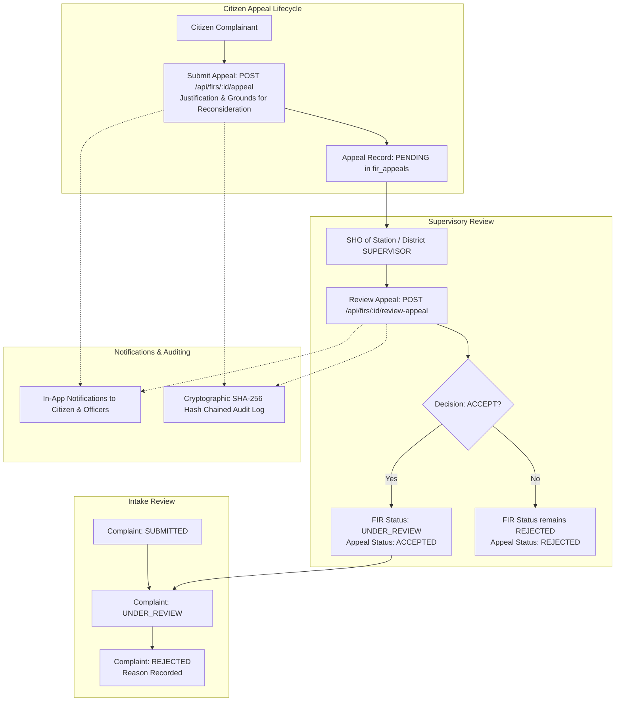

# Workflow 1: Citizen Rejection Appeal & Supervisory Review Implementation Guide

This guide documents the full architecture, database schema, state transitions, security guards, and step-by-step code implementation for **Workflow 1: Citizen Rejection Appeal & Supervisory Review** (Functional Requirements FR-R4, PROJECT_CONTEXT.md §5.3, §6.4, §7.2, §12.2).

---

## 1. System Contract & Architecture Blueprint



### A. State Machine Transition Specification (§6.4)
| From State | To State | Trigger | Actor Role | Guard Conditions | Side Effects |
|---|---|---|---|---|---|
| `UNDER_REVIEW` | `REJECTED` | Desk / SHO rejects complaint | `DESK_OFFICER`, `SHO` | Mandatory rejection reason | Citizen notified with reason |
| `REJECTED` | `REJECTED` (with `PENDING` appeal) | Citizen submits appeal | `CITIZEN` (owner) | Must be complainant; status must be `REJECTED`; no pending appeal | Inserts into `fir_appeals`; notifies SHO/Supervisor; audit logged |
| `REJECTED` | `UNDER_REVIEW` | Supervisory officer accepts appeal | `SHO`, `SUPERVISOR` | Station jurisdiction or district supervisor; appeal must be `PENDING` | FIR status set to `UNDER_REVIEW`; version incremented; status history logged; citizen notified; audit logged |

---

## 2. Core Architectural Guarantees & Defense-in-Depth Guards

1. **Complainant Ownership Guard (FR-R4):**  
   Only the citizen who originally filed the complaint (`fir.complainant_id === req.user.citizenId`) is permitted to submit an appeal. Unauthorized users receive `403 Forbidden`.
2. **Current Status Guard:**  
   Appeals can only be lodged against complaints in the `REJECTED` state. Submitting an appeal for an active (`UNDER_REVIEW`) or registered case is blocked with `400 Bad Request`.
3. **Single Pending Appeal Guard:**  
   A citizen cannot flood the queue with multiple simultaneous appeals for the same FIR. If a pending appeal already exists, further submissions return `409 Conflict`.
4. **Supervisory Review Authority Guard:**  
   Desk officers cannot rule on appeals against rejections. Only the Station House Officer (`SHO`) of the designated station or senior district oversight (`SUPERVISOR`) can review and decide on appeals.
5. **Atomic Reinstatement Transaction:**  
   When an appeal is accepted, reopening the review (`UNDER_REVIEW`), recording case status history, updating appeal metadata, generating citizen notifications, and writing the cryptographic audit entry occur within a single ACID database transaction.

---

## 3. Database Schema (`08_rejection_appeal_schema.sql`)

### Tables Created & Permissions Configured:
1. **`fir_appeals`**: Stores citizen appeal submissions, grounds for appeal, review decisions, supervisory notes, and timestamps.
2. **Indexes**: Composite and lookup indexes on `(fir_id, status)` and `created_at`.
3. **Permissions**: Maps `fir:appeal` to `CITIZEN`, `SHO`, and `SUPERVISOR`.

```sql
CREATE TABLE IF NOT EXISTS fir_appeals (
  appeal_id BIGSERIAL PRIMARY KEY,
  fir_id BIGINT NOT NULL REFERENCES fir(fir_id) ON DELETE CASCADE,
  citizen_id BIGINT NOT NULL REFERENCES citizens(citizen_id) ON DELETE RESTRICT,
  reason TEXT NOT NULL,
  status VARCHAR(20) NOT NULL DEFAULT 'PENDING' CHECK (status IN ('PENDING', 'ACCEPTED', 'REJECTED')),
  reviewed_by BIGINT REFERENCES users(user_id) ON DELETE SET NULL,
  review_notes TEXT,
  reviewed_at TIMESTAMPTZ,
  created_at TIMESTAMPTZ NOT NULL DEFAULT now(),
  updated_at TIMESTAMPTZ NOT NULL DEFAULT now()
);

CREATE INDEX IF NOT EXISTS idx_appeals_fir ON fir_appeals(fir_id);
CREATE INDEX IF NOT EXISTS idx_appeals_status ON fir_appeals(status);
CREATE INDEX IF NOT EXISTS idx_appeals_citizen ON fir_appeals(citizen_id);
```

---

## 4. REST API Specification

| Method | Endpoint | Allowed Roles | Description |
|---|---|---|---|
| `POST` | `/api/firs/:id/appeal` | `CITIZEN` | Submit an appeal against complaint rejection |
| `POST` | `/api/firs/:id/review-appeal` | `SHO`, `SUPERVISOR` | Accept or reject a pending appeal |
| `GET` | `/api/firs/:id/appeals` | `CITIZEN`, `SHO`, `SUPERVISOR`, `AUDITOR`, `ADMIN` | List all appeals filed for an FIR |
| `GET` | `/api/station/appeals` | `SHO`, `SUPERVISOR` | List pending appeals awaiting supervisory review |

### Request & Response Examples

#### A. Submit Appeal: `POST /api/firs/:id/appeal`
**Headers:** `Authorization: Bearer <citizen_token>`  
**Body:**
```json
{
  "reason": "The desk officer overlooked the timestamped CCTV screenshot showing the theft occurring within jurisdiction. Requesting reconsideration."
}
```
**Response (201 Created):**
```json
{
  "success": true,
  "message": "Appeal submitted successfully and forwarded to supervisory officers for review.",
  "data": {
    "appeal_id": 1,
    "fir_id": 25,
    "status": "PENDING",
    "reason": "The desk officer overlooked...",
    "created_at": "2026-10-23T13:10:00.000Z"
  }
}
```

#### B. Review Appeal: `POST /api/firs/:id/review-appeal`
**Headers:** `Authorization: Bearer <sho_or_supervisor_token>`  
**Body:**
```json
{
  "appealId": 1,
  "decision": "ACCEPT",
  "reviewNotes": "Reviewed supplementary proof; jurisdiction verified. Reopened for full desk review."
}
```
**Response (200 OK):**
```json
{
  "success": true,
  "message": "Appeal accepted. Complaint has been returned to UNDER_REVIEW status.",
  "data": {
    "appeal_id": 1,
    "fir_id": 25,
    "status": "ACCEPTED",
    "fir_status": "UNDER_REVIEW",
    "reviewed_at": "2026-10-23T13:12:00.000Z"
  }
}
```

---

## 5. Implementation Files & Step-by-Step Plan

1. **Migration File**: `src/db/migrations/08_rejection_appeal_schema.sql`
2. **Validator File**: `src/validators/appeal.validator.js`
3. **Service Layer**: `src/services/appeal.service.js`
4. **Controller Layer**: `src/controllers/appeal.controller.js`
5. **Route Mounting**:
   - Add routes in `src/routes/fir.route.js` and `src/routes/station.route.js`
6. **Integration Test Suite**: `test/test-rejection-appeal-apis.js`
7. **Test Runner Update**: Add suite to `test/run-all-tests.js`
8. **Verification**: Run complete test suite and confirm 100% pass rate.
