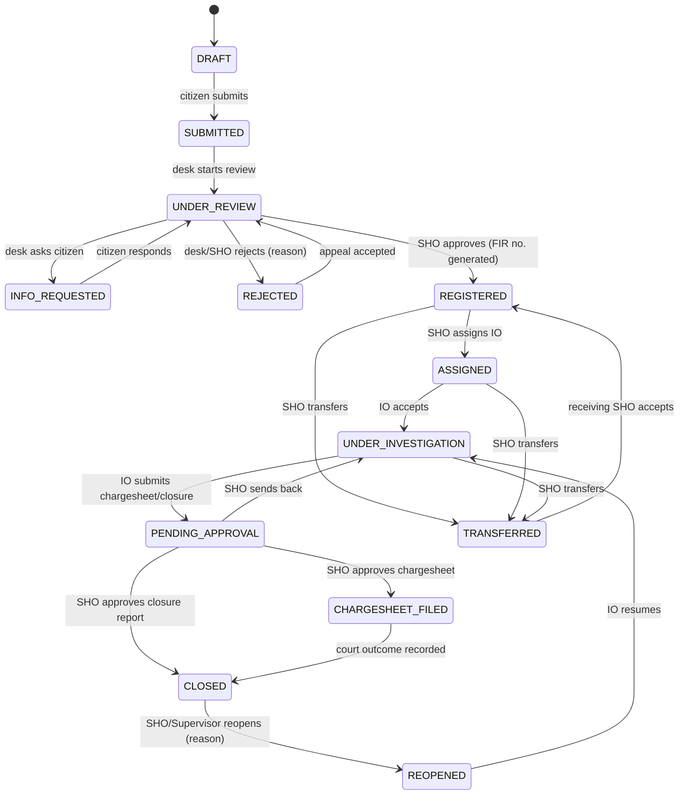

# PROJECT CONTEXT: Online FIR & Police Case Management System

> **Purpose of this file:** Single source of truth for the whole project. Paste or attach it to any AI assistant, teammate brief, or report-writing session so that all work (schema, backend, UI, testing, documentation, viva prep) stays consistent with the same workflow, vocabulary and design decisions.
>
> **Assumptions flagged in this document** are marked `[ASSUMPTION]`. Adjust them to match your course handout / faculty guidelines.

---

## 1. Project Snapshot

| Item | Detail |
|---|---|
| **Title** | Online FIR & Police Case Management |
| **One-line description** | Digitize FIR filing, case tracking, evidence logging and status updates for citizens |
| **Project type** | Database-centric full-stack application (DBMS course project) |
| **Core technical themes** | Case-state workflow, audit trail, role-based access control (RBAC), transactions, indexing |
| **Program Outcomes (POs)** | PO1, PO2, PO3, PO5, PO7, PO8, PO9, PO10, PO11 |
| **Program Specific Outcomes** | PSO1, PSO2 `[ASSUMPTION: definitions not given; see §3.3]` |
| **SDG** | **SDG 16: Peace, Justice and Strong Institutions** |
| **Domain** | Public safety / e-governance / law enforcement |

### 1.1 Problem statement
Filing a First Information Report (FIR) in person is slow, intimidating and inconsistent. Citizens often face delays, refusals to register, no visibility into progress, and lost paperwork. Inside police stations, case records, evidence and status changes are maintained manually, so accountability is weak and tampering is hard to detect.

### 1.2 Proposed solution
A web platform where:
1. Citizens file complaints/FIRs online, attach supporting files, and track status with a reference number.
2. Station staff review, register, assign and investigate cases through a **strictly enforced state machine**.
3. Investigating officers log evidence with a **chain-of-custody** trail.
4. Every important action is written to a **tamper-evident audit log**.
5. Access is controlled by **roles and permissions**, and station jurisdiction.
6. Critical multi-step operations run in **ACID transactions**; heavy queries are supported by **well-chosen indexes**.

### 1.3 Goals (what success looks like)
- G1: A citizen can submit a complaint in under 5 minutes and get a tracking ID instantly.
- G2: No case can skip or reverse a state illegally (enforced in DB, not only in UI).
- G3: Every state change, evidence action and login-sensitive action is auditable (who, what, when, from where, before/after).
- G4: Users see only what their role and station permit.
- G5: The database remains consistent under concurrent use (two officers acting on the same case).
- G6: Common queries (search by FIR no., filter by station/status/date) stay fast with indexes, proven using `EXPLAIN ANALYZE`.

### 1.4 Non-goals (out of scope)
- Real integration with CCTNS / national police databases or court systems (simulate with mock data).
- Biometric/face recognition, AI crime prediction.
- Real payment, SMS gateway or Aadhaar e-KYC (mock / simulated OTP only).
- Legal advice: the system records data, it does not decide legality.

---

## 2. Domain Primer (vocabulary the team must use consistently)

| Term | Meaning in this project |
|---|---|
| **Complaint** | Raw submission by a citizen, before police accept it. |
| **FIR (First Information Report)** | Formal record created when a complaint about a *cognizable offence* is registered by the police. Has a unique FIR number. |
| **Case** | The investigative file created from a registered FIR; moves through the workflow. |
| **Cognizable / Non-cognizable** | Cognizable: police may investigate without court order (FIR registered). Non-cognizable: typically recorded as a Non-Cognizable Report (NCR) `[simplified in this project: flag only]`. |
| **Zero FIR** | FIR filed at any station regardless of jurisdiction, then transferred. Supported via TRANSFER. |
| **Complainant** | Citizen who files. |
| **Accused / Suspect** | Person(s) named in the FIR. |
| **Witness** | Person who can give information about the incident. |
| **IO (Investigating Officer)** | Officer assigned to investigate a case. |
| **SHO (Station House Officer)** | Head of police station; approves registration, assigns IO, closes cases. |
| **Evidence / Exhibit** | Physical, digital or documentary item linked to a case. |
| **Chain of custody** | Chronological record of who held an evidence item, when, and why. |
| **Charge sheet** | Final report filed in court after investigation. |
| **Closure report** | Report stating no case could be made / untraced. |
| **Legal sections** | Offence sections invoked. Since 1 July 2024 India uses **BNS (Bharatiya Nyaya Sanhita)** replacing IPC; store `act` + `section` so both old (IPC) and new (BNS) data are possible. |

> **Disclaimer to include in the app and report:** This is an academic prototype using dummy data; it is not an official police system.

---

## 3. Alignment With Outcomes

### 3.1 Program Outcome mapping (with concrete evidence in the project)

| PO | Title | How this project demonstrates it |
|---|---|---|
| **PO1** | Engineering Knowledge | Applying DBMS fundamentals: ER modelling, normalization (3NF/BCNF), SQL, transactions (ACID), concurrency control, indexing (B-tree), triggers, views. |
| **PO2** | Problem Analysis | Analysing the FIR process gaps (delay, opacity, tampering); identifying roles, states, constraints and failure scenarios; converting into requirements. |
| **PO3** | Design/Development of Solutions | Designing schema, state machine, RBAC model, API and UI; implementing the working system. |
| **PO4** | Conduct Investigations of Complex Problems | *Not claimed* in the mapping. (Do not cite in report.) |
| **PO5** | Engineering Tool Usage | PostgreSQL/MySQL, pgAdmin/Workbench, Git/GitHub, Postman, ER tools (draw.io/dbdiagram), `EXPLAIN ANALYZE`, testing frameworks, Docker (optional). |
| **PO6** | The Engineer and The World | *Not claimed* directly (SDG link is covered via PO7/PO11 narrative; avoid over-claiming). |
| **PO7** | Ethics | Privacy of complainants/victims, data minimisation, least privilege, audit transparency, tamper-evidence, no real personal data, responsible handling of sensitive legal data. |
| **PO8** | Individual & Collaborative Teamwork | Module split among members, Git workflow, code reviews, integration testing, shared documentation. |
| **PO9** | Communication | ER diagrams, state diagrams, SRS, report, README, API docs, demo/viva presentation. |
| **PO10** | Project Finance & Management | Timeline, task breakdown, effort estimation, risk register, cost estimate (free/open-source stack, hosting cost comparison), version control milestones. |
| **PO11** | Lifelong Learning | Learning new areas independently: legal workflow of FIRs, advanced DB features (triggers, row-level security, partial indexes), security practices. |

### 3.2 SDG 16: Peace, Justice and Strong Institutions
Relevant SDG 16 targets this project supports:
- **16.3**: Promote the rule of law and ensure equal access to justice for all, *online filing lowers barriers to access.*
- **16.6**: Develop effective, accountable and transparent institutions, *audit trail and status visibility.*
- **16.7**: Responsive, inclusive, participatory decision-making, *citizen feedback / tracking.*
- **16.10**: Public access to information and protection of fundamental freedoms, *transparent case status (within privacy limits).*
- **16.5** (supporting): Reduce corruption and bribery, *immutable logs, no off-record changes.*

### 3.3 PSO1 and PSO2 `[ASSUMPTION]`
The handout lists PSO1/PSO2 without definitions. Typical for CS/IT programs:
- **PSO1:** Ability to apply software/database engineering principles to design and build reliable, secure data-driven systems.
- **PSO2:** Ability to use modern tools/platforms to develop solutions for societal/e-governance needs.

*Replace with your institute's official wording before submitting.*

---

## 4. Stakeholders and Roles

### 4.1 Roles (RBAC)

| Role code | Role | Description | Scope |
|---|---|---|---|
| `CITIZEN` | Citizen / Complainant | Files complaints, tracks own cases, uploads supporting docs, replies to info requests, gives feedback. | Own data only |
| `DESK_OFFICER` | Front-desk / Duty officer | Reviews incoming complaints, requests clarification, drafts FIR, rejects invalid/duplicate. | Own station |
| `IO` | Investigating Officer | Investigates assigned cases, adds updates, logs evidence, records accused/witnesses, requests closure/chargesheet. | Assigned cases |
| `SHO` | Station House Officer | Approves registration, assigns/reassigns IO, approves chargesheet/closure, transfers, reopens. | Own station |
| `SUPERVISOR` | Senior officer (DSP/SP) | Read-only oversight across stations in the district, reports, escalations, can reopen. | District |
| `ADMIN` | System administrator | Manages users, stations, roles, master data (categories/sections). Cannot alter case content. | System |
| `AUDITOR` | Auditor / Vigilance | Read-only access to audit logs and reports; cannot see sensitive personal details unless required. | System, read-only |

> Keep roles **data-driven** (tables), not hard-coded `if role == ...` strings, so the RBAC design is demonstrable.

### 4.2 Permission model
Permissions are `resource:action` strings, e.g. `fir:create`, `fir:read_own`, `fir:read_station`, `case:transition`, `case:assign`, `evidence:create`, `evidence:transfer`, `audit:read`, `user:manage`.

Authorization = **Role permission** AND **Scope check** (own record / own station / assigned case / district) AND **State guard** (action allowed in current state).

### 4.3 Permission matrix (summary)

| Action | CITIZEN | DESK | IO | SHO | SUPERVISOR | ADMIN | AUDITOR |
|---|:-:|:-:|:-:|:-:|:-:|:-:|:-:|
| Submit complaint | ✔ | | | | | | |
| View own complaint/FIR | ✔ | | | | | | |
| View station complaints | | ✔ | | ✔ | ✔ | | |
| Review / request info | | ✔ | | ✔ | | | |
| Register FIR | | ✔ (draft) | | ✔ (approve) | | | |
| Assign IO | | | | ✔ | | | |
| Add case update | | | ✔ | ✔ | | | |
| Log evidence | | | ✔ | ✔ | | | |
| Transfer evidence custody | | | ✔ | ✔ | | | |
| Approve chargesheet/closure | | | | ✔ | | | |
| Reopen case | | | | ✔ | ✔ | | |
| Read audit log | | | | | ✔ (district) | | ✔ |
| Manage users/master data | | | | | | ✔ | |

---

## 5. Functional Requirements

### 5.1 Authentication & accounts
- FR-A1: Citizen registration with name, phone, email, ID proof type + masked ID number `[mock]`, address.
- FR-A2: Login with password (hashed with bcrypt/argon2) + optional mock OTP.
- FR-A3: Session/JWT with expiry; lockout after repeated failures; log failed attempts.
- FR-A4: Officer accounts are created by ADMIN only (badge number, rank, station).
- FR-A5: Password reset flow (mock email token).

### 5.2 Complaint / FIR filing (Citizen)
- FR-C1: Form fields: incident date/time, location (address, district, optional lat/long), category, description, accused details (optional), witnesses (optional), property lost (optional).
- FR-C2: Attach files (images/PDF; type and size validated; stored on disk/object store; metadata + SHA-256 in DB).
- FR-C3: Draft save, then submit. On submit a **tracking ID** (e.g. `CMP-2026-000123`) is issued.
- FR-C4: Duplicate detection hint (same complainant + category + date + location).
- FR-C5: Option to file *e-Zero FIR* if jurisdiction unknown (station chosen later by desk).
- FR-C6: Acknowledgement view/PDF with disclaimer.

### 5.3 Review & registration (Desk officer / SHO)
- FR-R1: Inbox of `SUBMITTED` complaints for the station, sorted by priority/time.
- FR-R2: Actions: *Start review*, *Request more info* (citizen replies), *Reject* (reason mandatory), *Mark non-cognizable*, *Draft FIR* (assign legal sections).
- FR-R3: SHO approves → FIR number generated atomically → case created.
- FR-R4: Rejection requires reason code + text; citizen notified; citizen may appeal (creates a new review request to supervisor).

### 5.4 Case management (SHO / IO)
- FR-M1: SHO assigns IO (workload visible: active case count per officer).
- FR-M2: IO adds progress updates (typed: Statement, Site Visit, Arrest, Search, Forensic, General), with visibility flag (`internal` vs `citizen_visible`).
- FR-M3: Manage accused and witnesses linked to the FIR.
- FR-M4: State transitions strictly per §6.
- FR-M5: Reassignment keeps history of previous IO.
- FR-M6: Transfer to another station (Zero FIR flow) with SHO approval at both ends `[simplified: receiving SHO accepts]`.
- FR-M7: Priority and SLA flags (e.g. no update in 15 days → "stale" highlighted).

### 5.5 Evidence logging
- FR-E1: Add evidence: type (Physical, Digital, Document, Biological, Weapon, Other), description, where/when collected, collected by, optional file upload (hash stored).
- FR-E2: Unique evidence number per case (`EVD-<FIRNO>-<seq>`).
- FR-E3: **Chain of custody**: every handover (collected → malkhana → forensic lab → court) is an append-only record: from, to, purpose, timestamp, remarks.
- FR-E4: Evidence status: `COLLECTED, IN_STORAGE, IN_LAB, PRODUCED_IN_COURT, RETURNED, DESTROYED`.
- FR-E5: Evidence rows are never hard-deleted; corrections create new log entries.
- FR-E6: Integrity check: re-hash file and compare to stored hash.

### 5.6 Citizen tracking & communication
- FR-T1: Track by tracking ID/FIR number + logged-in ownership (or phone OTP for guest tracking `[optional]`).
- FR-T2: Timeline view of status history + citizen-visible updates.
- FR-T3: In-app notifications on status change, info request, assignment, closure.
- FR-T4: Citizen feedback/rating on closure `[optional]`.

### 5.7 Audit & reporting
- FR-U1: Append-only audit log of significant actions (§9).
- FR-U2: Auditor/Supervisor filters: user, entity, action, date range.
- FR-U3: Integrity verification endpoint for hash-chained audit log.
- FR-U4: Reports: cases by status, by category, by station; average time per state; pending > N days; IO workload; evidence by status.
- FR-U5: Export CSV/PDF (optional).

### 5.8 Administration
- FR-AD1: CRUD for stations, ranks, crime categories, legal sections.
- FR-AD2: User/role assignment; deactivate (soft) users.
- FR-AD3: Configure SLA thresholds.

---

## 6. Case-State Workflow (CORE of the project)

### 6.1 Entities that carry state
- `complaints/fir` record: pre-registration states.
- `cases`: post-registration states.
`[DESIGN CHOICE]` A **single `fir` table with one `status` column** is simpler and recommended: the same record starts as a complaint and becomes a registered FIR. (Alternative: separate `complaints` and `cases` tables. Pick one and stay consistent; the schema in §8 uses a single `fir` table plus `cases` for investigation-specific fields.)

### 6.2 States

| Code | Phase | Meaning | Terminal? |
|---|---|---|---|
| `DRAFT` | Citizen | Saved but not submitted | No |
| `SUBMITTED` | Intake | Submitted by citizen, awaiting review | No |
| `UNDER_REVIEW` | Intake | Desk officer reviewing | No |
| `INFO_REQUESTED` | Intake | Waiting for citizen clarification | No |
| `REJECTED` | Intake | Not registered (reason recorded) | Soft-terminal (appeal allowed) |
| `REGISTERED` | Registration | FIR number issued, approved by SHO | No |
| `ASSIGNED` | Investigation | IO assigned | No |
| `UNDER_INVESTIGATION` | Investigation | IO actively working | No |
| `PENDING_APPROVAL` | Closing | IO submitted chargesheet or closure report for SHO approval | No |
| `CHARGESHEET_FILED` | Court | Chargesheet filed in court | No |
| `CLOSED` | Closing | Case closed (outcome stored) | Terminal (reopen allowed by SHO/Supervisor) |
| `TRANSFERRED` | Special | Moved to another station (new owner station set; state continues there) | Pass-through |
| `REOPENED` | Special | Previously closed case reopened | No (flows back to `UNDER_INVESTIGATION`) |

### 6.3 State diagram (Mermaid)



### 6.4 Transition table (stored as DATA in `state_transitions`)

| From | To | Allowed roles | Guard conditions | Required input | Side effects |
|---|---|---|---|---|---|
| DRAFT | SUBMITTED | CITIZEN (owner) | Mandatory fields present | none | Generate tracking ID; notify station desk |
| SUBMITTED | UNDER_REVIEW | DESK_OFFICER, SHO | Same station (or Zero-FIR pool) | none | Notify citizen |
| UNDER_REVIEW | INFO_REQUESTED | DESK_OFFICER, SHO | none | Question text | Notify citizen; set SLA pause |
| INFO_REQUESTED | UNDER_REVIEW | CITIZEN (owner) | Response text provided | Response | Notify desk |
| UNDER_REVIEW | REJECTED | DESK_OFFICER, SHO | none | Reason code + text | Notify citizen |
| REJECTED | UNDER_REVIEW | SHO, SUPERVISOR | Appeal exists | Appeal decision note | Notify citizen |
| UNDER_REVIEW | REGISTERED | SHO | ≥1 legal section selected; cognizable=true | none | **Generate FIR number (atomic)**; create `cases` row |
| REGISTERED | ASSIGNED | SHO | IO active, same station | IO id | Insert assignment; notify IO & citizen |
| ASSIGNED | UNDER_INVESTIGATION | IO (assigned) | Is the assigned IO | none | Start investigation clock |
| UNDER_INVESTIGATION | PENDING_APPROVAL | IO (assigned) | ≥1 case update exists; if chargesheet then accused list non-empty | Report type + summary | Notify SHO |
| PENDING_APPROVAL | UNDER_INVESTIGATION | SHO | none | Remarks | Notify IO |
| PENDING_APPROVAL | CHARGESHEET_FILED | SHO | Report type = chargesheet | Court name, date | Notify citizen |
| PENDING_APPROVAL | CLOSED | SHO | Report type = closure | Closure reason | Notify citizen |
| CHARGESHEET_FILED | CLOSED | SHO | Outcome recorded | Outcome (convicted/acquitted/etc.) | Notify citizen |
| CLOSED | REOPENED | SHO, SUPERVISOR | none | Reason | Notify all parties |
| REOPENED | UNDER_INVESTIGATION | IO / SHO | IO assigned | none | |
| REGISTERED/ASSIGNED/UNDER_INVESTIGATION | TRANSFERRED | SHO | Target station ≠ current | Target station, reason | Custody of evidence flagged for transfer |
| TRANSFERRED | REGISTERED | SHO (receiving) | Receiving station = target | none | Station owner updated; IO cleared |

### 6.5 Enforcement strategy (defence in depth)
1. **Data-driven rules:** `state_transitions(from_state, to_state, required_permission)` table.
2. **DB-level:** a stored procedure/function `change_case_status(fir_id, new_status, actor_id, note, expected_version)` is the *only* way to change status. A `BEFORE UPDATE` trigger on `fir.status` rejects any update not present in `state_transitions` (blocks direct SQL tampering).
3. **App-level:** service layer calls the function; UI hides illegal buttons (convenience only, not security).
4. **History:** every successful transition inserts into `case_status_history` (inside the same transaction).
5. **Optimistic locking:** `version` column; update fails if `version` changed (concurrent officer actions).

---

## 7. End-to-End Workflow (Narrative)

### 7.1 Happy path
1. **Citizen registers & logs in.** Audit: `USER_REGISTERED`, `LOGIN_SUCCESS`.
2. **Citizen drafts complaint** → fills form, uploads attachments (hash computed). State `DRAFT`.
3. **Citizen submits.** In one transaction: validate → set `SUBMITTED` → generate tracking ID → insert history + audit + notification to station desk.
4. **Desk officer reviews** (`UNDER_REVIEW`). May ask for info (`INFO_REQUESTED`) → citizen answers → back to review.
5. **Desk drafts FIR:** chooses legal sections, cognizable flag, priority; may reject with reason if invalid.
6. **SHO approves** → `REGISTERED`. In one transaction: lock station-year counter → generate FIR number like `FIR/<STATIONCODE>/<YEAR>/<SEQ>` → create `cases` row → history + audit + notification.
7. **SHO assigns IO** (`ASSIGNED`); IO accepts (`UNDER_INVESTIGATION`).
8. **IO investigates:** adds updates, accused, witnesses; **logs evidence** and **transfers custody** as items move.
9. **IO submits report** (chargesheet or closure) → `PENDING_APPROVAL`.
10. **SHO decides:** send back, approve chargesheet (`CHARGESHEET_FILED`) or approve closure (`CLOSED`).
11. **Court outcome recorded** → `CLOSED`. Citizen gets notification and can give feedback.
12. **Auditor/Supervisor** run reports and verify audit-chain integrity.

### 7.2 Exception paths (must be implemented and demoed)
- **Rejection & appeal:** desk rejects with reason; citizen appeals; supervisor/SHO re-opens review.
- **Info request loop:** cycle between `UNDER_REVIEW` and `INFO_REQUESTED` with SLA pause.
- **Reassignment:** SHO reassigns IO; previous assignment end-dated; evidence custody remains until formally transferred.
- **Transfer (Zero FIR):** complaint filed at wrong station → transferred → receiving SHO accepts.
- **Reopen:** closed case reopened with justification; goes back to investigation.
- **Concurrent action conflict:** two officers act simultaneously → second gets "record changed, reload" (optimistic lock) or waits (row lock).
- **Illegal transition attempt:** direct SQL `UPDATE fir SET status='CLOSED'` blocked by trigger → audit entry `ILLEGAL_TRANSITION_BLOCKED`.
- **Unauthorized access:** citizen A requests citizen B's FIR → 403 + audit entry `ACCESS_DENIED`.

### 7.3 Sequence (Mermaid) for FIR registration

```mermaid
sequenceDiagram
    participant C as Citizen
    participant UI as Web UI
    participant API as Backend API
    participant DB as Database
    C->>UI: Fill form + attach files
    UI->>API: POST /complaints (draft)
    API->>DB: INSERT fir(status=DRAFT) + attachments
    C->>UI: Submit
    UI->>API: POST /complaints/{id}/submit
    API->>DB: BEGIN; call change_case_status(DRAFT->SUBMITTED)
    DB-->>DB: validate transition, write history, audit, notification
    DB-->>API: COMMIT, tracking_id
    API-->>UI: tracking_id
    Note over API,DB: Later, SHO approves
    API->>DB: BEGIN; lock fir_counters row; generate FIR no; create case; history; audit; COMMIT
```

---

## 8. Database Design

### 8.1 Recommended stack `[ASSUMPTION: adjust to course]`
- **Database:** PostgreSQL 15+ (best for triggers, partial indexes, row-level security, `EXPLAIN ANALYZE`). MySQL 8 is a viable alternative (syntax notes in §8.7).
- **Backend:** Python (FastAPI/Flask/Django) *or* Node.js (Express) *or* Java Spring Boot.
- **Frontend:** React / plain HTML+Bootstrap / Django templates.
- **Tools:** pgAdmin, Postman, Git, draw.io/dbdiagram.io, pytest/Jest, Docker (optional).

### 8.2 Entity list and relationships (ER summary)

| Entity | Key attributes | Relationships |
|---|---|---|
| `roles`, `permissions`, `role_permissions` | role_id, code; permission code | M:N roles ↔ permissions |
| `users` | user_id, email, phone, password_hash, role_id, status | belongs to role; 1:1 with `citizens` or `officers` profile |
| `citizens` | citizen_id, user_id, name, dob, address, id_proof_type, id_proof_last4 | 1:N files FIRs |
| `police_stations` | station_id, code, name, district, address | 1:N officers, 1:N FIRs |
| `officers` | officer_id, user_id, badge_no, rank, station_id | assigned to cases |
| `crime_categories` | category_id, name, parent_id | 1:N FIRs |
| `legal_sections` | section_id, act (BNS/IPC/IT_ACT), section_no, title, cognizable, bailable | M:N with FIR via `fir_sections` |
| `fir` | fir_id, tracking_id, fir_number, complainant_id, station_id, category_id, incident_dt, location, description, status, priority, is_cognizable, version, timestamps | central entity |
| `fir_sections` | fir_id, section_id | bridge |
| `fir_persons` | person_id, fir_id, role (ACCUSED/WITNESS/VICTIM), name, contact, address, notes | 1:N per FIR |
| `cases` | case_id, fir_id (unique), current_io_id, investigation_started_at, outcome, closed_at | 1:1 with registered FIR |
| `case_assignments` | assignment_id, case_id, officer_id, assigned_by, from_ts, to_ts, reason | history of IOs |
| `state_transitions` | from_state, to_state, required_permission, guard_code | configuration |
| `case_status_history` | history_id, fir_id, from_state, to_state, actor_id, note, created_at | append-only |
| `case_updates` | update_id, case_id, officer_id, type, text, visible_to_citizen, created_at | progress notes |
| `attachments` | attachment_id, fir_id, uploaded_by, file_name, mime, size, sha256, storage_path | files for FIR |
| `evidence` | evidence_id, case_id, evidence_no, type, description, collected_at, collected_by, current_holder_id, status, file_sha256 | per case |
| `evidence_custody_log` | log_id, evidence_id, from_holder, to_holder, purpose, ts, remarks | **append-only** |
| `notifications` | notification_id, user_id, fir_id, message, is_read, created_at | |
| `audit_log` | audit_id, ts, actor_id, actor_role, action, entity_type, entity_id, old_data JSONB, new_data JSONB, ip, prev_hash, row_hash | **append-only, hash-chained** |
| `fir_counters` | station_id, year, last_seq | used to generate FIR numbers safely |
| `login_attempts` | id, user_id/email, ts, success, ip | security |

### 8.3 Normalization notes (for report/viva)
- Legal sections extracted into `legal_sections` + bridge table → removes multi-valued attribute (1NF) and repeated data.
- Persons (accused/witness/victim) in `fir_persons` with role → avoids repeating groups.
- Assignment history separated from `cases` → avoids update anomalies, preserves history.
- Master data (stations, categories, ranks) as lookup tables → 3NF.
- *Deliberate denormalization:* `cases.current_io_id` and `fir.status` store "current" values for fast reads, kept consistent by the transactional function; history tables keep full detail. Document this trade-off.

### 8.4 Core DDL (PostgreSQL, trim/extend as needed)

```sql
-- ===== Reference & security =====
CREATE TABLE roles (
  role_id SERIAL PRIMARY KEY,
  code VARCHAR(30) UNIQUE NOT NULL,
  description TEXT
);

CREATE TABLE permissions (
  permission_id SERIAL PRIMARY KEY,
  code VARCHAR(60) UNIQUE NOT NULL      -- e.g. 'fir:create'
);

CREATE TABLE role_permissions (
  role_id INT REFERENCES roles(role_id),
  permission_id INT REFERENCES permissions(permission_id),
  PRIMARY KEY (role_id, permission_id)
);

CREATE TABLE users (
  user_id BIGSERIAL PRIMARY KEY,
  email VARCHAR(255) UNIQUE NOT NULL,
  phone VARCHAR(15) UNIQUE,
  password_hash TEXT NOT NULL,
  role_id INT NOT NULL REFERENCES roles(role_id),
  is_active BOOLEAN NOT NULL DEFAULT TRUE,
  failed_logins INT NOT NULL DEFAULT 0,
  locked_until TIMESTAMPTZ,
  created_at TIMESTAMPTZ NOT NULL DEFAULT now()
);

CREATE TABLE police_stations (
  station_id SERIAL PRIMARY KEY,
  code VARCHAR(10) UNIQUE NOT NULL,
  name VARCHAR(120) NOT NULL,
  district VARCHAR(80) NOT NULL,
  address TEXT
);

CREATE TABLE officers (
  officer_id BIGSERIAL PRIMARY KEY,
  user_id BIGINT UNIQUE NOT NULL REFERENCES users(user_id),
  badge_no VARCHAR(30) UNIQUE NOT NULL,
  full_name VARCHAR(120) NOT NULL,
  rank VARCHAR(40) NOT NULL,
  station_id INT NOT NULL REFERENCES police_stations(station_id)
);

CREATE TABLE citizens (
  citizen_id BIGSERIAL PRIMARY KEY,
  user_id BIGINT UNIQUE NOT NULL REFERENCES users(user_id),
  full_name VARCHAR(120) NOT NULL,
  dob DATE,
  address TEXT,
  id_proof_type VARCHAR(30),
  id_proof_last4 CHAR(4)                -- never store full ID numbers
);

CREATE TABLE crime_categories (
  category_id SERIAL PRIMARY KEY,
  name VARCHAR(80) NOT NULL,
  parent_id INT REFERENCES crime_categories(category_id)
);

CREATE TABLE legal_sections (
  section_id SERIAL PRIMARY KEY,
  act VARCHAR(20) NOT NULL,             -- 'BNS','IPC','IT_ACT'
  section_no VARCHAR(20) NOT NULL,
  title VARCHAR(200) NOT NULL,
  is_cognizable BOOLEAN NOT NULL,
  is_bailable BOOLEAN,
  UNIQUE (act, section_no)
);

-- ===== Core =====
CREATE TYPE fir_status AS ENUM (
 'DRAFT','SUBMITTED','UNDER_REVIEW','INFO_REQUESTED','REJECTED','REGISTERED',
 'ASSIGNED','UNDER_INVESTIGATION','PENDING_APPROVAL','CHARGESHEET_FILED',
 'CLOSED','TRANSFERRED','REOPENED');

CREATE TABLE fir (
  fir_id BIGSERIAL PRIMARY KEY,
  tracking_id VARCHAR(25) UNIQUE,                    -- CMP-2026-000123
  fir_number VARCHAR(40) UNIQUE,                     -- FIR/<ST>/<YYYY>/<SEQ>, NULL until registered
  complainant_id BIGINT NOT NULL REFERENCES citizens(citizen_id),
  station_id INT REFERENCES police_stations(station_id),  -- NULL for Zero-FIR pool
  category_id INT REFERENCES crime_categories(category_id),
  incident_dt TIMESTAMPTZ NOT NULL,
  location_text TEXT NOT NULL,
  latitude NUMERIC(9,6), longitude NUMERIC(9,6),
  description TEXT NOT NULL,
  status fir_status NOT NULL DEFAULT 'DRAFT',
  priority SMALLINT NOT NULL DEFAULT 2 CHECK (priority BETWEEN 1 AND 3),
  is_cognizable BOOLEAN,
  rejection_reason TEXT,
  version INT NOT NULL DEFAULT 1,                    -- optimistic locking
  created_at TIMESTAMPTZ NOT NULL DEFAULT now(),
  submitted_at TIMESTAMPTZ,
  registered_at TIMESTAMPTZ,
  updated_at TIMESTAMPTZ NOT NULL DEFAULT now(),
  CHECK (fir_number IS NULL OR status NOT IN ('DRAFT','SUBMITTED','UNDER_REVIEW','INFO_REQUESTED','REJECTED'))
);

CREATE TABLE fir_sections (
  fir_id BIGINT REFERENCES fir(fir_id),
  section_id INT REFERENCES legal_sections(section_id),
  PRIMARY KEY (fir_id, section_id)
);

CREATE TABLE fir_persons (
  person_id BIGSERIAL PRIMARY KEY,
  fir_id BIGINT NOT NULL REFERENCES fir(fir_id),
  person_role VARCHAR(10) NOT NULL CHECK (person_role IN ('ACCUSED','WITNESS','VICTIM')),
  full_name VARCHAR(120) NOT NULL,
  contact VARCHAR(40),
  address TEXT,
  notes TEXT
);

CREATE TABLE cases (
  case_id BIGSERIAL PRIMARY KEY,
  fir_id BIGINT UNIQUE NOT NULL REFERENCES fir(fir_id),
  current_io_id BIGINT REFERENCES officers(officer_id),
  investigation_started_at TIMESTAMPTZ,
  report_type VARCHAR(15) CHECK (report_type IN ('CHARGESHEET','CLOSURE')),
  outcome TEXT,
  closed_at TIMESTAMPTZ
);

CREATE TABLE case_assignments (
  assignment_id BIGSERIAL PRIMARY KEY,
  case_id BIGINT NOT NULL REFERENCES cases(case_id),
  officer_id BIGINT NOT NULL REFERENCES officers(officer_id),
  assigned_by BIGINT NOT NULL REFERENCES users(user_id),
  from_ts TIMESTAMPTZ NOT NULL DEFAULT now(),
  to_ts TIMESTAMPTZ,
  reason TEXT
);

CREATE TABLE state_transitions (
  from_state fir_status NOT NULL,
  to_state fir_status NOT NULL,
  required_permission VARCHAR(60) NOT NULL,
  PRIMARY KEY (from_state, to_state)
);

CREATE TABLE case_status_history (
  history_id BIGSERIAL PRIMARY KEY,
  fir_id BIGINT NOT NULL REFERENCES fir(fir_id),
  from_state fir_status,
  to_state fir_status NOT NULL,
  actor_id BIGINT NOT NULL REFERENCES users(user_id),
  note TEXT,
  created_at TIMESTAMPTZ NOT NULL DEFAULT now()
);

CREATE TABLE case_updates (
  update_id BIGSERIAL PRIMARY KEY,
  case_id BIGINT NOT NULL REFERENCES cases(case_id),
  officer_id BIGINT NOT NULL REFERENCES officers(officer_id),
  update_type VARCHAR(20) NOT NULL,
  body TEXT NOT NULL,
  visible_to_citizen BOOLEAN NOT NULL DEFAULT FALSE,
  created_at TIMESTAMPTZ NOT NULL DEFAULT now()
);

CREATE TABLE attachments (
  attachment_id BIGSERIAL PRIMARY KEY,
  fir_id BIGINT NOT NULL REFERENCES fir(fir_id),
  uploaded_by BIGINT NOT NULL REFERENCES users(user_id),
  file_name VARCHAR(255) NOT NULL,
  mime_type VARCHAR(100) NOT NULL,
  size_bytes BIGINT NOT NULL CHECK (size_bytes > 0),
  sha256 CHAR(64) NOT NULL,
  storage_path TEXT NOT NULL,
  uploaded_at TIMESTAMPTZ NOT NULL DEFAULT now()
);

-- ===== Evidence & custody =====
CREATE TABLE evidence (
  evidence_id BIGSERIAL PRIMARY KEY,
  case_id BIGINT NOT NULL REFERENCES cases(case_id),
  evidence_no VARCHAR(40) UNIQUE NOT NULL,
  evidence_type VARCHAR(20) NOT NULL,
  description TEXT NOT NULL,
  collected_at TIMESTAMPTZ NOT NULL,
  collected_by BIGINT NOT NULL REFERENCES officers(officer_id),
  current_holder_id BIGINT REFERENCES officers(officer_id),
  location_stored TEXT,
  status VARCHAR(25) NOT NULL DEFAULT 'COLLECTED',
  file_sha256 CHAR(64),
  created_at TIMESTAMPTZ NOT NULL DEFAULT now()
);

CREATE TABLE evidence_custody_log (
  log_id BIGSERIAL PRIMARY KEY,
  evidence_id BIGINT NOT NULL REFERENCES evidence(evidence_id),
  from_holder BIGINT REFERENCES officers(officer_id),
  to_holder BIGINT REFERENCES officers(officer_id),
  purpose VARCHAR(100) NOT NULL,
  remarks TEXT,
  created_at TIMESTAMPTZ NOT NULL DEFAULT now()
);

-- ===== Misc =====
CREATE TABLE fir_counters (
  station_id INT NOT NULL REFERENCES police_stations(station_id),
  year INT NOT NULL,
  last_seq INT NOT NULL DEFAULT 0,
  PRIMARY KEY (station_id, year)
);

CREATE TABLE notifications (
  notification_id BIGSERIAL PRIMARY KEY,
  user_id BIGINT NOT NULL REFERENCES users(user_id),
  fir_id BIGINT REFERENCES fir(fir_id),
  message TEXT NOT NULL,
  is_read BOOLEAN NOT NULL DEFAULT FALSE,
  created_at TIMESTAMPTZ NOT NULL DEFAULT now()
);

CREATE TABLE audit_log (
  audit_id BIGSERIAL PRIMARY KEY,
  ts TIMESTAMPTZ NOT NULL DEFAULT now(),
  actor_id BIGINT,
  actor_role VARCHAR(30),
  action VARCHAR(60) NOT NULL,
  entity_type VARCHAR(40) NOT NULL,
  entity_id BIGINT,
  old_data JSONB,
  new_data JSONB,
  ip_address INET,
  prev_hash CHAR(64),
  row_hash CHAR(64)
);
```

### 8.5 Key database logic (patterns to implement)

**a) Atomic FIR number generation (inside registration transaction)**
```sql
-- upsert counter and lock the row until commit
INSERT INTO fir_counters (station_id, year, last_seq)
VALUES ($station, EXTRACT(YEAR FROM now()), 1)
ON CONFLICT (station_id, year)
DO UPDATE SET last_seq = fir_counters.last_seq + 1
RETURNING last_seq;
-- fir_number = 'FIR/' || station_code || '/' || year || '/' || lpad(last_seq::text, 5, '0')
```
Guarantees no duplicate/gapped numbers under concurrency (gap only if transaction rolls back, which also rolls back the counter).

**b) Transition function (single entry point)**
```
change_case_status(p_fir_id, p_new_status, p_actor_id, p_note, p_expected_version) 
  1. SELECT ... FROM fir WHERE fir_id = p_fir_id FOR UPDATE;
  2. IF version <> p_expected_version THEN RAISE 'STALE_VERSION';
  3. Check (current_status, p_new_status) exists in state_transitions, else RAISE + audit ILLEGAL_TRANSITION.
  4. Check actor permission (role_permissions) and scope (station / assignment).
  5. Check guard conditions (sections present, IO set, notes present...).
  6. UPDATE fir SET status = p_new_status, version = version + 1, updated_at = now(), ...;
  7. INSERT INTO case_status_history ...;
  8. INSERT notification(s);
  9. INSERT audit_log (via trigger or explicit).
```

**c) Guard trigger (blocks bypass)**
```sql
CREATE OR REPLACE FUNCTION trg_fir_status_guard() RETURNS trigger AS $$
BEGIN
  IF NEW.status IS DISTINCT FROM OLD.status THEN
    IF NOT EXISTS (SELECT 1 FROM state_transitions
                   WHERE from_state = OLD.status AND to_state = NEW.status) THEN
      RAISE EXCEPTION 'Illegal transition % -> %', OLD.status, NEW.status;
    END IF;
  END IF;
  RETURN NEW;
END $$ LANGUAGE plpgsql;

CREATE TRIGGER fir_status_guard BEFORE UPDATE ON fir
FOR EACH ROW EXECUTE FUNCTION trg_fir_status_guard();
```

**d) Append-only protection**
```sql
CREATE OR REPLACE FUNCTION trg_block_mutation() RETURNS trigger AS $$
BEGIN RAISE EXCEPTION '% is append-only', TG_TABLE_NAME; END $$ LANGUAGE plpgsql;

CREATE TRIGGER audit_no_update BEFORE UPDATE OR DELETE ON audit_log
FOR EACH ROW EXECUTE FUNCTION trg_block_mutation();
-- repeat for case_status_history and evidence_custody_log
-- plus: REVOKE UPDATE, DELETE ON these tables FROM the application DB role.
```

### 8.6 Indexing strategy

| Index | Table(columns) | Why / query served |
|---|---|---|
| PK/UNIQUE (auto) | `fir.tracking_id`, `fir.fir_number`, `users.email` | Lookup by tracking ID / FIR no. / login |
| `idx_fir_complainant` | `fir(complainant_id, created_at DESC)` | "My complaints" list |
| `idx_fir_station_status` | `fir(station_id, status, priority DESC, submitted_at)` | Station inbox / dashboards (composite; column order matters: equality columns first) |
| `idx_fir_active_partial` | `fir(station_id, submitted_at) WHERE status IN ('SUBMITTED','UNDER_REVIEW','INFO_REQUESTED')` | Partial index for the review queue (smaller, faster) |
| `idx_fir_incident_dt` | `fir(incident_dt)` | Date range reports |
| `idx_history_fir` | `case_status_history(fir_id, created_at)` | Timeline view |
| `idx_assign_case_open` | `case_assignments(case_id) WHERE to_ts IS NULL` | Current IO lookup |
| `idx_cases_io` | `cases(current_io_id)` | IO workload |
| `idx_evidence_case` | `evidence(case_id, status)` | Evidence list per case |
| `idx_custody_evidence` | `evidence_custody_log(evidence_id, created_at)` | Chain of custody view |
| `idx_audit_entity` | `audit_log(entity_type, entity_id, ts DESC)` | History of a record |
| `idx_audit_actor_ts` | `audit_log(actor_id, ts DESC)` | "What did this user do" |
| `idx_audit_ts_brin` | `audit_log USING BRIN(ts)` | Huge append-only time-ordered table |
| `idx_notif_user_unread` | `notifications(user_id, created_at DESC) WHERE is_read = FALSE` | Bell icon |
| (optional) GIN full-text | `to_tsvector('english', description)` on `fir` | Keyword search |

**Evidence for the report:** run `EXPLAIN ANALYZE` on 3-5 key queries *before* and *after* indexes with a large seed (50k-500k rows) and tabulate Seq Scan vs Index Scan, execution time, rows examined. Note the write-overhead trade-off.

### 8.7 MySQL notes (if PostgreSQL is not allowed)
- Replace `SERIAL/BIGSERIAL` with `AUTO_INCREMENT`; `TIMESTAMPTZ` → `DATETIME`/`TIMESTAMP`; `JSONB` → `JSON`.
- No partial indexes → use composite indexes or generated columns.
- `ENUM` is supported inline; triggers use `SIGNAL SQLSTATE '45000'`.
- Use `SELECT ... FOR UPDATE` in InnoDB; counters via `INSERT ... ON DUPLICATE KEY UPDATE last_seq = LAST_INSERT_ID(last_seq + 1)`.

---

## 9. Audit Trail Design

### 9.1 What to log
| Category | Actions |
|---|---|
| Auth | `LOGIN_SUCCESS`, `LOGIN_FAILED`, `LOGOUT`, `PASSWORD_RESET`, `ACCOUNT_LOCKED` |
| FIR | `FIR_DRAFT_CREATED`, `FIR_SUBMITTED`, `FIR_REVIEW_STARTED`, `INFO_REQUESTED`, `FIR_REJECTED`, `FIR_REGISTERED`, `FIR_VIEWED` (officers viewing sensitive cases) |
| Case | `IO_ASSIGNED`, `IO_REASSIGNED`, `STATUS_CHANGED`, `CASE_TRANSFERRED`, `CASE_REOPENED`, `CASE_UPDATE_ADDED` |
| Evidence | `EVIDENCE_ADDED`, `CUSTODY_TRANSFERRED`, `EVIDENCE_STATUS_CHANGED`, `EVIDENCE_INTEGRITY_CHECK` |
| Admin | `USER_CREATED`, `ROLE_CHANGED`, `USER_DEACTIVATED`, `MASTER_DATA_CHANGED` |
| Security | `ACCESS_DENIED`, `ILLEGAL_TRANSITION_BLOCKED` |

### 9.2 Fields
Who (`actor_id`, `actor_role`), what (`action`), on what (`entity_type`, `entity_id`), when (`ts`), from where (`ip_address`), before/after (`old_data`, `new_data` JSONB), integrity (`prev_hash`, `row_hash`).

### 9.3 Tamper-evidence (hash chain)
```
row_hash = SHA256( prev_hash || ts || actor_id || action || entity_type || entity_id || old_data || new_data )
```
Each row stores the previous row's hash. A `verify_audit_chain()` routine recomputes from the start and reports the first broken link. Combine with: append-only triggers, revoked UPDATE/DELETE privileges, and (optionally) periodic export of the latest hash to an external location.

### 9.4 Implementation options
- **Triggers** on core tables (`fir`, `evidence`, `cases`, `case_assignments`) writing before/after JSON, **plus**
- **Explicit app-level audit** for non-data events (login, access denied, viewed).
- Set the acting user via a session variable (`SET LOCAL app.user_id = ...`) so triggers can record the real actor, not just the DB role.

---

## 10. Transactions & Concurrency

### 10.1 Operations that MUST be single ACID transactions
| Operation | Steps inside the transaction |
|---|---|
| Submit complaint | status change + tracking ID + history + notification + audit |
| Register FIR | lock FIR row → counter upsert → set fir_number → create `cases` → history → notification → audit |
| Assign / reassign IO | close previous assignment (`to_ts`) → insert new assignment → update `cases.current_io_id` → status change → notify → audit |
| Add evidence | insert evidence → insert first custody log (collected) → audit |
| Transfer custody | lock evidence row → verify current holder = caller → insert custody log → update `current_holder_id` + status → audit |
| Case transfer | status change → update station → flag evidence custody → history → audit |
| Close case | status change → set outcome/closed_at → history → notify citizen → audit |

### 10.2 Isolation & locking choices (document and justify)
- Default `READ COMMITTED` for most operations.
- `SELECT ... FOR UPDATE` on `fir` / `evidence` row for state/custody changes (pessimistic, short-lived).
- `version` column (optimistic) for UI-driven edits to detect stale views.
- `SERIALIZABLE` (with retry on `40001`) optionally for IO assignment to enforce workload limits (e.g. max N active cases per IO).
- Keep transactions short: no file I/O or external calls inside.

### 10.3 Demonstration scenarios for the viva
1. **Atomicity:** force a failure (e.g., invalid notification insert) after status update → show full rollback (status unchanged, no history row).
2. **Consistency:** try to register an FIR with no legal section → CHECK/guard fails.
3. **Isolation:** two sessions both try to register the same complaint / assign different IOs → one waits or fails with stale version.
4. **Durability:** commit, restart DB, data persists (WAL).
5. **Deadlock handling (optional):** two transactions locking `fir` and `evidence` in opposite order → show detection + fix with consistent lock ordering.

---

## 11. Security, Privacy & Ethics (PO7)

- **Passwords:** bcrypt/argon2, never plain text; rate-limit & lock after N failures.
- **Least privilege:** the app connects with a DB role lacking DDL and with no UPDATE/DELETE on append-only tables.
- **Data scoping:** every query filtered by role scope (own / station / assigned / district). Optionally implement PostgreSQL **Row-Level Security (RLS)** policies as a showcase.
- **Input validation:** server-side validation, parameterized queries (prevent SQL injection), output encoding (XSS), CSRF protection, file type/size checks, malware-scan note for uploads.
- **PII protection:** store only last 4 digits of ID proofs; mask phone/email in lists; field-level encryption for sensitive notes (optional); HTTPS in deployment.
- **Sensitive complaints (e.g., crimes against women/children):** restrict visibility to designated roles; hide identity from general views (flag `is_sensitive`) `[optional enhancement]`.
- **Data retention:** soft-delete for users; never delete evidence/audit; document retention policy.
- **Ethics statement for report:** dummy data only, no misuse, transparency over surveillance, avoiding bias in priority scoring (priority is set by humans, not an opaque model).

---

## 12. System Architecture

```
[ Browser: Citizen / Officer / Admin UI ]
              |  HTTPS (JSON)
[ Backend API: auth, RBAC middleware, services, validators ]
   |         |                |
   |         |                +--> File storage (attachments/evidence files) + SHA-256
   |         +--> Notification service (in-app; mock email/SMS)
   +--> [ PostgreSQL: tables, functions, triggers, indexes, views, RLS ]
```

### 12.1 Layers
1. **Presentation:** role-specific dashboards.
2. **API/Service:** thin controllers; business rules call DB functions; central authorization middleware.
3. **Data:** schema + stored procedures + triggers (rules that must never be bypassed live here).

### 12.2 Suggested REST endpoints
```
POST   /auth/register            POST /auth/login           POST /auth/logout
GET    /me
POST   /complaints               GET  /complaints?mine=true
GET    /complaints/{id}          PUT  /complaints/{id}   (draft only)
POST   /complaints/{id}/submit   POST /complaints/{id}/attachments
GET    /track/{tracking_id}

GET    /station/inbox            POST /firs/{id}/review
POST   /firs/{id}/request-info   POST /firs/{id}/respond
POST   /firs/{id}/reject         POST /firs/{id}/appeal
POST   /firs/{id}/sections       POST /firs/{id}/register
POST   /cases/{id}/assign        POST /cases/{id}/accept
POST   /cases/{id}/updates       GET  /cases/{id}/timeline
POST   /cases/{id}/persons
POST   /cases/{id}/submit-report POST /cases/{id}/approve  POST /cases/{id}/send-back
POST   /cases/{id}/transfer      POST /cases/{id}/reopen

POST   /cases/{id}/evidence      GET  /evidence/{id}/custody
POST   /evidence/{id}/transfer   POST /evidence/{id}/verify

GET    /audit?entity=&actor=&from=&to=      GET /audit/verify
GET    /reports/{name}
GET    /notifications               POST /notifications/{id}/read
ADMIN: /admin/users, /admin/stations, /admin/categories, /admin/sections
```

### 12.3 UI screens
Citizen: Register/Login, Dashboard, New Complaint (multi-step), My Complaints, Track Status (timeline), Respond to Info Request, Notifications.
Desk/SHO: Station Inbox, Review Detail, FIR Draft (sections), Assign IO, Approvals queue.
IO: My Cases, Case Detail (updates, persons, evidence tabs), Add Evidence, Transfer Custody, Submit Report.
Supervisor/Auditor: Dashboards, Audit Explorer, Integrity Check.
Admin: Users, Stations, Master Data.

---

## 13. Reports & Analytics (SQL showcase)

Useful queries/views to implement:
1. Cases per status per station (`GROUP BY station_id, status`).
2. Average days from `SUBMITTED` → `REGISTERED` and `REGISTERED` → `CLOSED` (window functions on `case_status_history`).
3. Pending complaints older than N days.
4. IO workload ranking (active cases per IO, `RANK()`).
5. Most frequent crime categories by month (`DATE_TRUNC`).
6. Evidence not updated in X days / evidence by status.
7. Rejection rate per station and top rejection reasons.
8. Audit: actions by user in a period; failed-login hotspots.
9. Complete chain of custody for one evidence item (join custody log + officers).
10. Views: `v_station_inbox`, `v_case_timeline`, `v_io_workload`, `v_citizen_case_summary` (hides internal notes).

---

## 14. Seed Data & Test Strategy

### 14.1 Seed data
- 3-5 stations, 7 roles, ~15 officers, ~200 citizens, ~20 crime categories, ~50 legal sections (sample), ~1,000 FIRs across all states, ~300 evidence items, histories/audit rows generated via the real functions (not raw inserts, so audit and history are consistent).
- Separate **bulk generator** (50k-500k FIR rows) for index benchmarking (use `generate_series` / Faker).
- All names, numbers, addresses are fictional.

### 14.2 Test plan

| Layer | Tests |
|---|---|
| Schema | Constraints (NOT NULL, CHECK, FK, unique) reject bad data |
| State machine | Every legal transition passes; *every illegal pair* fails (matrix test) |
| RBAC | Role × endpoint matrix; scope tests (cross-station, cross-citizen) |
| Transactions | Rollback on failure, concurrent registration (no duplicate FIR no.), stale-version conflict |
| Audit | Row exists for each action; update/delete on audit blocked; chain verify passes, then fails after simulated tampering |
| Evidence | Custody continuity (`to_holder` of log N = `from_holder` of log N+1), hash verify |
| Performance | `EXPLAIN ANALYZE` before/after indexes; concurrent load (e.g., k6/JMeter/pgbench) |
| Security | SQL injection attempts, XSS, brute force lockout, file upload abuse |
| UI/E2E | Happy path + each exception path in §7.2 |

---

## 15. Project Management (PO8, PO10)

### 15.1 Team roles `[adjust to team size]`
- **DB Architect:** ER, schema, functions/triggers, indexes, benchmarks.
- **Backend Lead:** API, auth/RBAC, services, transactions integration.
- **Frontend Lead:** UI flows, validation, timeline views.
- **QA/Docs Lead:** test cases, seed data, report, README, demo script.
(Everyone reviews each other's PRs.)

### 15.2 Suggested timeline (8-10 weeks)
| Week | Deliverable |
|---|---|
| 1 | Problem study, requirements, roles, SRS draft, repo set up |
| 2 | ER diagram, normalization, state machine finalised |
| 3 | Schema + seed data + master data |
| 4 | Auth + RBAC + citizen complaint flow |
| 5 | Review/registration + FIR numbering transaction + state function/trigger |
| 6 | Case assignment, updates, persons, evidence + custody |
| 7 | Audit trail (triggers, hash chain, verify), notifications |
| 8 | Reports/views, indexing + performance benchmarks |
| 9 | Testing, security hardening, bug fixes, documentation |
| 10 | Final demo rehearsal, report, presentation |

### 15.3 Cost/finance note (PO10)
Open-source stack (PostgreSQL, Python/Node, React) → ₹0 licence cost. Optional hosting estimate (small VM / free tier) and effort estimate (person-hours × modules) go in the report.

### 15.4 Risk register
| Risk | Impact | Mitigation |
|---|---|---|
| Scope creep (AI, maps, payments) | Missed deadline | Freeze scope after Week 2; list extras as "future work" |
| Complex state logic bugs | Data integrity issues | Data-driven transition table + matrix tests |
| Concurrency bugs hard to reproduce | Flaky demo | Scripted two-session demo prepared in advance |
| Legal accuracy concerns | Misleading content | Disclaimer; sections are sample data |
| Team member unavailability | Delays | Cross-review, documented modules |

### 15.5 Git workflow
`main` (stable) ← `develop` ← feature branches (`feature/fir-registration`). PRs need one review. Commit messages: `type(scope): message` (e.g. `feat(case): add transition function`). Tag milestones.

---

## 16. Deliverables Checklist

- [ ] SRS (requirements, use cases, user roles)
- [ ] ER diagram + relational schema + normalization write-up
- [ ] State diagram + transition table
- [ ] DDL scripts, functions, triggers, views, indexes (`/db`)
- [ ] Seed + bulk-data scripts
- [ ] Backend + frontend source (`/backend`, `/frontend`)
- [ ] API documentation (Postman collection/OpenAPI)
- [ ] Test report (functional, concurrency, security, performance)
- [ ] Index benchmark table (`EXPLAIN ANALYZE`)
- [ ] PO/PSO/SDG mapping page with evidence
- [ ] Final report + PPT + demo video/script
- [ ] README with setup steps, demo credentials (dummy), disclaimer

### 16.1 Suggested repository layout
```
fir-case-management/
├── README.md
├── docs/            (SRS, diagrams, report, PO-SDG mapping)
├── db/
│   ├── 01_schema.sql
│   ├── 02_functions_triggers.sql
│   ├── 03_indexes.sql
│   ├── 04_views_reports.sql
│   ├── 05_seed.sql
│   └── 06_bulk_data.sql
├── backend/
├── frontend/
├── tests/
└── demo/            (scripts for concurrency/audit-tamper demos)
```

---

## 17. Demo Script (10-12 minutes)

1. **Intro (1 min):** problem + SDG 16 link.
2. **Citizen** files complaint with attachment → gets tracking ID.
3. **Desk** requests info → citizen responds → desk drafts FIR with sections.
4. **SHO** registers → show FIR number generated transactionally; show `case_status_history`.
5. **Assign IO**, IO adds update and **evidence + custody transfer**.
6. **Illegal action attempts:** direct SQL status jump blocked; citizen tries another's FIR → denied; both visible in audit.
7. **Concurrency demo:** two psql sessions → lock / stale version result.
8. **Audit:** open audit explorer, verify chain, tamper a row manually → verification fails.
9. **Indexing:** show EXPLAIN ANALYZE before/after on a 200k-row table.
10. **Close the case** → citizen sees timeline. Wrap up with outcomes mapping.

---

## 18. Likely Viva / Review Questions (prepare answers)

1. Why enforce the state machine in the database instead of only the app?
2. How do you prevent two FIRs getting the same number under concurrency?
3. Explain ACID using the *Register FIR* operation.
4. Why a composite index `(station_id, status, ...)` and why this column order? When would a partial index help?
5. What is the cost of too many indexes?
6. How is the audit log tamper-evident? What can't it protect against?
7. Difference between RBAC and scope/ABAC checks; why both?
8. Is your schema in 3NF/BCNF? Where did you denormalize and why?
9. How did you design chain-of-custody so that it can't be silently edited?
10. Optimistic vs pessimistic locking, when did you use which?
11. What happens if a transaction fails halfway through assigning an IO?
12. How does your project advance SDG 16 and which targets?
13. What ethical risks exist (privacy, misuse, bias) and how are they mitigated?
14. How would this scale (partitioning `audit_log`, read replicas, archiving)?

---

## 19. Future Enhancements (clearly "out of current scope")
- Real SMS/email/OTP gateway, multilingual UI, voice-to-text complaint entry.
- Geo-visualization (crime heatmaps) with PostGIS.
- e-Signature on FIR and digital court integration.
- Table partitioning for audit/history, archival policies.
- Anonymous tip submission with secure reporting.
- Mobile app (PWA) and accessibility improvements.

---

## 20. Instructions for AI Assistants Using This File

When asked to help on this project:
1. **Respect the state machine (§6) and role model (§4)**; do not invent new states/roles without saying so.
2. **Prefer database-enforced rules** (functions, triggers, constraints) over app-only checks.
3. **Use the exact table/column names in §8** unless the team has updated them; call out any change.
4. **Keep transactions short and complete** as per §10; always include audit + history inside the same transaction.
5. **Never use real personal data**; generate fictional data only.
6. When producing code, include: input validation, parameterized queries, error handling, and tests for illegal paths.
7. When writing documentation, tie work back to the relevant **PO / SDG 16** points in §3.
8. Mark any assumption with `[ASSUMPTION]` and ask the team to confirm.
9. Don't claim legal accuracy; keep the disclaimer in §2.

---

## 21. Quick Glossary of Abbreviations
FIR, IO, SHO, RBAC, ABAC, RLS, ACID, ER, 3NF, BCNF, BNS, IPC, SLA, PII, WAL, BRIN, GIN, PO, PSO, SDG, SRS, CRUD, JWT, PWA, CCTNS.

*End of context file.*
